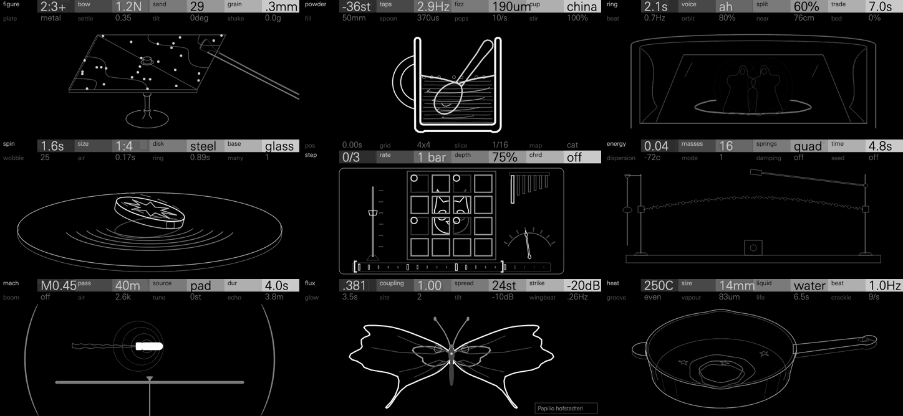
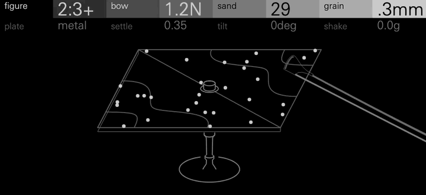
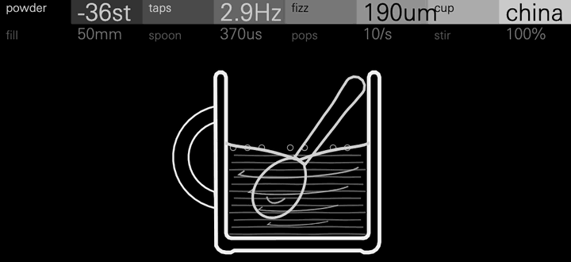
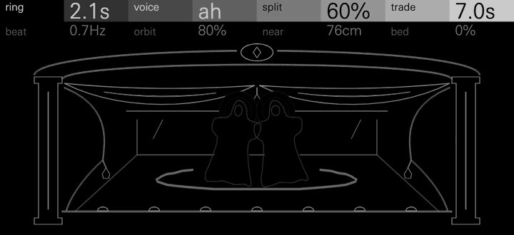
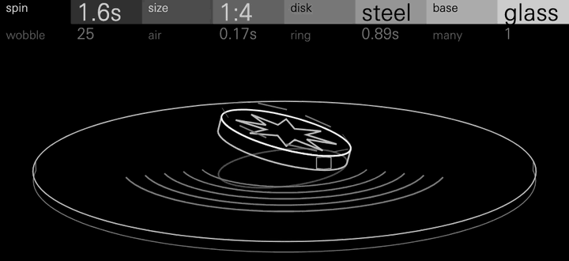
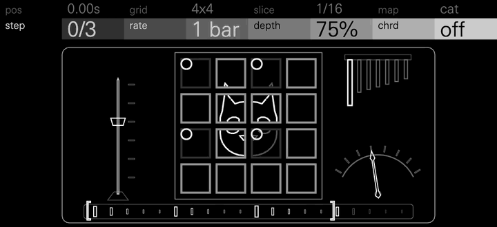
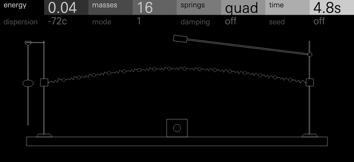
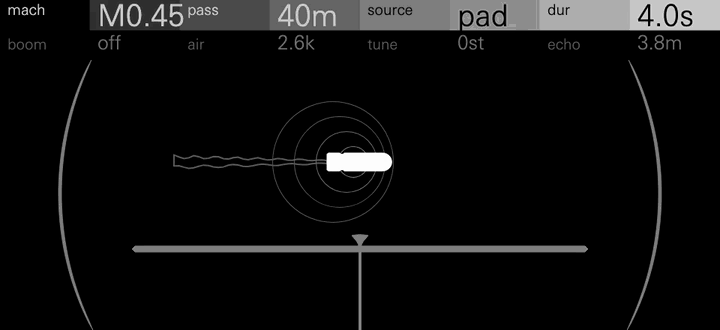
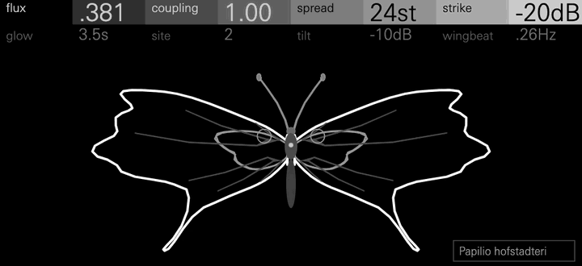
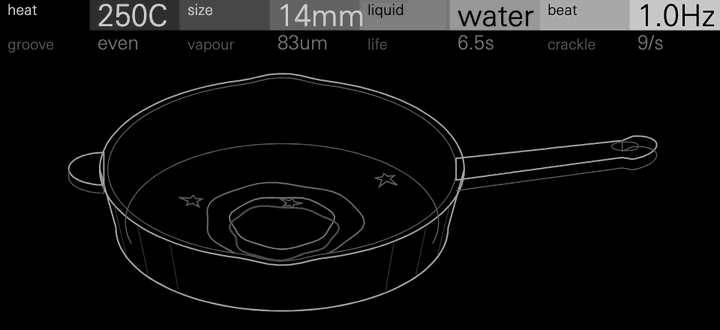

# Nonagon Suite



Nine experimental sounds for the OP-XY, built with the
[Open-XY SDK](https://github.com/etcetc000/open-xy). Each one starts from
something odd in the physical world (sand dancing on a bowed plate, a cup of
cocoa that won't stay in tune, a pitch heard only between the ears, a coin
that spins faster as it falls, a scrambled picture that always comes home, a
chain of springs that forgets and remembers, a supersonic flyby, the fractal
spectrum of an electron, a drop floating on its own vapour) and turns it into
an instrument the OP-XY way: eight controls on two pages, the OP-XY's own
envelopes, filter, LFOs and effects on top, and a screen that draws one
object, in outline, that every control visibly changes.

They are the companions of the [Hexagon Suite](https://github.com/mmockett/OP-XY-Hexagon),
with levels matched to it, but stranger: less a set of familiar instruments
than nine sounds you won't have heard from a synth before.

**Status: experimental.** All nine pass the SDK's tests and run on the
OP-XY, their screens are checked against how it draws, and their CPU is
measured on it (below). Expect rough edges.

## The machines

<table>
<tr>
<td width="50%"></td>
<td>

### Sand

**Origin:** in 1787 Ernst Chladni drew a violin bow along the edge of a
sand-strewn metal plate. The sand jumped off the parts of the plate that
moved and gathered on the still lines between them, drawing the plate's
modes as figures.

Sand bows or strikes a plate whose modes are tuned to the note, with grains
of sand bouncing on it. While the grains rattle, the sound is a dry,
crackling patter; as they settle into the nodal lines, it clears into a
glassy tone. Figure picks the mode, plate the material (metal, glass or
wood), grain the size of the sand, tilt runs it downhill and shake keeps it
jumping.

**Page 1:** figure, bow, sand, grain<br>
**Page 2:** plate, settle, tilt, shake

The screen is the plate on its stand, the bow at its edge and the sand
drawing the figure. The plate itself tips with tilt. *Shown: Chladni, three
notes, then tilt turned up.* [More about Sand](sand/README.md)

</td>
</tr>
<tr>
<td width="50%"></td>
<td>

### Cocoa

**Origin:** the hot chocolate effect. Tap a mug of freshly stirred cocoa with
a spoon and the note starts low and climbs: the powder fills the drink with
tiny bubbles that slow sound down, and the pitch rises as they clear. Frank
Crawford described it in 1982.

Each note is a spoon tapping the inside of a mug. Powder sets how far below
pitch a tap starts, fizz how fast it climbs back, and taps how often the
spoon strikes. Cup (china, glass or tin), fill and spoon set the ring; pops
adds bursting bubbles, and stir how much the next tap scoops back down.

**Page 1:** powder, taps, fizz, cup<br>
**Page 2:** fill, spoon, pops, stir

The screen is the mug, with the spoon in the drink. The drink's engraved
lines are frothy while bubbles remain and straighten as the note comes into
tune. *Shown: Hot Chocolate, four taps, then powder turned up.*
[More about Cocoa](cocoa/README.md)

</td>
</tr>
<tr>
<td width="50%"></td>
<td>

### Ghost

**Origin:** binaural phantom pitches. In 1958 Cramer and Huggins played the
same noise to both ears, delaying one ear's copy over a narrow band, and
listeners heard a faint tone that was in neither ear alone. The screen is
Pepper's ghost, the 1862 stage illusion of John Henry Pepper and Henry
Dircks.

A sample engine for headphones. Each note is made of breath and hum, split
between the ears so that its pitch lives in the space between them. Split
moves harmonics from one ear to the other, trade swaps them, beat sets how
fast the two ears drift against each other, and orbit walks the voice round
your head. Ghost plays without a sample; a loaded sample becomes its bed.

**Page 1:** ring, voice, split, trade<br>
**Page 2:** beat, orbit, near, bed

The screen is the stage with the apparition in the glass: split parts it into
twins, ring gives it halos and orbit draws its path on the floor. *Shown:
Seance, three notes, then split turned up.* [More about Ghost](ghost/README.md)

</td>
</tr>
<tr>
<td width="50%"></td>
<td>

### Coin

**Origin:** Euler's disk, the desk toy Joseph Bendik made in the 1990s and
named after Leonhard Euler's study of spinning bodies. A heavy disk spun on a
mirror rolls round and round as it falls, and its whirr rises faster and
faster until it stops dead.

Each note spins a disk. Its ring rises and quickens as it settles, then
stops. Spin sets how long it rolls, size and disk its weight and material,
base the surface it spins on (glass, wood or stone), wobble a weight on its
rim, air the drag, ring the metal's ring, and many adds companion disks.

**Page 1:** spin, size, disk, base<br>
**Page 2:** wobble, air, ring, many

The screen is the disk on its base, leaning as it slows, with rings spreading
across the glass. *Shown: Euler, two notes, then many turned up.*
[More about Coin](coin/README.md)

</td>
</tr>
<tr>
<td width="50%"></td>
<td>

### Recur

**Origin:** Arnold's cat map. In the 1960s Vladimir Arnold stretched and
folded a picture of a cat over and over; it dissolved into noise and then,
after enough steps, came back exactly. Henri Poincaré had shown that such
systems must return.

A sample engine. The sample is cut into a grid of tiles and shuffled step by
step by a chaotic map, so a loop scrambles further each bar and then comes
home to the original. Map picks the shuffle, grid and slice the tiles, step
and rate where and how fast it goes, depth how much of the loop moves and
chrd stacks shuffled copies into a chord.

**Page 1:** pos, grid, slice, map<br>
**Page 2:** step, rate, depth, chrd

The screen is a sliding-tile puzzle tin; each map shuffles its own picture.
*Shown: Recur, a note held while the tiles scramble.*
[More about Recur](recur/README.md)

</td>
</tr>
<tr>
<td width="50%"></td>
<td>

### Fermi

**Origin:** the Fermi–Pasta–Ulam–Tsingou problem. In 1953–55, on the MANIAC I
at Los Alamos, Enrico Fermi, John Pasta, Stanislaw Ulam and Mary Tsingou
simulated a chain of masses on slightly nonlinear springs. They expected the
energy put into its first mode to spread evenly; instead it flowed into the
next few and then almost wholly back.

Each note sets a chain ringing in its first mode and lets it run. The tone
breathes as energy flows into higher modes and returns, slowly or quickly
with time; more energy, more masses or stiffer springs push it into chaos.
Disperse detunes the modes, mode picks which one is struck, damping lets it
fade and seed nudges a single mass.

**Page 1:** energy, masses, springs, time<br>
**Page 2:** disperse, mode, damping, seed

The screen is the chain on a laboratory stand, drawn back as far as energy
sets, with a damping lever and a timing pendulum. *Shown:
Breath, three notes, then energy turned up.* [More about Fermi](fermi/README.md)

</td>
</tr>
<tr>
<td width="50%"></td>
<td>

### Mach

**Origin:** a supersonic flyby. A source passing faster than sound outruns
its own wavefronts, which fold into a cone; where the cone sweeps over a
listener there's a sonic boom, and the pitch heard sweeps down with the
Doppler shift. Ernst Mach photographed the shock waves round a supersonic
bullet in 1887.

Each note is one flyby. Mach sets the speed, up to Mach 3, pass how close it
comes, source what's flying (bell, organ, pad, voice or siren) and dur how
long the pass takes. Boom sets the shock's sharpness, air how much the
distance dulls it, tune when in the pass the note is in tune, and echo adds
the ground's reflection. Everything is worked out from the geometry of the
pass.

**Page 1:** mach, pass, source, dur<br>
**Page 2:** boom, air, tune, echo

The screen is the pass seen from above, like Mach's photographs: the source,
its wavefronts and the cone, and the listener below the line of flight.
*Shown: Flyby Pad, four flybys, then mach turned up.* [More about Mach](mach/README.md)

</td>
</tr>
<tr>
<td width="50%"></td>
<td>

### Butterfly

**Origin:** the Hofstadter butterfly. In 1976 Douglas Hofstadter worked out
the energy levels of an electron in a crystal lattice under a magnetic
field. Plotted against the field, they form a fractal shaped like a
butterfly.

Each note rings a chain of sites whose spectrum is that butterfly at a given
flux: its bands sound, its gaps are silent. Flux reshapes the spectrum,
coupling traps the ringing in place, spread sets its width, strike how it's
hit, glow how long it rings, site where, tilt how the spectrum leans and
wingbeat how it beats.

**Page 1:** flux, coupling, spread, strike<br>
**Page 2:** glow, site, tilt, wingbeat

The screen is a butterfly drawn as a companion to Hexagon's Moth: the
spectrum shapes its wing margins, the chain its markings. *Shown: Specimen,
three notes, then flux turned.* [More about Butterfly](butterfly/README.md)

</td>
</tr>
<tr>
<td width="50%"></td>
<td>

### Drop

**Origin:** the Leidenfrost effect. In 1756 Johann Gottlob Leidenfrost saw
that a drop of water on a very hot iron spoon doesn't boil away at once but
skates on a cushion of its own vapour. Such drops can quiver into stars with
several lobes.

Each note drops liquid on a hot pan. It floats, quivers into a star whose
lobes set the beat, sizzles and boils away. Heat sets how hot the pan is,
size and liquid what's dropped (water, ethanol or liquid nitrogen), groove
cuts teeth into the pan that ratchet the drop along, vapour how high it
floats, life how long it lasts and crackle the spatter.

**Page 1:** heat, size, liquid, beat<br>
**Page 2:** groove, vapour, life, crackle

The screen is a skillet seen at an angle, with star-shaped drops floating in
it, their steam and their reflections. *Shown: Drop, three notes, then heat
turned up.* [More about Drop](drop/README.md)

</td>
</tr>
</table>

## Playing them

Choose a synth on an instrument track, or Ghost or Recur on the sampler page.
Press any encoder to switch between the two pages; Shift + turn makes fine
steps. Each machine's presets show what it does; start there.

Levels are matched to the Hexagon Suite: an eight-note chord on any preset
peaks between about 0.4 and 0.8 of full scale, leaving room for the OP-XY's
own filter and effects.

Synths in the Open-XY SDK get no tempo, no note-off and no velocity, so
Cocoa's taps, Drop's beat and Recur's rate run in their own units rather than
locking to the beat, and a note's own life (a spin, a flyby, a drop) runs its
course after the key is released, under the OP-XY's amp envelope.

Ghost is made for headphones: its pitches exist only between the ears. As a
sample engine it plays in stereo, which the SDK's synth voices can't.

Ghost and Recur are sample engines, on the sampler page. With no sample
loaded, both screens say so ("load a sample · shift + sample"). Recur needs
one to play. Ghost plays without: its bed is then a gusty breath of its own,
and a loaded sample takes its place.

## CPU

Measured on an OP-XY (OS 1.2.1) with the SDK's `profile benchmark`: three runs
each at `v0.1.0`, and Mach from one capture at `v0.4.0`. For a synth, one voice plays middle C with the first
four controls at their midpoint; for a sample engine, its sample callback
plays the SDK's generated two-second test sample at its default settings. Each
figure is a share of the OP-XY's 580,352-cycle audio block.

| Machine | One voice | Eight voices |
| --- | ---: | ---: |
| Sand | 5.4% | ~43% |
| Cocoa | 5.7% | ~45% |
| Coin | 1.5% | ~12% |
| Fermi | 3.8% | ~31% |
| Mach | 3.8% | ~30% |
| Butterfly | 5.6% | ~44% |
| Drop | 3.2% | ~26% |
| Ghost (sample callback) | 3.0% | n/a |
| Recur (sample callback) | 1.2% | n/a |

The OP-XY's own engines measure 1.6–2.7% a voice in the same test, and
Hexagon's synths 2.4–6.5%. A full chord on one track is fine; several tracks
of heavy chords at once, with effects, can run out. Each test plays one
setting, and heavier settings cost more: Coin's four disks, a fully rattling
plate in Sand or a hissing chord in Recur cost several times their figure
here. The sample engines' tests time the callback alone, not the stock
sampler's own mixing, so they don't compare directly with the synths.

## Building

The seven synths need SDK 1.4 (the two-page header), on the `staging` branch
of [etcetc000/open-xy](https://github.com/etcetc000/open-xy). Ghost and Recur
are sample engines with their own screens, which need a change still in
review ([etcetc000/open-xy#182](https://github.com/etcetc000/open-xy/pull/182)):
build them from the `sdk/sample-overview` branch of
[mmockett/open-xy](https://github.com/mmockett/open-xy/tree/sdk/sample-overview)
until it merges.

Check the SDK out beside this repository as `../open-xy`, fetch its
toolchain (`python sdk.py toolchain fetch`), then:

```sh
python ../open-xy/sdk.py test --machine sand --machine cocoa --machine coin --machine fermi --machine mach --machine butterfly --machine drop
python ../open-xy/sdk.py build --machine sand --machine cocoa --machine coin --machine fermi --machine mach --machine butterfly --machine drop --stock-os <your stock-1.2.1>/os.ldr --layout <your last build's layout.json> --out <folder outside this checkout>
```

and the same for `--machine ghost --machine recur` from the sample-overview
branch. Then install the build's `candidate/` files as the SDK's
[build guide](https://github.com/etcetc000/open-xy/blob/staging/docs/build.md#5-install)
describes. Pass your last build's `layout.json` so the machines already on
your OP-XY keep their numbers.

They ask for these numbers; a build gives them out when they're free, and
otherwise the lowest free ones:

| | Engine | Page |
| --- | --- | --- |
| Sand | 54 | 113 |
| Cocoa | 55 | 114 |
| Coin | 57 | 115 |
| Fermi | 56 | 116 |
| Mach | 62 | 117 |
| Butterfly | 40 | 118 |
| Drop | 41 | 119 |
| Ghost | 42 | sampler page 2, screen 121 |
| Recur | 43 | sampler page 2, screen 120 |

## Develop

Each machine's folder has its engine (`engine.cpp` and headers), its screen
(`display.cpp`, with artwork in `panel.svg.fragment` generated by
`tools/make_panel.py`), its tests (`tests/`, run by `sdk.py test`) and a
contact sheet of every control at 0, 50 and 100 (`docs/controls.png`, and at
the screen's own size in `docs/controls-1x.png` where present). Screens are
checked the way the OP-XY draws them, not just in the browser preview: text
measured in the device's font at its real size (`tools/caption_width.py`),
outlines against the device's drawing rules, and churn kept low;
[AGENTS.md](AGENTS.md) has the rules. The
animations in `docs/screens` are rendered from the real display code through
the SDK's browser preview, at the OP-XY's 480 × 220 and in its screen font,
Univers Next Pro Light, by
[mmockett/OP-XY's renderer](https://github.com/mmockett/OP-XY/tree/main/tools/render).

## Licence

MIT ([LICENSE](LICENSE)).
