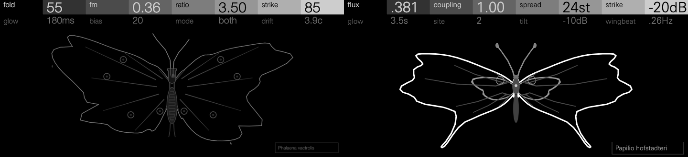
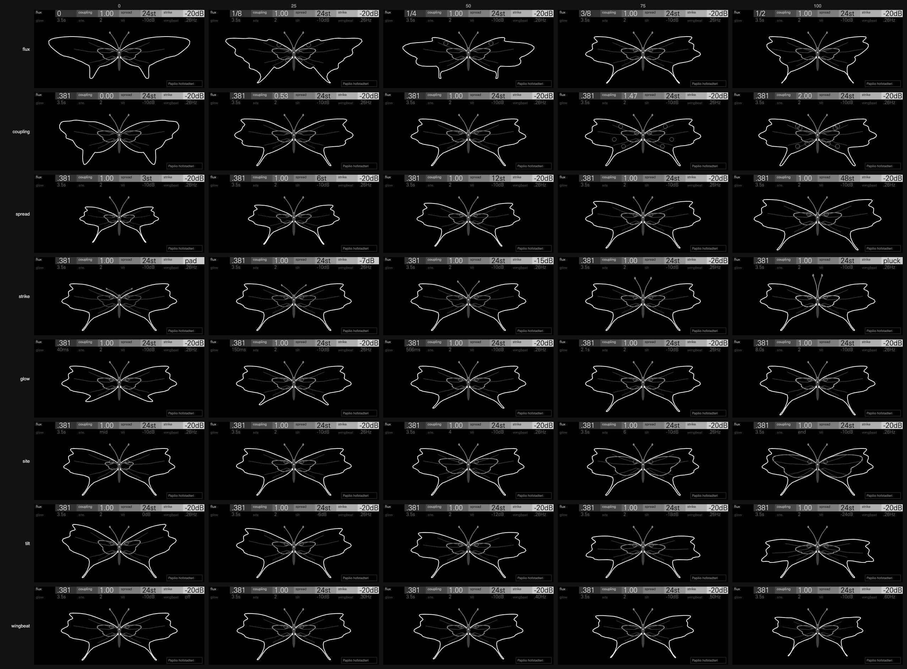

# Butterfly

A struck quantum chain. Each note strikes an electron on a chain of 17 sites
in a magnetic field, and its partials are the chain's energy levels. Each
partial is as loud as its state is present at the struck site. The partials
sit behind a lowpass gate in Moth's vocabulary: strike pings it over a held
hum, glow sets how slowly it closes and how long the hum sustains, and tilt
darkens the top of the spectrum, which closes first.

In 1976 Douglas Hofstadter computed the energy spectrum of an electron in a
crystal lattice under a magnetic field, using Harper's equation (P. G.
Harper, 1955). Plotted against the magnetic flux through each cell of the
lattice, the allowed energies form a fractal, a pattern of bands within
bands, that looks like a butterfly: Hofstadter's butterfly. Butterfly plays
that spectrum. Its chain is Harper's, whose states spread over the chain
below a coupling of 1 and are localized above it (Aubry and André, 1980).
Its screen is drawn as a companion to Moth's in the Hexagon Suite: a pinned
swallowtail beside Moth's moth.

It sounds like a bell made of a fractal, played in tune. The note is the
lowest band, the chain's ground state, a hum like a bell's. Above it the
partials gather into bands: at a simple flux p/q there are q of them, so 1/3
is a three-band chord of shimmers and 2/5 five. Each band is a knot of
partials a few hertz apart, beating slowly. Between the fractions the bands
split into bands within bands. Below a coupling of 1 every state spreads
over the chain, and a strike sounds the whole spectrum, a full, shimmering
bell. Above 1 every state is localized, and a strike sounds only the few
living near the struck site: glassy pings, a different one at each site.
At strike 0 the gate simply holds open, so the bell becomes a pad. The
wingbeat slowly moves the flux and the struck site, so the bands drift and
the bright partials trade places.

**Status: experimental.** Butterfly passes the SDK's tests. It has not yet
been played on an OP-XY, and its CPU figures (below) are estimates, not
measurements on the device.

## Controls

Press any encoder to switch pages. Page 1 sets the spectrum and the strike,
page 2 the gate's time, where the chain is struck, the darkening and the
wingbeat.

| Encoder | Page 1 | Page 2 |
| --- | --- | --- |
| 1 | flux | glow |
| 2 | coupling | site |
| 3 | spread | tilt |
| 4 | strike | wingbeat |

| Control | Range | Default | Caption | What it does |
| --- | --- | --- | --- | --- |
| flux | α, 0 to 1/2 a flux quantum a plaquette | .382 | its fraction when it rests on one (`2/5`), otherwise three places (`.381`) | Reshapes the spectrum through Hofstadter's butterfly. The chain at 1 − α is the chain at α, so the knob spans the half that differs. A gentle snap (30% of each basin) holds it on the simple fractions (q up to 8), where the bands are exact; the golden flux reads `.381`, pulled a little toward 3/8. |
| coupling | λ, 0 to 2, held at 1.00 over the middle 6% of its travel | 1.00 | `1.00` | The potential's strength. Below 1 the states spread and a strike sounds many partials; above 1 they localize and it sounds a few. At 0 the chain is free: one cosine band. |
| spread | 3 to 48 semitones | 24 | `24st` | The span of the whole spectrum, 4 + 4λ wide in energy, in semitones above the key. |
| strike | 0 to 100 | 63 | `pad`, the held hum's level under the strike (`-20dB`), `pluck` | How hard a note strikes the gate. A strike pulses it open, then it settles to a held hum, lower the harder the strike: 7 dB down at 25, 15 at 50, 26 at 75 (against a pad's level, three quarters open), and none at 100, a pluck. At 0 the note swells in and holds: a pad. The caption is the hum's level. |
| glow | 40 ms to 8 s, exponentially | 3.5 s | `180ms`, `3.5s` | How long a struck gate takes to close from open to −60 dB. It closes three times faster while still bright, as a vactrol's cell does. A struck note's hum fades too, with a time constant of four glows over the strike squared: at short glows it dies with the ring, at long ones it sustains, and a pad never fades. An unstruck note swells in at a twentieth of glow. |
| site | from the chain's middle (`mid`) to its end (`end`) | 2 | `mid`, `1` to `7`, `end` | Where the chain is struck. The middle excites only the even states of the mirror-symmetric chain, as a bar struck at its centre sounds only its symmetric modes. Off the middle every state sounds, and above λ = 1 each site has its own few partials. |
| tilt | 0 to 3 | 1.2 | the top partial's darkening (`-10dB`) | How dark the top of the spectrum is, and how much faster it follows the gate down. The upper three quarters of the span are darkened, to tilt × 8 dB at the top, and each partial takes the gate to the power 1 + tilt × place (its place being its height in the span), so the bell is darker from the strike and darkens further as it rings, as through a lowpass gate. |
| wingbeat | 0 to 100 | 15 | `off`, the beats a second (`.26Hz`) | A slow beat, 0.2 to 0.6 a second, of the flux (up to 1/48 either way) and of the struck site (up to 1.5 sites), from each note's own strike and starting at rest. The bands drift and breathe. |

Measured on one note of 220 Hz at 0, 25, 50, 75 and 100, the other controls
at Specimen's and the wingbeat at 0 outside its own rows
(`tests/sound.cpp` checks that each moves as it should;
`BUTTERFLY_REPORT=1` prints the table):

| Control | 0 | 25 | 50 | 75 | 100 |
| --- | --- | --- | --- | --- | --- |
| flux: bands the 17 levels form (λ 1; at 0, 1/8, 1/4, 3/8, 1/2) | 1 | 6 | 3 | 3 | 2 |
| coupling: partials a strike excites (λ 0, 0.53, 1, 1.47, 2) | 12.0 | 11.8 | 7.0 | 4.2 | 3.3 |
| spread: highest partial within 40 dB, semitones above the note | 1.8 | 3.7 | 7.3 | 14.6 | 29.3 |
| strike: level held at 2 s against an unstruck note's | 0 dB | −9.6 dB | −19.7 dB | −30.4 dB | −43.0 dB, a pluck |
| glow (tilt 0): a pluck's fall to −60 dB | 0.05 s | 0.16 s | 0.53 s | 1.8 s | 6.6 s |
| glow: Specimen's fall to 30 dB under its strike | 0.4 s | 1.3 s | 3.3 s | 6.3 s | 11.6 s |
| site: the sound's centroid, times the note | 1.87 | 1.54 | 1.10 | 1.29 | 2.05 |
| site: partials within 20 dB of the loudest | 2 | 9 | 4 | 9 | 4 |
| tilt: the upper half of the span against the lower, at the strike | −10.1 dB | −12.5 dB | −14.9 dB | −17.3 dB | −19.7 dB |
| tilt: centroid 1 s into a pluck, against at its strike | 0.94 | 0.91 | 0.88 | 0.85 | 0.83 |
| wingbeat: the partials' glide from one extreme to the other, weighted by level | 0 cents | 15 cents | 20 cents | 30 cents | 38 cents |
| wingbeat: beats a second | 0.2 | 0.3 | 0.4 | 0.5 | 0.6 |

Flux's bands are q at a simple p/q, as far as 17 levels can show them: 1/4's
middle bands touch, and 1/8 and 3/8 need more than 17 levels to show all
eight. Site's measures rise and fall rather than climb, as a struck bar's
modes do along it. The gate alone falls 60 dB in exactly glow's caption at
every setting; the sound falls a little sooner at long glows, as its beating
peaks set the measure.

Every control moves the sound across its whole travel. Rendered at each
tenth of its travel with the others at Specimen's, each step changes the
sound's band spectrum and envelope by at least about 1.2 dB rms, and no
stretch of a fifth of the travel is flat.

## Presets

| Preset | Role | Sound | 8 notes, peak |
| --- | --- | --- | --- |
| Specimen | The init sound, a bell | Golden flux (.382), λ = 1, a ping over a hum 20 dB down, a 3.5 s glow | 0.83 |
| Glass Keys | Keys | λ = 1.6: one or two glassy partials a note, short and bright | 0.82 |
| Gamelan | A gamelan bell | Flux 2/5, λ 0.85: five beating bands over a wide spread, a long ring | 0.74 |
| Shimmer | A pad | Strike 0, λ 0.7, a narrow spread, a deep wingbeat: a held chord of slow beats | 0.63 |
| Struck Bass | A struck bass | Flux 1/3, λ 1.1, a narrow spread, a firm strike, dark (tilt) | 0.45 |
| Fractal | A texture | λ = 1 at flux .27, four octaves wide, a light strike, the deepest wingbeat | 0.66 |
| Chime | High chimes | Flux 1/4, λ 0.5, three octaves wide, struck off the middle | 0.65 |
| Bowed Glass | A bowed pad | λ 1.3: localized states held near open, a light strike, the wingbeat moving the bow | 0.61 |

The peaks are the raw sum of an eight-note chord (C3 to B4), full scale 1,
over the first three seconds, the notes struck together. One voice peaks at
0.17 to 0.29.

Each preset's A3, measured over its first second, beside Moth's Bell and
Lantern measured the same way. TNR is the power in spectral lines against
the rest; beat is the 10 ms envelope's modulation once its straight-line
trend is taken out, its rms depth and strongest rate:

| Sound | RMS (dBFS) | Crest | TNR (dB) | Centroid | Partials within 30 dB | Beat (dB, Hz) | Decay (dB/s) |
| --- | --- | --- | --- | --- | --- | --- | --- |
| Specimen | −29.8 | 5.0 | 37.8 | 330 Hz (1.50 f0) | 10 | 3.9, 7.6 | −7.3 |
| Glass Keys | −31.1 | 5.3 | 49.6 | 220 Hz (1.00 f0) | 2 | (decays) | −69.0 |
| Gamelan | −26.7 | 5.3 | 18.4 | 237 Hz (1.08 f0) | 9 | 3.9, 6.4 | −13.0 |
| Shimmer | −25.0 | 3.5 | 22.7 | 247 Hz (1.12 f0) | 8 | 3.5, 7.2 | −1.0 |
| Struck Bass | −30.1 | 5.6 | 25.0 | 235 Hz (1.07 f0) | 4 | 4.2, 4.8 | −2.5 |
| Fractal | −26.6 | 3.4 | 13.6 | 847 Hz (3.85 f0) | 10 | 3.0, 0.8 | 0.1 |
| Chime | −32.9 | 8.3 | 8.4 | 317 Hz (1.44 f0) | 12 | (decays) | −27.9 |
| Bowed Glass | −24.2 | 2.4 | 30.2 | 304 Hz (1.38 f0) | 6 | 3.2, 1.2 | −2.0 |
| Moth: Bell | −27.8 | 3.4 | 54.1 | 300 Hz (1.36 f0) | 16 | 0.4, 19.2 | −15.9 |
| Moth: Lantern | −23.3 | 1.8 | 21.1 | 443 Hz (2.02 f0) | 6 | 0.2, 5.6 | 0.2 |

Butterfly's spectra are darker and more clustered than Moth's FM, except
Fractal's, whose wingbeat carries the strike across the chain. Their
beating is the instrument's own: about 3 to 4 dB at 1 to 8 Hz, from each
band's partials a few hertz apart, plus the wingbeat. Moth's tones are
steadier (0.2 to 0.4 dB). Lower TNR comes from that beating, the wingbeat's
glides, and the fast decays of Chime and Glass Keys, whose windows see the
ring falling.

## How it works

`harper.h` holds the physics, shared by the engine and the screen. It is
integer and 32-bit only, with no division.

- **The chain.** Harper's equation, the almost-Mathieu or Aubry–André
  operator: H ψ_m = ψ_(m+1) + ψ_(m−1) + 2λ cos(2π α m) ψ_m, on the 17 sites
  m = −8..8, open at both ends. The potential's phase is 0 at the middle, so
  the chain is mirror-symmetric, as a butterfly is. Its spectrum repeats with
  period 1 in flux and mirrors about 1/2, and a site at distance d from the
  middle behaves as the site at −d.
- **Tables, so a note starts at once.** `tools/make_tables.py` solves the
  chain in double precision (numpy's `eigh`) at 72 fluxes and 7 couplings
  (0, 0.5, 0.8, 1, 1.25, 1.6, 2).
  - The fluxes are 0 to 1/2 in 128ths, plus every fraction with q up to 8, so
    a snapped flux lands on an exact spectrum.
  - For each state the tables store the energy and |ψ| at distances 0 to 8.
  - Both members of a mirror pair whose energies agree to 2^−10 ring at one
    pitch: one carries both weights and the other is silent.
  - The engine reads the spectrum trilinearly, across flux, coupling and the
    struck site, matching states by rank, every block.
  - The tables come to about 106 KB: 17 KB of energies, 77 KB of amplitudes,
    the 8 KB sine and small ones. They are defined once (`tables_data.h`,
    included by `engine.cpp`), so the engine's object and the display's share
    them.
- **The key** is the lowest band's middle, weighted as the strike excites it.
  The band is the states within 7% of the span of the lowest, about 1.7
  semitones at the default spread. A band is a knot of partials heard at its
  amplitude-weighted middle, and that middle is put on the note. With none
  of the band excited, the band's plain middle is used.
- **Levels.** A partial's level is its weight at the struck site, scaled by
  R^(−1/4) × (1 − 0.6R), where R is the sum of the weights squared (1/R is
  how many partials the strike excites). That is halfway between equal peak
  and equal power, with a sparse strike trimmed, so a chord of pings peaks no
  higher than a chord of full bells.
- **The gate.** Each voice has one vactrol, after Moth's laws.
  - Its cell opens with a 1 ms time constant during a strike's 4.4 ms pulse.
  - It then settles toward the held level: up at a twentieth of glow's pace,
    down at glow's, faster while bright. The held level is three quarters of
    1 − strike, the strike's knob taken on a curve, 1 − (1 − k) 2^(−3k), so
    each tenth of its travel lowers the hum 3 to 6 dB.
  - A struck note's held level fades with a time constant of four glows
    over the strike squared, so glow sets how long the hum sustains as well
    as how long the ring takes; an unstruck pad holds.
  - Each step keeps the light's low bits, so a long glow's tail falls at its
    own pace: 8 s takes 8.0 s to fall 60 dB.
  - Each partial takes the gate to the power 1 + tilt × place, and the upper
    three quarters of the span are darker, to tilt × 8 dB at the top (made
    up by tilt × 1 dB, never above a partial's own level, so the note keeps
    its loudness and the levels' sum its headroom).
- **The bank.**
  - The 17 partials run at half the sample rate, 32 samples a block, as
    sine-table oscillators, each amplitude ramped across the block.
  - A 27-tap half-band (a Kaiser sinc, beta 5.5, rounded) doubles the rate
    back: flat to 8 kHz, with images 58 dB down above 14 kHz.
  - Partials fade between 7.2 and 8 kHz.
  - Each partial starts at a phase of its own (golden-ratio steps from the
    note's), so a chord's strikes do not pile up.
- **The note-on and the amp envelope.**
  - The engine hears note starts, never releases, so a note-on is the strike.
  - The gate holds while the voice sounds, and the OP-XY's amp envelope ends
    the note. The presets' envelope has full sustain and a long release
    (24000 of 32767), so a struck note rings on after the key is let go.
  - A voice struck again while sounding fades out in one block (1.5 ms) and
    is struck afresh.
  - Velocity reaches only stock's amp.

## Screen


A pinned swallowtail, wings spread, drawn as a companion to Moth's moth:
centred where Moth is and about as wide (328 px at Specimen against Moth's
336), in Moth's greys. It has its own specimen label, *Papilio
hofstadteri*, in Moth's corner.



Each wing is the chain, in two zones, and each control changes the specimen
itself. `docs/controls-1x.png` shows each at 0, 25, 50, 75 and 100, every
cell the screen at 1:1, 480 × 220 pixels, as the device shows it;
`docs/controls.png` is the same at twice the size:



It is drawn for that screen at 1:1, in three weights. The margin is the
one bold line, white and 2 px. The lit band is 1 to 1.6 px, grey to near
white with the strike. The veins, eyespot rings, antennae and body are a
step down. There are no fills on the wings, no line closer than about 3 px
to its neighbour, and none of its own text under 9 px.

- **The breadth is the chain.** From the body out to the submarginal band
  (0.2 to 0.64 of the margin's reach) lies the chain, from its middle site
  to its end.
  - The localized states, those over at most three sites, are eyespots,
    rings up to four a wing, at their sites and at their energies along the
    wing. They appear as **coupling** passes 1, and a strike lights the ones
    it excites.
  - The lit band, one line following the wing's shape, lies at the struck
    site, so **site** carries it from the body out to the submarginal band.
    **Strike** sets its grey and so its weight, from grey 7 and 1 px at 0 to
    grey 13 and 1.6 px at 100, and it brightens a step as the strike rings.
- **The margin is the spectrum.** Outside the inner zone the margin is one
  64-point outline, read from the forewing's leading edge (the top of the
  spectrum) round to the hindwing's tail (the bottom). Each band of the
  butterfly swells a lobe and each gap cuts a notch, between 0.72 and 1 of
  the reach, so **flux** reshapes it: one smooth lobe at 0, two at 1/2,
  scallops within scallops between fractions. **Coupling** reshapes it too:
  at 0 the chain's one cosine band is one smooth wing.
  - **Tilt** sweeps the forewing back about the root, 7 degrees a unit, from
    as spread at 0 to 21 degrees back over the hindwing at 3, as it darkens
    the top of the spectrum. Its veins, eyespots and lit band turn with it.
    The margin turns fully to just past the apex, then less and less down
    the outer edge and over the hindwing's shoulder, so the edge folds
    rather than crossing itself (checked at every flux and coupling).
  - **Glow** draws a swallowtail's tail out of the hindwing, as it draws out
    the ring: none at 40 ms, 40 px long at 8 s, pointing down and a little
    out. The margin is sampled three times as densely there, so the tail is
    a narrow strap with a rounded tip. It ends by y 216, inside the screen's
    foot, so at the widest spreads the longest tails are a little shorter.
  - The margin never comes inside 0.68 of its reach, so it never crosses the
    veins, which end at 0.66.
- **The wing's scale.** Each wing's nodes scale together about its root.
  **Spread** is the wingspan: 0.64 of Moth's at 3 semitones, 0.94 at 24,
  1.04 at 48, so the wings stay at least 7 px clear of the header. The
  **wingbeat** breathes the wings in by up to 28% at its own rate while a
  note sounds, and eases them back when it ends.
- **The antennae** are clubbed, as a butterfly's are. **Strike** stands them
  up: at 0 they are short (0.7 of their length) and folded back 35 degrees
  along the forewings; at 100 they are long (1.05) and upright, 13 degrees
  in, their tips at least 10 px clear of the header. They turn and grow from
  their bases. A strike flicks them out and back within 0.2 s.
- **Static parts:** each half wing's veins (three a half wing, 1 px tapering
  to 0.6, stopping short of the body so they never merge there; one
  comb-shaped outline each, a node so it scales with the wing and the
  forewing's turns with tilt), the body (head, thorax and abdomen), the pin
  through the thorax and the label, its name 9 px tall.

The screen cannot hear the voices. It reads the same tables from the same
controls, and follows the latest strike with the engine's own gate and
wingbeat, a block at a time. The chain, the wings' scale, the forewing's
sweep, the tails and the lit band's grey ease to the controls in about
0.15 s. When nothing sounds the screen is still. Reduced motion shows the
held light at once, with no flick or breathing. A reset solves nothing: the
first frame reads the tables.

### Redrawing little

- **The wings are solved at most eight times a second**, and only when what
  they show moved. A solve reads the spectrum, places the eyespots and
  reshapes the outlines.
- **One wing a frame.** When a wing's shape, light or pose (scale, sweep,
  tail, the lit band's grey) changes, its nodes are placed on one frame and
  the other wing's on the next: its margin and lit band, its two veins and
  its four eyespot rings, at most 10 nodes a frame with the antennae.
- **The light is stepped,** in sixteen steps, on the lit band and the
  eyespots.
- **Churn:** 3.0 nodes a frame on average over a scripted 24 s run at
  60 fps and 3.9 at 30 fps, at most 10; 0.7 with reduced motion; 0 when
  idle. The GIF's tour of every control averages 3.9.

Display state is 508 bytes, with 26 nodes, 4 outlines and all 16 text slots
for the two-page header.

## Level

A single A3 on Specimen is −29.8 dBFS RMS over its first second, against
Moth's Bell at −27.8. Shimmer held is −25.4, against Lantern's −23.3.
Eight-note chords on every preset peak at 0.45 to 0.83, each voice under
0.3. At tilt 3, where the make-up is greatest, a chord of Glass Keys' plucks
peaks at 0.93.

## CPU

These are estimates on a host computer; Butterfly has not been measured on
an OP-XY.

- By count of the Blackfin build: the bank's inner loop is 11 instructions
  a partial a half-rate sample, about 6,000 a block for 17 partials, and
  about 11,400 a block with the table reads, the gate and the held hum's
  fade, each partial's tilt, the increments and the half-band.
- The SDK's host estimate (`sdk.py test`) reads 11,500 Blackfin instructions
  per voice block at the heaviest setting, on a heavily loaded host.
- Both are within 15,000; Moth reads 10,300 by the same count. Nothing is
  solved at run time.
- **Memory.** Butterfly takes 143.8 KiB of the 2040 KiB module region, most
  of it the tables, and needs no runtime helpers. Eight voices are 352 bytes
  each, with no shared state.

## Tests

`sdk.py test` runs three host tests, and `--firmware` compiles Butterfly for
the Blackfin. The sound and screen tests are clean under UBSan, and the
screen test under ASan too.

- **`tests/sound.cpp`:**
  - **The tables against a double-precision Jacobi solve.** On the grid,
    energies agree to 5.8e−4 and the cumulative weight to 0.014. Between grid
    points the energies are off by 0.032 rms (0.31 at worst, at strong
    coupling, of a span of 8).
  - **Clusters.** At 1/2, 1/3, 2/3, 1/5, 2/5 and 3/7, at λ = 1, the levels
    form exactly q runs.
  - **Localization.** Participation falls from 8.6 partials at λ 0.5 to 2.5
    at 2.
  - **No clicks** from any control swept under a held pad: 1.5 to 1.8 on a
    detector that reads 38 for a 0.003 step.
  - **Every note sounds in its first block.**
  - **The pad holds** within 0.5 dB over 4 s.
  - **In tune.** The lowest band's middle is within 16 cents of the key from
    C2 to C6, and within 7.2 cents from C3.
  - **Levels and chords** as above.
  - **Retrigger.** Striking a sounding voice again steps 0.0019, against
    0.0067 within the note.
  - **Each control's measure** moves as it should from 0 to 100.
  - **Glow.** A pluck falls 60 dB within 1.25 times glow's caption.
- **`tests/screen.cpp`:**
  - Every frame of the scripted runs is valid, at 60 and 30 fps, with and
    without reduced motion.
  - The idle screen is still.
  - Churn stays within 20 a frame on average and 30 at most.
  - `./screen controls` prints the contact sheet's frames.
- **`tests/scenes.cpp`:** each preset's phrase and a flux sweep. Given a
  folder, it writes them there as WAVs; every scene's DC is under 1e−5.

## Files

| File | What it is |
| --- | --- |
| `harper.h` | The chain's controls and their laws, snap, the table reads, the key, the levels, the gate and the wingbeat, shared by engine and screen |
| `core.h`, `engine.cpp` | The voice: the half-rate bank behind its gate, and the half-band |
| `tables.h`, `tables_data.h` | The tables' declarations, and their one definition (from `tools/make_tables.py`) |
| `display.h`, `display.cpp` | The screen |
| `panel.svg.fragment`, `plate.h` | Artwork and the wing's geometry, from `tools/make_panel.py` |
| `tests/sound.cpp`, `tests/screen.cpp`, `tests/scenes.cpp` | The checks above |
| `tests/presets.h` | The presets for the tests, from `tools/make_presets.py` |
| `tools/make_gif.py`, `tools/make_controls.py`, `tools/render.py`, `tools/frame2svg.py` | `docs/butterfly.gif`, `docs/controls-1x.png`, `docs/controls.png` and single frames, from the real display code |

The tools, run from this folder, with `<sdk>` the Open-XY SDK's checkout
and `<folder>` where the scenes' WAVs go. `make_tables.py` needs numpy; the
image tools need a host C++ compiler and Google Chrome (`make_gif.py` also
ffmpeg), and draw the label in the device's face when `XY_FONT` is the
path of `UniversNextPro-Light.ttf`, which is not in this repository.

```sh
python tools/make_tables.py
python tools/make_panel.py [--png out.png]
python tools/make_presets.py
python tools/make_gif.py --sdk <sdk>
python tools/make_controls.py --sdk <sdk>
c++ -std=c++11 -O2 -I <sdk>/sdk/include tests/scenes.cpp -o scenes && ./scenes <folder>
```

## References

- D. R. Hofstadter, "Energy levels and wave functions of Bloch electrons in
  rational and irrational magnetic fields", Physical Review B, 1976: the
  butterfly.
- P. G. Harper, 1955: the equation the chain follows.
- S. Aubry and G. André, 1980: the chain's change from spread to localized
  states at a coupling of 1.
- Moth, in the Hexagon Suite: the lowpass gate's vactrol laws, and the screen
  this one is drawn beside.
