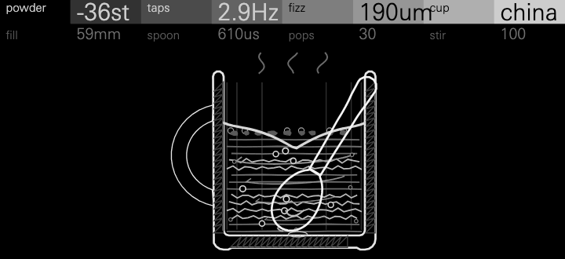

# Cocoa

The hot chocolate effect, played as an instrument. Each note stirs the drink
and taps the mug. By default that makes a mellow, keys-like tone, somewhere
between a kalimba and a glass marimba, that scoops up about five semitones
into the key and lands within a cent in under half a second. Turn powder up
and fizz down and it becomes the full effect: three octaves of climbing over
several seconds while the spoon keeps tapping. The column's modes give the
body, the cup's wall clinks at its own fixed pitches, and bubbles burst at
the surface as small Minnaert pops.

There is no envelope or filter of its own: the OP-XY's envelopes, filter,
LFOs and effects sit on top.

Cocoa starts from the hot chocolate effect, which the physicist Frank
Crawford described in the *American Journal of Physics* in 1982. Stir
powder into hot milk and tap the mug: the first tap rings low and each one
rings higher, until the drink rings clear. The powder fills the milk with
tiny bubbles. A fraction of a percent of air makes the liquid nearly as
compressible as air while it keeps water's weight, so its sound speed
collapses (Wood's equation, 1930), and the liquid column's note with it. As
the bubbles rise out, the note climbs back to the key.

**Status: experimental.** Cocoa passes the SDK's tests but has not yet been
played on an OP-XY. Its CPU figures (below) are the SDK's host estimate and a
count from the compiled code, not measurements on the device.

## Controls

Press any encoder to switch pages. Every figure in the table's second line
is measured on an A3, with the other controls at the default
(`tests/controls.cpp`). [docs/controls-1x.png](docs/controls-1x.png) shows each
control at 0, 50 and 100 on the screen at 1:1, as the device shows it;
[docs/controls.png](docs/controls.png) is the same at twice the size.

| Page | Control | 0 / 25 / 50 / 75 / 100 | Default | What it does |
| --- | --- | --- | --- | --- |
| 1 | powder | `0st` `-3st` `-12st` `-27st` `-48st`<br>first tap −0.0 / −3.0 / −11.9 / −26.9 / −47.8 semitones | `-5st` (32) | How much air a stir puts in, as how far under the key the first tap rings. Squared, so the first half of the control scoops up to an octave and the rest reaches four. On screen, the drink darkens from pale milk (every fourth engraved line) to thick chocolate (every line), with cocoa floating on it, and a stir fills it with more bubbles. |
| 1 | taps | `once` `1.1Hz` `2.4Hz` `5.4Hz` `12Hz`<br>0 / 1.0 / 2.3 / 5.3 / 11.8 taps a second | `once` | Once: one tap a note, an instrument. Above that the spoon keeps tapping while the note sounds, each tap softer as they come faster, so tapping holds a single tap's level. On screen, the spoon rests lifted 24° for a single tap and 2° for the fastest. |
| 1 | fizz | `120um` `210um` `380um` `680um` `1.2mm`<br>in tune after 11.6 / 3.7 / 1.2 / 0.37 / 0.21 s | `600um` (70) | Bubble size, which sets how fast the drink clears. Fine bubbles make long climbs with sparse, high pops; large ones short scoops with low, dense pops. On screen, the rising bubbles and the foam grow from 0.5 to 2 times. |
| 1 | cup | `china` `china` `glass` `tin` `tin`<br>a tap rings 569 / 569 / 955 / 823 / 823 ms (to −40 dB) | `china` | The wall: china's short tock (1.65 / 4.5 / 9 kHz), a glass tumbler's ting (1.15 / 3.2 / 6.1 kHz) or an enamelled tin mug's clank (0.72 / 1.9 / 3.4 kHz). It also sets how long the column rings once clear. On screen, the mug changes: hatched china with a C handle, a heavy-based glass tumbler, or a thin tin mug with a rolled rim, strap handle and chipped enamel. |
| 2 | fill | `20mm` `35mm` `50mm` `65mm` `80mm`<br>the second mode at 1.16 / 1.43 / 1.77 / 2.15 / 2.55 times the key | `59mm` (65) | The drink's depth, which tunes the column's upper modes. At 59 mm they sit at 1, 2.00, 3, 3.46, 3.73 and 5 times the key, an octave and a twelfth with a little shimmer. Shallow drinks cluster the modes into bells; deep ones spread them. Deeper drinks also lower and damp the cup's clink. |
| 2 | spoon | `5.0ms` `2.1ms` `870us` `360us` `150us`<br>upper modes −21.9 / −14.2 / −9.2 / −8.5 / −8.4 dB under the fundamental | `610us` (60) | From a wooden spoon to a silver one, as its contact time: a soft spoon strikes only the fundamental, a hard one the upper modes and the cup's clink too, with a sharper onset. On screen, a fat wooden spoon with grain along its handle becomes a slender silver teaspoon with a shine in its bowl. |
| 2 | pops | 0 to 100<br>pops −∞ / −17 / −21 / −14 / −13 dB against the rest of a long climb | 15 | How loud the bubbles bursting at the surface are, from 300 Hz to 7 kHz. They burst as often as air leaves the drink, so they thin out as it clears. (The measure is random: pops are.) On screen, the foam grows from none to two rows. |
| 2 | stir | 0 to 100<br>a second note 0.1 s on scoops −2.0 / −2.7 / −3.4 / −4.1 / −4.9 semitones | 100 | How much a note stirs a drink that is still settling: at 0, overlapping notes carry the drink on and only tap; at 100 every note is fresh. The first note after a pause always stirs fresh. On screen, a heap of undissolved powder lies on the floor at 0 and is gone at 100, and a note's stir dips the surface into a vortex. |

## Presets

Each preset plays a phrase in `tests/scenes.cpp` (see Renders, below); the
last columns are that phrase's peak, its loudest 0.4 s (dBFS) and its
spectral centroid.

| Preset | Role | Settings | Peak | Loudest | Centroid |
| --- | --- | --- | --- | --- | --- |
| **Mug Keys** | The default: mellow keys for melodies and chords. One tap a note, a five-semitone scoop that lands in under half a second, china's soft tock. | china, 59 mm, −5 st, once, 600 µm | 0.57 | −21.5 | 279 Hz |
| **Glass Bells** | Bells and arpeggios. A shallow glass gives inharmonic, bell-like modes, struck with a hard spoon and a two-semitone scoop. | glass, 35 mm, −2 st, hard | 0.80 | −17.4 | 341 Hz |
| **Tin Percussion** | A rhythm instrument. The spoon taps an enamelled tin mug 3.6 times a second while a note is held, each note topping up the drink a little, so held notes chatter and scoop. | tin, 47 mm, −10 st, 3.6 Hz, stir 30 | 0.47 | −18.6 | 287 Hz |
| **Bass Mug** | Bass lines. A deep, smooth drink, a soft wooden spoon and a three-semitone scoop, with no pops. | china, 68 mm, −3 st, soft | 0.33 | −20.9 | 80 Hz |
| **Hot Chocolate** | The effect itself: three octaves of climbing over five seconds while the spoon taps and the drink fizzes. | china, −36 st, 2.9 Hz, 190 µm | 0.39 | −22.8 | 220 Hz |
| **Fizz** | A texture: a glass tapped seven times a second, full of bubbles and pops, half-stirred by each note. | glass, −24 st, 7.4 Hz, pops 100 | 0.55 | −15.8 | 220 Hz |
| **Spoonful** | The kitchen demonstration as a phrase. At stir 0 the first note stirs and each overlapping note only taps, so a legato line keeps rising. A pause starts it again. | china, −24 st, once, stir 0 | 0.31 | −22.9 | 323 Hz |

## How it works

**Wood's equation.** A bubbly liquid's density and compressibility are the
volume averages of its parts', so at void fraction x its sound speed c is
c² / c_l² = 1 / ((1 − x + x ρ_g/ρ_l)(1 − x + x K)), with K = ρ_l c_l² / (ρ_g c_g²)
= 15,937 (liquid 1000 kg/m³ at 1500 m/s, air 1.2 kg/m³ at 343 m/s). The
engine computes the drop, half of log₂ of that product, with a 257-point
log₂ table. It matches the equation within 0.03 cent.

**The column.** The drink is a cylinder with a rigid side and floor and a
free surface. Its modes are f = c/2π · √((j′_ml/a)² + ((2n − 1)π/2h)²), for
a radius a of 40 mm and a depth h set by fill. The quarter-wave c/4h is the
key. The engine plays six modes: (0,0,1), (1,1,1), (0,1,1), (0,0,2), (1,1,2)
and (0,0,3). They are weighted toward the axisymmetric ones, so the odd
harmonics 1, 3 and 5 carry the tone and the others shimmer above it. All six
follow the sound speed together.

**The bubbles.** There are eight classes of radius, an octave either side of
the median (fizz), log-normal by volume. Each fills the column above the
height it has cleared and rises at its Stokes speed, v = 2g r² Δρ / 9μ
(μ = 2 mPa·s, at most 0.25 m/s). A quarter-wave weighs the compressibility
by p² = cos²(πz/2h), so the column rings as if its void fraction were
x_eff = Σ d_i W(s_i), with W(s) = (1 − s) − sin(πs)/π. That gives the scoop
its shape: fast at first, as the floor clears and the big bubbles leave, then
a soft landing as the fine ones go. Once every class is out, x_eff is exactly
0 and the pitch is exactly the key's.

**The modes.** Each mode is a sine from a 4096-point table, read without
interpolation (its spurs are about 72 dB down). Its increment glides sample
by sample, so a ringing tap keeps its level as it climbs. A tap adds to each
mode's amplitude over the spoon's contact time. Between taps the modes decay,
(1 + 0.75 × drop) times faster while bubbles damp the column, and higher
modes faster still (T60 / √ratio). A bubbly column's low impedance takes up
less of the blow: a tap's level falls a quarter octave for each octave of drop.

**The cup and the pops.** The wall has three modes per material, fixed in
hertz, as a real mug's are, and the drink lowers and damps them. A chord is
one cup: only the newest note's taps ring it. Pops are Minnaert rings at
3.26 / r Hz from the foam (ten times the rising bubbles), held to 0.3–7 kHz,
two at a time, as often as the air leaves the column.

**Playing it.**
- **Chords strum.** Notes that start in the same block tap a block apart
  (1.45 ms, at most 7 ms), as a hand's chord does.
- **Chords share the blow.** Each of n notes struck together taps at
  n^(−¼) of a lone note's strength. An eight-note chord is still 6.7 dB louder
  than one note, but its peaks stay in bounds.
- **A soft clip rounds each voice's peaks**, from 0.2 to a ceiling of
  0.325. It only touches a tap's first milliseconds, where every mode starts
  at once, so the ring can sit 3 dB louder.
- **Fast taps strike softer**, by 1/√(1 + rate × T60 / 2).
- **The drink is shared.** `Shared` keeps the latest stir's drink and a
  clock that ticks once a block while any voice renders. A note that finds
  every other note ended, counted between `start` and `destroy`, finds the
  drink settled and stirs it fresh, so a note after a pause always scoops by
  the powder's full amount.

**No division, no float in the audio.** Per sample, a mode costs a table
read, a product and four adds. Logarithms and powers of two come from tables
a few times a block. The stir divides once per class at a note's start.

### The release, and the OP-XY's amp envelope

A synth voice on this SDK hears its note start but not its release, and gets
no velocity. So the note-on is the whole gesture: it stirs and taps. With
taps at `once`, the default, a note is a single tap that rings out by itself,
and the amp envelope only shortens it. With tapping on, the spoon taps until
the voice ends, and the amp release fades it out. The presets hold full
sustain and a medium release (presetDefaults: attack 0, decay and sustain
full, release 16000).

**Tempo.** The SDK gives a tempo only to effects and sample engines
(`transport`); a synth's `render` has none. So taps run in hertz, not in note
lengths.

### What the tests check

`tests/sound.cpp`, run by `sdk.py test`:
- After a stir the pitch rises monotonically.
- Once clear it is within 0.0002 cents of the key at six keys from C1 to C7
  and three fills.
- The drop matches Wood's equation within 0.031 cents.
- Successive taps ring higher in the audio: 56, 108, 167, 237, 314, 380, 423,
  439, then 440 Hz on an A4.
- With powder at 0, every tap is at the key.
- The default scoops 4.9 semitones, is within 10 cents at 312 ms and within
  a cent at 461 ms.
- A four-note chord's first taps fall a block apart.
- A stir-0 note after a pause stirs fresh.

## Level

Measured on a host computer, not on the OP-XY. Cocoa's renders (below) were
set beside the Hexagon Suite's Hollow, Wane and Moth playing Mug Keys' tune,
a single A3 and an eight-note chord (A2 to E5) under the same stand-in
envelope, and measured with `tools/measure.py`. Levels are dBFS, and the
loudest 0.4 s stands in for loudness. Crest is peak over RMS. HNR and
roughness are explained in `tools/measure.py`.

| Render | Loudest 0.4 s | Peak | Crest | Centroid (Hz) | HNR | Tonal | Roughness |
| --- | --- | --- | --- | --- | --- | --- | --- |
| Cocoa single A3 | −24.3 | 0.28 | 15.0 | 240 | 33.1 | 0.998 | 0.000 |
| Hollow single A3 | −25.4 | 0.17 | 11.7 | 766 | 13.1 | 0.921 | 0.630 |
| Wane single A3 | −22.9 | 0.14 | 7.7 | 471 | 21.6 | 0.970 | 0.016 |
| Moth single A3 | −21.8 | 0.11 | 2.7 | 224 | 49.4 | 1.000 | 0.000 |
| Cocoa chord, 8 notes | −19.9 | 0.71 | 18.9 | 310 | 5.6 | 0.991 | 0.589 |
| Moth chord | −12.5 | 0.78 | 11.2 | 335 | 6.9 | 1.000 | 0.582 |
| Wane chord | −14.5 | 0.69 | 12.6 | 625 | 5.1 | 0.922 | 0.585 |
| Hollow chord | −15.9 | 0.54 | 12.5 | 750 | 3.2 | 0.830 | 0.410 |
| Cocoa Mug Keys tune | −21.5 | 0.57 | 19.9 | 279 | 28.1 | 0.806 | 0.629 |
| Hollow tune | −19.3 | 0.42 | 14.8 | 713 | 7.8 | 0.858 | 0.455 |
| Wane tune | −17.8 | 0.45 | 13.5 | 493 | 12.8 | 0.938 | 0.220 |
| Moth tune | −15.7 | 0.42 | 10.5 | 256 | 21.6 | 1.000 | 0.124 |

- **A single note is as loud as Hexagon's.** Cocoa's A3 sits between Hollow
  and Wane, and is purer: HNR 33 dB, a tonal share of 0.998 and no roughness
  once the scoop lands.
- **Pitch.** The A3 is +0.0 cents, and the tests show 0.0002 cents from C1
  to C7.
- **Chords peak like Moth and Wane** (0.71) and are as smooth.
- **Chords and phrases are 3–7 dB less loud than the pads.** These are
  struck notes with 15–20 dB crest factors, against a pad's 3–13.
- **Its brightness sits with Moth** (centroid 240–340 Hz), darker than Wane
  and Hollow.
- **Fizz is the one noisy, rough sound** (HNR 1.3 dB, roughness 3.3), and it
  is meant to be: a texture.

**Cleanliness.** DC is under 3 × 10⁻⁵ in every render. Energy above 16 kHz
is 56–73 dB down. The only steps are tap onsets and pops.

### Renders

`tests/scenes.cpp` plays each preset's phrase at 100 BPM with up to eight
voices and a stand-in amp envelope, and checks each one's peak, level and
DC. Given a folder, it also writes them there as 16-bit mono WAVs:

```sh
c++ -std=c++11 -O2 -I <sdk>/sdk/include tests/scenes.cpp -o scenes
./scenes <folder>
python tools/measure.py <folder>/*.wav    # needs numpy
```

- `cocoa-mug-keys.wav`: a tune over half-note chords (C, Am, F, G, C).
- `cocoa-glass-bells.wav`: broken chords, Am F C G, then Am together.
- `cocoa-tin-percussion.wav`: held notes, the spoon tapping their rhythm.
- `cocoa-bass-mug.wav`: a bass line in eighths and quarters, A1 to E2.
- `cocoa-hot-chocolate.wav`: a long A3 climbing three octaves, then a held fifth.
- `cocoa-fizz.wav`: an A minor seventh held, fizzing.
- `cocoa-spoonful.wav`: a legato phrase on one drink, a pause, and again.
- `cocoa-single-a3.wav`, `cocoa-chord-8.wav`: the measuring renders.

## Screen



One object: a mug of hot chocolate in section, centred, engraved as in
Tyndall's *Sound* or Ganot's *Physics*, to scale at 1.5 px a millimetre
(80 mm across inside, 90 mm deep), with steam rising off it. The spoon
stands in the drink and taps the floor, and the drink shows its own pitch:
while bubbles remain its engraved lines are frothy, and they clear from the
floor up as the bubbles rise out; when every line is clear, the note is in
tune. It is still until a note or a control moves it. It is drawn for the
480 × 220 screen at 1:1: every line about a pixel, nothing that matters
under 3 px, no lines closer than 5 px, no difference carried by grey alone.

- **The spoon stands in the drink.** Its bowl rests on the floor. Each tap
  rocks it onto the floor in time with the sound, rippling the surface and
  sending a ring across the floor. **Taps** sets how high it rests: lifted
  24° for a single tap, so its bowl hangs mid-drink, down to 2° for the
  fastest, where it lies on the floor and shakes, with strokes beside its
  bowl while it taps. **Spoon** turns a short, fat wooden spoon, grained
  along its handle and in its bowl, into a long, slim silver teaspoon with a
  shine in its bowl. Either leans on the inside of the rim's lip and carries
  on up past it, and neither crosses a line of the cup: each spoon's rest is
  worked out against each cup's own outline, and each tap rocks it about the
  lip, so it stays clear at every cup, spoon and tap (`tests/screen.cpp`
  checks a gap of at least 1 px).
- **The drink shows the pitch.** A note's stir dips the surface further and
  fills the drink with bubbles: five rings to a class, larger for
  larger bubbles (**fizz**), each class rising at its own speed from the
  voices' own law. The drink's engraved lines are frothy wherever bubbles
  remain, enough to flatten the note by 3 cents or more, and straight where
  the drink has cleared. Since the floor clears first, the clear lines climb
  up the drink as the note climbs. When every line is straight, the note is
  in tune.
- **The drink itself.** **Fill** raises it, with a meniscus at the walls.
  **Powder** sets how dark it is: the engraver's tone, from every fourth line
  (pale milk) to every line (thick chocolate), with cocoa floating on top.
  **Stir** at 0 leaves the powder undissolved: a heap on the floor with lumps
  about it and clumps hanging in the drink. Turned up, the heap shrinks and
  the clumps go, and the drink turns: swirls narrowing toward the floor, one
  for each quarter, and a vortex dipping the surface by up to 8 px. **Pops**
  sets how much foam rides the surface, none to two rows, and fizz its size;
  bubbles burst from it as the voices pop.
- **Cup** redraws the wall as cut through: china hatched at 45° with a C
  handle; a glass tumbler's tapering wall, heavy base and glints; or an
  enamelled tin mug's thin wall, rolled rim, strap handle and chipped enamel.

The screen keeps its own drink and spoon, stepped with the voices' code
(`drink.h`) for each 64 samples of time. It follows the notes and the
controls, not the audio. It assumes the voices sound for 0.5 s after the last
key, a guess at the amp release. Reduced motion keeps the spoon, the surface
and the pops still, and a reset snaps everything into place.

**Churn.** `tests/screen.cpp` plays a 22 s scene at 60 fps (a long climb,
page 2 and its controls, a second note, a chord at fast taps, then cup and
fill changes): 6.0 nodes change a frame on average, 47 at most, at a cup
change. The idle screen changes nothing. Bubbles move in 2 px steps, at most
14 a frame, and the drink's lines change at most six a frame.

## Files

| File | What it is |
| --- | --- |
| `drink.h` | The physics both sides share: Wood's equation, the bubble classes, clearing, stirring, the taps |
| `core.h`, `engine.cpp` | The voice: the drink, the column's and cup's modes, the pops, the strum and the soft clip |
| `display.h`, `display.cpp` | The screen |
| `tables.h` | Written by `tools/make_tables.py`: log₂ and 2^x, the sine, W(s), the modes, the cups, the spoon |
| `panel.svg.fragment`, `plate.h` | Written by `tools/make_panel.py`: the artwork, the vessels and spoons, each spoon's rest on each cup, the scatter of bubbles and flecks |
| `tests/sound.cpp` | The physics and playing checks |
| `tests/controls.cpp` | Each control at 0/25/50/75/100, measured (the table above) |
| `tests/scenes.cpp` | The preset phrases; writes the WAVs when given a folder |
| `tests/screen.cpp` | The screen: validity, churn, stillness, reduced motion, reset, the spoon clear of the cup; writes frames for the GIF and the contact sheet |
| `tools/measure.py` | The level measurements, from WAVs |
| `tools/make_gif.py` | Renders `docs/cocoa.gif` and, with `--sheet`, `docs/controls-1x.png` and `docs/controls.png` from the real display code, in the device's face |

Run `tools/make_tables.py` or `tools/make_panel.py` after changing a figure
or a shape there, and commit what it writes. `tools/make_gif.py` needs a host
C++ compiler, Google Chrome and ffmpeg:

```sh
python tools/make_gif.py --sdk <open-xy checkout> [--sheet] [--font <UniversNextPro-Light.ttf>]
```

The device's face is stock OP-XY content, so it is not in this repository:
pass it with `--font` or set `XY_FONT` to its path. Without it the text
falls back to the browser's face.

## CPU

Not yet measured on an OP-XY. At the heaviest setting:

- **Host estimate.** `sdk.py test` gives 4,900, 5,700, 6,300 and 8,900
  Blackfin instructions per voice block over four runs; the best is 4,900.
  The host's timing varies with its load.
- **Counted from the compiled code.** Counting the Blackfin instructions in
  `render`'s loops, from `sdk.py compile`'s disassembly: a mode's sample loop
  is 14–15 instructions, a pop's 17, and the output stage's about 25. With
  all six liquid modes, three cup modes and two pops sounding, plus about
  2,000 for the block's own work, that makes about 14,300 a block at most. A
  held note in the default, with the cup rung out, is about 9,400.

**Memory.** A voice is 292 bytes, `Shared` 96 and the display state 236.
`sdk.py test --firmware` compiles it for the Blackfin in 67.2 KiB of module
memory, 8 KiB of it the sine table.

## Prior art

The physics is Crawford's hot chocolate effect (1982) and Wood's equation
(1930), and there are papers that show the effect in spectrograms. Bubble
sounds have their own line of work, from Minnaert's resonance (1933) to
computer graphics (van den Doel, 2005; *Sounding Liquids*, 2009; *Harmonic
Fluids*, 2009), whose stochastic Minnaert bubbles are close to Cocoa's pops.
No synthesizer or instrument built on the hot chocolate effect was found.
