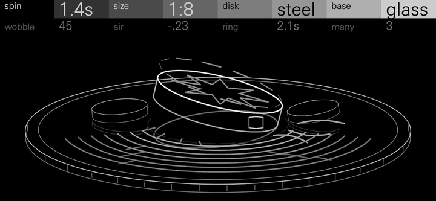

# Coin

Euler's disks spun on a mirror. Each note throws a heavy disk down on its
edge. As it settles, its contact point circles faster and faster: a
finite-time singularity, Ω ∝ (t0 − t)^(−n). The contact point's rolling
strikes are a pulse train that rises through the note's subharmonics, rings
the disk (whose ring is the key) and the base under it, and lands on the
note itself, where the disk falls flat with a slap and rings on.

Coin starts from Euler's Disk, a desk toy by Joseph Bendik from the 1990s: a
heavy, polished steel disk spun on its edge on a concave mirror. As it
settles it rolls lower and lower, and its wobble speeds up, its whirr rising
in pitch, until it stops all at once. The toy is named after Leonhard Euler,
who worked out the equations of a rigid body's motion. Keith Moffatt
(Nature, 2000) described its settling as a finite-time singularity and
proposed that its energy goes into the thin layer of air under the disk.

Spin sets how long the disk settles, size how far under its ring it starts,
and air the curve of the rush, from rolling friction to the viscous air
under the disk, and how much that air breathes. Ring sets how long it sings
once flat, and the disk's material scales it. A short spin is a zip
and a tick, a middling one a pitched bell that settles onto its note, and a
long one a whirr that tightens for seconds before its sudden rush. At hold
it drones. **Many** puts up to four disks of slightly different sizes in a
note; they chorus in tune and stop one after another. The disk's ring beats
slowly, as a disk that is not quite round does.

The spin is the instrument's own envelope. A synth on this SDK cannot hear
its note-off, so every note is a free spin, and hold is a position of the
spin control, not a held key. The OP-XY's amp envelope applies on top:
Coin's presets give it full sustain and the longest release, so a spin plays
out after the key is let go.

**Status: experimental.** Coin passes the SDK's tests and runs on an
OP-XY, and its CPU figures (below) are estimates, not
measurements on the device.

## Controls

Press any encoder to switch pages. Page 1 is the disk and its base, page 2
how it rolls and rings.

| Encoder | Page 1 | Page 2 |
| --- | --- | --- |
| 1 | spin | wobble |
| 2 | size | air |
| 3 | disk | ring |
| 4 | base | many |

| Control | Range | Default | Caption | What it does |
| --- | --- | --- | --- | --- |
| spin | 0.2 to 30 s, exponentially, then hold | 1.6 s | seconds, `1.6s` or `hold` | How long the thrown disk takes to settle, from note-on to the moment it leaves the surface. The rate follows its law exactly, block by block, so a long spin barely rises for most of its life and then rushes. At hold (its top 4%) a hand keeps the disk re-spun at a steady, slowly wobbling rate; turning spin down lets it go from where it is. |
| size | 1:2, 1:4, 1:8, 1:16, 1:32 | 1:4 | the ratio, `1:4` | Where the whirr starts: the held strike rate, 1 to 5 whole octaves under the disk's ring. A small coin buzzes an octave under its note, a heavy disk rattles five under. Whole octaves keep the ring on a strike harmonic, so the note is in tune; the sweep rises through each subharmonic to the note. |
| disk | steel, brass, glass, wood | steel | the material | How its three modes (at 1, 1.73 and 2.33 times the key, a free plate's) ring and beat, and how long it rings once flat: steel long and bright, brass warmer and 0.6 times as long, glass pure with strong upper modes and 1.5 times as long, wood a short knock, 0.35 times. |
| base | glass, wood, stone | glass | the material | What it rolls on: the base's own resonance (glass 1.2 kHz, wood 205 Hz, stone 640 Hz), its rolling noise, and how much it damps the disk through the contact: wood two and a half times as much as glass, stone 1.3 times. |
| wobble | 0 to 100 | 25 | amount | Eccentricity, felt early (it acts as w(2 − w)). An off-centre weight, carried round by the disk's slow turn, swings the contact rate, a warble in the whirr of up to 0.06 octave, and the strikes' strength (0.375 to 1.625 times) and the rolling noise with it; a bounce follows each strike, and a disk kept at hold wobbles more (0.003 to 0.015 octave). In its top half the disk also slips: its strikes jitter, it hisses, and noise rings in the first disk's ring (a squeal). |
| air | rolling friction to viscous air | rolling friction | the rush, `0.17s` or `24ms` | The dissipation law, and so the rush's curve: the rate rises as (t0 − t)^(−n), n = 1/3 for rolling friction, 1/4 at 50, 1/6 for Moffatt's viscous air layer. With air the spin hangs low longer and then rushes, and the air pushed from under the disk breathes, louder and brighter as it speeds up. The caption is how long the whirr's last octave onto the note takes, at the current spin and size (`-` at hold). |
| ring | 0.12 to 4 s, exponentially | 0.89 s | seconds, `0.89s` | How long the disk rings at its note once it lies flat (its T60), from a dead slap to a bell, for steel; the other materials scale it, and the caption shows the result. Its upper modes fade two and three times as fast. |
| many | 1 to 4 | 1 | the count | Disks in a note, detuned about it and stopping at 1, 0.86, 1.14 and 0.75 times the settle time. The detunes are centred, so the chorus stays in tune: ±3.5 cents for two; 0 and ±6 for three; ±3 and ±9 for four. |

Measured at A4 with the other controls at the defaults (the Euler preset)
(`tests/sound.cpp` checks the laws; `COIN_REPORT=1` prints these). The
enumerations are measured at each option:

| Control | 0 | 25 | 50 | 75 | 100 |
| --- | --- | --- | --- | --- | --- |
| spin: settles in | 0.20 s | 0.73 s | 2.68 s | 9.87 s | kept spinning |
| size: the held strike rate | 220 Hz | 110 Hz | 55 Hz | 27.5 Hz | 13.7 Hz |
| wobble: the whirr's warble | 2 cents | 23 cents | 40 cents | 79 cents | 134 cents |
| air: the last octave onto the note | 183 ms | 125 ms | 100 ms | 51 ms | 22 ms |
| air: the breath, above 2 kHz against below, late in the spin | −44.1 dB | −44.0 dB | −46.5 dB | −44.7 dB | −40.4 dB |
| ring: the after-ring's T60 | 0.12 s | 0.28 s | 0.66 s | 1.18 s | 3.4 s |
| many: disks, and the spread of their stops | 1 | 2, 0.22 s | 3, 0.44 s | 3, 0.44 s | 4, 0.62 s |

| Option | Measure |
| --- | --- |
| disk: the after-ring's T60 | steel 0.82 s, brass 0.50 s, glass 1.10 s, wood 0.26 s |
| disk: upper modes against the ring, held | steel −17 dB, brass −19 dB, glass −17 dB, wood −23 dB |
| base: the spin's level, and its low (100–330 Hz) against its high (0.9–1.5 kHz) | glass −28.5 dB, −6.3 dB; wood −32.3 dB, +2.9 dB; stone −29.6 dB, −2.3 dB |

Wobble's top half adds slip's jitter to the warble. Ring's shortest setting
measures at the base's own ring (0.1 s), and the after-rings a little under
the caption, as the upper modes fade first.

## Presets

Peaks are of the voices at unit gain struck together, as Moth's table
measures them. Hexagon's engines in similar roles peak at 0.24 to 0.57 for
four notes and 0.47 to 0.87 for eight.

| Preset | Sound | 4 notes, 8 notes |
| --- | --- | --- |
| Euler | The toy: a steel disk on the glass at 1:4, a 1.6 s spin that sweeps up through its subharmonics onto the note and rings 0.9 s, beating slowly. The init sound | 0.45, 0.70 |
| Tick | A brass coin on stone at 1:2, spun 0.25 s: a zip and a dry tick, for rhythm | 0.31, 0.56 |
| Knock | A wooden disk on a wooden base, 0.45 s: a marimba-like knock with a short whirr in front | 0.45, 0.83 |
| Bell | A glass disk at 1:2, spun 0.7 s with some air, then a 2.8 s ring | 0.33, 0.65 |
| Chorus | Four brass disks, 3.5 s: a whirring chorus in tune that stops disk by disk and rings 1.2 s | 0.34, 0.73 |
| Thrum | A steel disk at 1:2, 2.4 s: a low, warbling flutter at half the note rising onto it, then a 1.6 s ring. For bass | 0.54, 0.75 |
| Drone | Two glass disks kept spinning at hold. Give the amp envelope a release of about 2 s so notes end | 0.35, 0.66 |
| Settle | A 10 s spin in viscous air: it hangs for seconds, breathing, then rushes onto the note and rings 2.2 s | 0.46, 0.79 |

## How it works

`spin.h` holds the physics, shared by the engine and the screen, in integer
and 32-bit arithmetic.

- **The law.** As a spinning disk settles, its tilt falls as (t0 − t)^p and
  Ω² × tilt stays constant, so the contact rate Ω rises as (t0 − t)^(−n),
  n = p/2: p = 2/3 for rolling friction, 1/3 for viscous air (Moffatt).
- **Life.** Each disk keeps its life, the share of its spin left: 1 at the
  throw, falling a fixed step each 64-sample block, so it reaches 0 at t0. Its
  rise is −n log2(life) octaves over the held rate, through Q16 log2 and
  exp2 tables. Within a block the strike increment glides linearly.
- **Strikes.** Each wrap of the contact phase is a strike, split between two
  samples by its overshoot (a reciprocal taken once a block), so fast pulse
  trains stay clean. Strikes soften as 2^(−L/4) as the rate rises, and are
  louder when the held rate is sparse, so every key and size plays at about
  one level. The throw and the final slap are fixed in size.
- **The disk.** Each disk rings its first mode at the key: a two-pole
  resonance tuned from the pitch increment with a Q31 Taylor sine. Its
  second and third modes are the voice's, struck by all its disks. A lone
  disk's ring has a partner 0.45 to 1.6 Hz away (by material), and as the
  disk turns, its strikes move between the two: the beating. Once flat, the
  modes ring by ring's time, scaled by the material.
- **Wobble.** The off-centre weight turns with the disk. Each block, its
  angle swings the contact rate (the warble), the strikes' strength and the
  rolling noise; half a turn after each strike it bounces.
- **The base.** One resonance, at a quarter of the mix, struck by the
  strikes and the rolling noise (which rises as 2^(L/2)); it damps the
  rolling disk by its material.
- **Air.** Besides the exponent, the air under the disk breathes: noise that
  rises as 2^L, through a low-pass that opens with air, joins the rolling
  noise.
- **Output.** A DC blocker, then a soft knee from 0.375 up to half scale.

## Level

Single notes, each preset at its role's pitch, play at −27 to −35 dBFS RMS
with peaks of 0.10 to 0.20 and crest factors of 7 to 15 dB; Hexagon's Moth,
Orbit, Hollow and Wane play at −24 to −31 dBFS with peaks of 0.13 to 0.20.
Measured on those notes, with three Hexagon presets for comparison:

| Sound | RMS | Crest | Tonal/noise | Beating | Roughness | Pitch of the after-ring |
| --- | --- | --- | --- | --- | --- | --- |
| Coin Euler | −29.0 dB | 14.2 dB | 30 dB | 6.6 dB | 24% | +2.6 cents |
| Coin Bell | −34.6 | 15.4 | 47 | 1.9 | 7% | −0.2 |
| Coin Drone | −26.6 | 7.5 | 32 | 2.4 | 6% | +4.0 (the chorus) |
| Coin Thrum (A1) | −28.8 | 12.1 | 25 | 3.1 | 59% (its flutter) | −1.8 |
| Coin Chorus | −30.6 | 13.1 | 16 | 2.7 | 28% | −4.7 (the chorus) |
| Coin Tick (C6) | −31.9 | 11.5 | 22 | – | – | +0.1 |
| Moth Bell | −30.9 | 13.3 | 44 | 0.2 | 4% | −1.9 |
| Orbit Dusk Pad | −23.8 | 8.1 | 66 | 3.6 | 4% | +7.6 |
| Hollow Choir | −25.9 | 10.6 | 23 | 2.1 | 10% | −0.3 |

- **Tonal/noise:** the median over 93 ms frames of the energy in spectral
  peaks against the rest.
- **Beating:** how far the level swings either side of its 0.8 s trend.
- **Roughness:** the envelope's modulation from 20 to 150 Hz. In the
  whirring presets it is the whirr itself.

The presets' phrases (`tests/scenes.cpp`) have no clicks. DC is at most
3e-5, content above 16 kHz is −55 to −74 dB, and each ends in silence.

## Screen

The whole screen is the Euler's Disk toy: a heavy chrome disk spinning on
its concave mirror, seen low (16°) in mild perspective, with its reflection,
centred below the header on a plain base with its side.

It is drawn for the screen's own 480 × 222 pixels in four greys and few line
weights, used alike throughout: the disk's rim brightest and boldest; its
edge, its face, the base's top, the weight and the companions a step down;
the effects (motion lines, ripples, air, the ghost, wood's grain, stone's
specks) a step further; the reflection last. There are no labels, ticks or
decorative marks, and every part reads at 1:1.

Every outline is one the OP-XY draws cleanly: no point within an eighth of
a pixel of the next, no turn straight back, a closing edge of at least a
quarter of a pixel, and some area (a line traced out and back over itself
draws as a streak). The disk's outlines drop any point that would break
this, and start where both their edges are longest; where the side meets
the upper rim tangentially, the edge's corner is cut. The camera sits 16°
up, so a disk leaning away further would turn its face edge-on and its rim
into a line: it leans away at most 11°, and its face's engraving is left out
when seen at under 12°. `tests/frames.cpp` checks every outline and node
through each control's range and a note's animation.

The note's first disk is the four reshaping outlines, projected each frame:
its face's rim, its edge (the side facing the camera), its reflection (the
concave mirror flattens it) and what is engraved on its face. As it settles,
its tilt flattens (2^(−2L) of its throw, as Ω² × tilt is constant) and its
wobble quickens: the contact circles 0.6 turns a second at the throw, rising
0.55 octave for each octave of the sound's, at most 5, because the real
rates (7 Hz to 2 kHz) are too fast to see. Its contact point races round the
rim as a glint with motion lines lit behind it, which blur into a ring past
3 turns a second; its face turns slowly the other way and slows as the whirr
rises, as a real disk's does. When it leaves the surface it falls flat in
0.15 s, its ring's ripples flare across the mirror, outward a ripple a
frame, and fade over the ring's time, and it is still. Companion disks lean,
wobble and stop on their own. They are drawn smaller than they are (they
differ by under 1%), so that three fit on the mirror.

Every control changes the toy at a glance ([`docs/controls.png`](docs/controls.png):
a row per control at 0, 50 and 100, enlarged; [`docs/controls-1x.png`](docs/controls-1x.png)
is the same at the screen's own size):

| Control | What changes |
| --- | --- |
| spin | The lean the disk stands at, ready to throw: 4° for the shortest spin to 28° at hold |
| size | The disk: a thin coin (radius 44 px, 0.16 of it thick) to a heavy disk (88 px, 0.38 thick) |
| disk | Its face: steel's large engraved rose, brass's coarse milled ring, glass's underside seen through it, wood's wavy growth ring |
| base | The base: glass shows the disk's reflection, wood a flat-sawn grain across its top, stone four specks and two veins |
| wobble | A dashed ghost of the rim where the off-centre weight throws it, hopped up and rocked over: none at 0, 6 px and 5° at 50, 12 px and 10° at 100; and a lead balance weight clamped to the rim, growing from 0.7 to 2 times its size |
| air | Streaks of air fanning from under the low edge: none at rolling friction, five long ones in viscous air |
| ring | Ripples across the mirror in front of the disk, from just beyond its rim outward: none for a dead slap, four reaching halfway across the glass at 50, eight reaching its edge for a 4 s bell |
| many | One to four disks on the mirror |

Between notes, turning a control stands the disks up at their throw, still,
so its effect shows; after a note they lie flat until the next. The screen
cannot hear the voices: it keeps its own disks' lives, stepped by `spin.h`
exactly as the voices step theirs, catching up a second a frame so a slow
screen keeps time. Motion eases on the frame's time. Reduced motion stops
the turning, blur and drift; a reset snaps everything into place.

Churn at 30 fps, over a 13 s scene of spins with three disks, size, disk and
base changes and a held note: a mean of 7.4 nodes a frame and a peak of 19
(10.8 while the disks roll); with reduced motion, 3.7 and 20. A still screen
changes nothing. Wobble costs little: its ghost is eight dashes, two moved a
frame, and with four disks spinning wobble 100 changes about one node a frame
more than wobble 0 (two at hold); the disk's outlines change as often at any
wobble.

The header's captions fit their columns in the OP-XY's font (values at most
53 px wide at 20 px, titles 56 at 10 px); `tests/captions.cpp` checks every
caption the screen can show.

## CPU

These are estimates: Coin has not been measured on an OP-XY.

Counted from the pinned Blackfin compiler's output (`-O2 -mcpu=bf707`, as
the firmware build), at the heaviest setting, four disks rolling:
- **Each disk** is one loop, two samples a pass: about 32 instructions a
  sample with no strike in it, its coefficients held in registers. Four disks
  take about 8,200 a block.
- **The two shared upper modes** take 15 a sample each, 1,900 a block.
- **The base, rolling noise, DC blocker and knee** take 38 a sample, 2,400 a
  block.
- **Planning,** once a block (each disk's law, increments, the weight's
  swing, the breath and a few divisions), is about 2,150.

That is **about 14,650 instructions a block**, and about 14,970 with wobble
in its top half, when the first disk's ring takes slip's noise (5 more a
sample; only the first disk takes it, as all four would add 1,280). The resonances use Q31
multiplies, one instruction each on the Blackfin.

The host estimate in `sdk.py test` reads higher (17,700 to 18,400 on a quiet
host), because the host's portable Q31 multiply takes about ten instructions
where the Blackfin takes one: the loops that are cheapest on the Blackfin
are the ones the host times as dearest. The firmware compile
(`sdk.py test --firmware`) passes, and Coin takes 47.5 KiB of module memory.

## Files

- `engine.cpp`, `core.h`: the voice.
- `spin.h`: the physics and the controls' mappings, shared by the voice and
  the screen.
- `tables.h`: the log2 and exp2 tables, disk materials and their beating,
  base resonances and the sine series, written by `tools/make_tables.py`.
- `display.cpp`, `display.h`, `plate.h`, `panel.svg.fragment`: the screen.
  The artwork and face patterns are written by `tools/make_panel.py`; run it
  after changing a shape, and commit all three.
- `tests/sound.cpp`: the sound and screen checks, run by `sdk.py test`.
- `tests/frames.cpp`: every frame's outlines and nodes against what the
  OP-XY draws cleanly, run by `sdk.py test`.
- `tests/captions.cpp`: every header caption against the OP-XY's font, run
  by `sdk.py test`.
- `tests/scenes.cpp`: each preset's phrase, checked by `sdk.py test`, and
  written as WAVs into a folder you give it:
  `c++ -std=c++11 -O2 -I <sdk>/sdk/include tests/scenes.cpp -o scenes && ./scenes <folder>`.
- `docs/coin.gif`, `docs/controls.png`, `docs/controls-1x.png`: the screen
  and its contact sheet, enlarged and at 1:1, rendered offline from
  `display.cpp` in UniversNextPro-Light.
