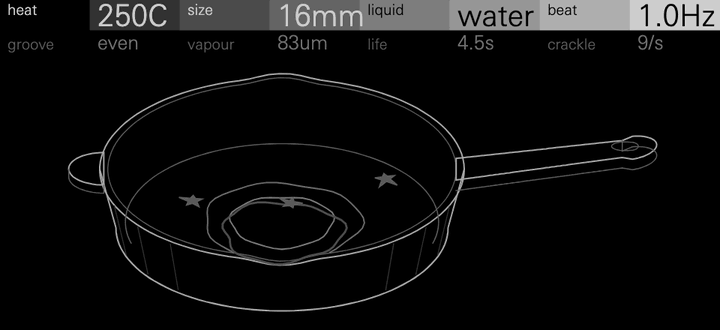
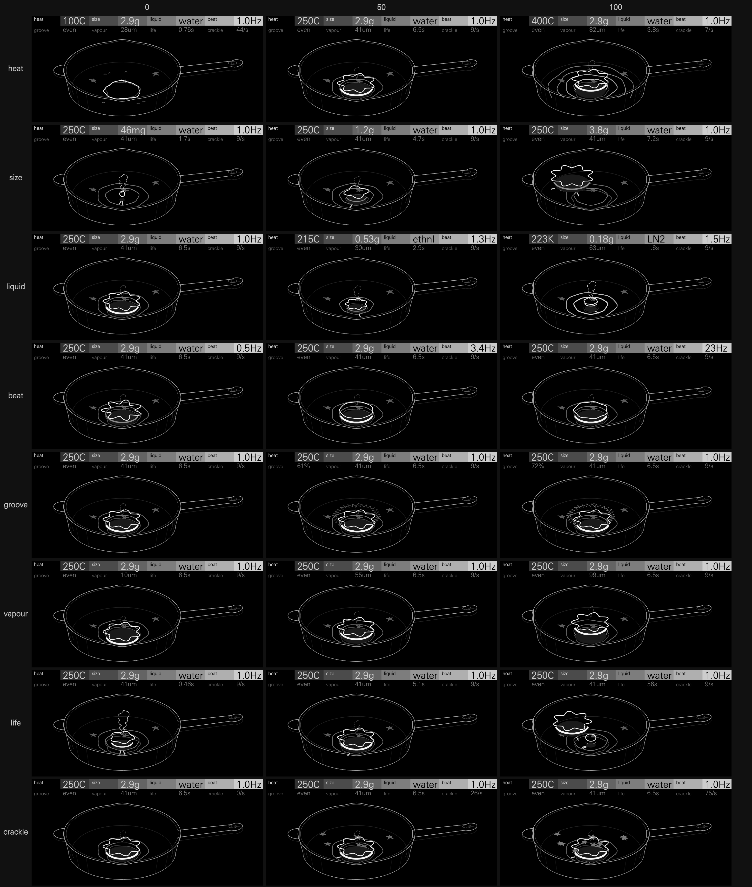
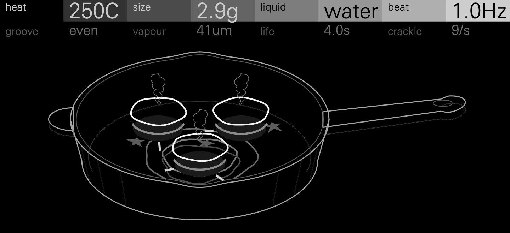

# Drop

A drop of liquid on a hot cast-iron skillet. Each note drops one. Past the
liquid's Leidenfrost point the drop floats on its own vapour, takes the star
shape its size supports and sings: a steady, breathy tone at the key, blown
by the vapour as a flute is blown, pulsing as the vapour vents under each
lobe. As the drop evaporates it gives up its lobes one by one, and each lobe
it gives up takes one pulse out of every beat: eight pulses to the beat, then
seven, six, down to two, a rhythm that slows in steps. Then it is a bead
whose beats quicken into a rising chirp, and it is gone. Under the
Leidenfrost point the drop touches the iron and boils away in a fraction of a
second, a fierce sizzle. Turn **heat** past the point and the sizzle becomes
a song.

In 1756 the German physician Johann Gottlob Leidenfrost described how a drop
of water on very hot iron does not boil away at once but lasts far longer,
floating on a layer of its own vapour: the Leidenfrost effect. A drop held
up this way can also oscillate into a star, its rim rippling in lobes whose
number its size sets. Drop is built from that drop: the star's lobes, its
beat and its evaporation are modelled on the papers cited below, with the
departures listed under How it works.

It sounds like a soft wooden flute or a bowed glass, played with a gentle
tremolo that slowly changes its count. At its default, one beat a second,
eight pulses to the beat are sixteenth notes at 120 BPM; as the drop shrinks
they become sevenths, sixths and so on to half notes, then the bead's
accelerating flutter. Big drops of the same size in a chord pulse together;
drops of different sizes pulse against each other, eight against five.
Thin vapour sings pure and long, like a kettle's whistle or a glass; thick
vapour is breathy and short, like a pipe overblown. At the top of **beat**
the pulses come at 23 Hz, the rate the papers measured, and the song turns
back into a flutter.

**Status: experimental.** Drop passes the SDK's tests. It runs on an
OP-XY, and its CPU is measured there
(below).

## Controls

Press any encoder to switch pages. The header shows real units, each
narrow enough for its column in the OP-XY's font (`tests/captions.cpp`). Each control's 0, 25, 50, 75 and 100, the others at their
defaults: what the header says, and what a held A3 measures
(`tools/sweep.py`: how long it lasts, its pulses a second and their swing,
its spectral centroid, its share of power over 2.5 kHz and the clicks heard
a second).

| Control | 0 | 25 | 50 | 75 | 100 | On the skillet |
| --- | --- | --- | --- | --- | --- | --- |
| **heat**: the plate, from 100 °C under the liquid's Leidenfrost point to 200 °C over it | `100C`: boils, gone in 0.8 s, broadband (centroid 6.2 kHz) | `175C`: boils, gone in 0.4 s (2.6 kHz) | `250C`: floats 6.6 s, a song (centroid 312 Hz) | `325C`: floats 4.7 s, its vapour thicker, 415 Hz | `400C`: floats 3.8 s, 562 Hz, over 2.5 kHz −13 dB (−21 at 250 °C) | Rings tempered into the iron round the burner: none at 100 °C, two at 250 °C, four at 400 °C; white frost on a cold plate. Under the point, a spattering puddle |
| **size**: the drop as it lands, shown as its mass (2.2 to 16 mm across its radius) | `46mg`: a bead, no star, 1.7 s | `0.48g`: 3 lobes, 3.4 s | `1.2g`: 5 lobes, 4.8 s | `2.3g`: 6 lobes, 6.1 s | `3.8g`: 8 lobes, 7.3 s | The water mark where the next drop lands; the drops |
| **liquid**: water, ethanol, liquid nitrogen | `water`: point 200 °C, beat ×1.0, 6.6 s, 312 Hz | `ethnl`: 4.5 s | `ethnl`: point 165 °C, beat ×1.27, 3.1 s, thinner vapour, darker (277 Hz) | `LN2`: 2.3 s | `LN2`: point −100 °C (173 K), beat ×1.54, 1.7 s, thicker vapour, an airy 447 Hz | Its lobes' width: the same size control makes a 14 mm water drop, an 8 mm ethanol one or a 6 mm nitrogen one; frost on nitrogen's cold plate |
| **beat**: the star's beat | `0.5Hz`: 5 pulses a second | `1.3Hz`: 8 | `3.4Hz`: 19, a flutter | `8.8Hz`: 14, pulses crowding into each beat | `23Hz`: 20, the papers' beats | The stars' lobes: deep and slowly breathing at 0.5 Hz, a shallow tremor at 23 Hz; their vapour flashes at each pulse |
| **groove**: the ratchet's teeth swing the pulses | `even`: straight (swing 0.54) | `55%`: 0.57 | `61%`: 0.63 | `66%`: 0.68, running at 7 cm/s, a tooth hopped now and then (centroid 395 Hz) | `72%`: 0.73, a hard shuffle at 9 cm/s, hops dropping a pulse | The sawtooth teeth cut into the pan, brighter as they deepen; the drops run round them |
| **vapour**: the layer's thickness | `10um`: rings 0.9 s, centroid 246 Hz, over 2.5 kHz −25 dB | `32um`: 282 Hz, −23 dB | `55um`: 374 Hz, −19 dB | `77um`: 552 Hz, −14 dB | `99um`: rings 0.09 s, 1.01 kHz, −10 dB | The drops lift off the iron: at 10 µm each sits on its dark shadow; thicker, it hovers higher, to 20 px over it |
| **life**: the floating life of an eight-lobe water drop at 250 °C | `0.46s`: gone before its first lobe | `1.5s`: its lobes step down 7 to 2 in 1.7 s | `5.1s` | `17s` | `56s`: a step every few seconds | Each drop's steam: a tall billowing plume swaying over a fast-shrinking drop at 0.5 s, smaller to 15 s, none past it |
| **crackle**: brief contacts with the iron, a second at this heat | `0/s`: none; over 2.5 kHz −23 dB | `9/s`: −21 dB, 7 clicks a second heard | `26/s`: −18 dB, 20 a second | `49/s`: −14 dB, 41 | `75/s`: −11 dB, 65 a second (six times as many near the point) | Spatter dried on the iron round the landing places, there with no note playing: none to twelve splashes; sparks at the drops' edges |

Heat, liquid, beat, groove, vapour, life and crackle act on drops already
sounding: turn heat under the point during a long note and the floating drop
falls onto the iron and sizzles away. Liquid nitrogen's heat runs from −200
to +100 °C, so its sizzle is as reachable as water's; for a liquid whose
point is under 100 °C the header gives the plate in kelvin, 73 to 373 K. The header's vapour
is the layer as it is: a hotter plate thickens it, ethanol thins it and
liquid nitrogen thickens it.

## Presets

| Preset | Role | What it is |
| --- | --- | --- |
| **Drop** | the default, a rhythmic voice | Water at 250 °C, a seven-lobed drop, a beat a second: sixteenths that slow by a step every second or so as the drop shrinks. Plays a melody or a riff straight away. |
| **Kettle** | a singing-kettle pad | The biggest drop, the thinnest vapour (a pure, long-ringing tone), a slow beat of 0.63 Hz and a 50 s life: a steady sung chord, swelling five times a second and slowing over a minute. |
| **Star Lead** | a beating lead | A six-lobed drop beating 4 Hz, so its pulses come about 25 times a second: a fluttering, flute-tongued lead that holds its pitch and slows as it shrinks. |
| **Spirit Bass** | a bass | Ethanol on a 200 °C plate, thin vapour, a beat of 1.3 Hz and a long life: a round, pulsing bass from A0 up, about nine pulses a second, slowing as it shrinks. |
| **Ratchet** | a ratchet rhythm | A grooved plate: the pulses swing (68%), the drop runs round the teeth at up to 7 cm/s, its pulses drift and wobble with its speed and it hops a tooth now and then, dropping a pulse and landing with a click. Hold a note for a riff that never repeats exactly. |
| **Sizzle** | sizzle percussion | The plate 46 degrees under the point: every note is a 0.3 s burst of bursting bubbles and frying hiss, faintly pitched. Sixteenths of it make a hi-hat, a shaker or rain on a hot pan. |
| **Whisper** | a nitrogen whisper | Liquid nitrogen floating over a −20 °C plate, the thickest vapour: an airy, breathy chord over a hiss, the drops beating fast and dying young. |
| **Last Drop** | a dying-drop effect | A small drop and a short life: a few pulses, then its last bead's chirp, then nothing. Each note is a gesture. |

Every preset shares the amp envelope in `machine.json`, so a note ends
when its key is let go. To hear a whole life, Kettle's or Last Drop's
especially, hold the key or lengthen the release.

Each preset's held A3 (A2 for the bass), 0.5 s in, measured by
`tools/ears.py`, beside four Hexagon engines' first presets at the same
note:

| | RMS dBFS | crest | HNR dB | pitch, cents | centroid Hz (10–90%) | fluctuation dB | roughness dB |
| --- | --- | --- | --- | --- | --- | --- | --- |
| Drop | −24.8 | 4.9 | 11.3 | −0.6 | 295 (263–352) | −11.5 | −16.7 |
| Kettle | −24.7 | 3.7 | 11.3 | −0.4 | 261 (247–291) | −10.6 | −16.5 |
| Star Lead | −25.0 | 4.6 | 6.9 | −0.2 | 296 (270–343) | −20.1 | −10.0 |
| Spirit Bass | −24.5 | 4.5 | 6.1 | +2.3 | 131 (122–141) | −12.1 | −8.3 |
| Ratchet | −25.9 | 6.3 | 8.7 | 0.0 | 487 (327–1044) | −8.6 | −13.7 |
| Whisper | −24.8 | 6.1 | 8.8 | +0.5 | 770 (541–1150) | −10.3 | −14.7 |
| Last Drop | −24.9 | 4.3 | 10.0 | +0.6 | 306 (274–533) | −9.6 | −15.7 |
| Sizzle (its 0.3 s) | −28.7 | 6.4 | 5.2 | | 6495 (1986–7247) | −12.0 | −16.7 |
| Hexagon Moth, Clean | −21.8 | 1.3 | 18.8 | 0.0 | 224 | (steady) | −53.7 |
| Hexagon Hollow, Choir | −26.4 | 3.6 | 13.7 | −0.2 | 749 (678–855) | −17.5 | −14.1 |
| Hexagon Wane, Clean | −24.6 | 2.4 | 16.7 | 0.0 | 503 (370–775) | −15.6 | −15.4 |
| Hexagon Orbit, Init | −23.7 | 1.4 | 19.2 | 0.0 | 279 | (steady) | −31.7 |

HNR counts all power more than 3% from a harmonic as noise, so the pulses'
sidebands count against Drop: its tone itself is cleaner than the number.
Fluctuation is the loudness's modulation from 0.5 to 15 Hz (the pulses) and
roughness from 15 to 300 Hz, both against its mean. Drop pulses 4 to 8 dB
more than Hollow or Wane, by design; it is no rougher, except the Star
Lead's flutter (by design) and the bass, whose own waveform falls in the
roughness band. Every preset's held note is −24.5 to −25.9 dBFS.

## How it works

`leidenfrost.h` holds the physics, shared by the engine and the screen,
stepped once a 64-sample block by both. Integer and 32-bit only.

- **The drop** (`physics::Drop`, `land`, `step`): its life runs from 1 down,
  floating or boiling. Its radius in lobes is ν = ν0 × life^(2/3) (a puddle
  evaporates as R^(3/2) linear in time, Biance 2003). It holds n = ⌊ν + 0.2⌋
  lobes and steps down one at a time; at each step the old mode's strength
  falls to 0.3 and the new one grows back over about 0.1 s. Under 1.8 lobes'
  worth it is round, and its beat rises as Rayleigh's, ν^(−3/2), to about 22
  times its start: the chirp. It is gone at a quarter of a lobe's radius.
- **The beat** (`physics::beat_rate`): the star's frequency is set by the
  capillary length, not the radius (Brunet 2018), so the beat holds steady
  through the drop's life, creeping a few percent through each mode as the
  wavenumber n / R rises, and falling back at each step.
- **The pulses** (`engine.cpp`): at each beat the vapour vents under each
  lobe in turn. Slow beats spread the vents evenly over the beat, so each
  beat is a bar of n pulses, the first leading at full strength and the rest
  at 0.8; fast ones crowd them into n/16 of it. On the ratchet the teeth
  swing them: the gap after the beat and every other vent lasts 1 + s of the
  spacing and the rest 1 − s, s up to 0.44 (a 72% swing). Each pulse opens the vent's
  gate (the tone sounds at full while it is open, at 0.18 between) and
  blows a puff of jet noise and a tick of random sign.
- **The tone**: a waveguide pipe tuned to the key (a delay of one period, an
  allpass for its fraction, a linear-phase three-tap loop filter) blown like
  a flute: the jet feeds the pipe's own sound back through a soft limit
  (u − u³/3), low-passed at 2.5 times the key so it blows the fundamental
  and not the octave, and high-passed at an eighth of it so it does not blow
  the loop's slow drift. Fed back at three times the loop's loss it settles at
  one level whatever the key or the ring. A DC blocker inside the loop keeps
  it from latching at DC; its phase lead, and the jet's lag, are taken off
  the delay, so the tone is within 4 cents of the key from E1 to A6. A drop
  landing pushes the pipe for half a period, so it speaks at once.
- **Vapour**: the loop rings 0.9 s under thin vapour (a glass's pure,
  singing fundamental) and 0.09 s under thick (a breathy pipe), at least 48
  periods; its filter and the jet's low-passes open as it thickens, and the
  jet's noise grows four times. The layer is the vapour control plus a
  share of the heat (0.15 of its range less at the point, 0.46 more 200
  degrees over it) and of the liquid (ethanol 0.12 less, liquid nitrogen
  0.24 more).
- **Crackle and sizzle**: bursts of noise 1.5 ms long at random moments
  (the square of a uniform number: mostly small, now and then loud), as
  crackle to the 1.5: 60 to 360 a second at full crackle as the plate nears
  the point, 21 at half and 7.5 at a quarter far over it, and louder as
  crackle grows (half as loud at a quarter); through a difference and two
  low-passes at about 3 kHz. Boiling, thousands a second with a frying hiss
  of low-passed noise.
- **Chords**: a chord's drops land and pulse together, so chords keep their
  rhythm, and their pulses add up. From three voices sounding (counted in
  `Shared`), each plays at √(2 / voices): an eight-note chord is 6 dB under
  eight single notes, and peaks at 0.5 to 0.8.
- **Output**: a DC blocker, then a soft knee from 0.25 to 0.45 of full scale.

### A note is the drop's life, and the OP-XY's amp envelope

On this SDK a synth voice hears its note start (`start`) but not its
release; stock's amp envelope runs after `render`. So a note-on drops a drop
and the drop lives its life from there. `machine.json` gives Drop's
generated presets an amp envelope of no attack, full sustain and a moderate
release (14000 of 32767), so notes end when the key is let go, like any
synth, and the drop's life shapes them while they are held. Letting go
cannot lift the drop off the plate, since the voice is not told. The screen
is told: it boils the drop away over the amp's fade, so a released note leaves
the screen still within a second.

### Where it departs from the physics

- **Beat bends the physics.** The papers' drops beat at 23 Hz whatever their
  size. Beat slows the star to as little as 0.5 Hz, and slow beats spread
  one pulse a lobe across each beat, so each lobe given up is a rhythmic
  step.
- **Beat is set in Hz, not locked to tempo.** The SDK gives tempo only to
  sample engines and effects, not to synths. 1 Hz is a half note at 120 BPM,
  eight lobes its sixteenths.
- **The tone is blown, not plucked.** A self-sustained, jet-blown pipe sings
  a steady tone that the pulses gate, with a full fundamental.
- **The tone stays at the key.** In the papers it rises as the drop shrinks.
- **Heat is relative to the liquid's point**, so liquid nitrogen's sizzle is
  reachable: its plate runs from −200 to +100 °C.
- **Chords pulse together and are scaled from three voices**, for clean
  rhythm without clipping.
- **The screen** draws the drops 2.6 times larger than the skillet.

## Screen



An engraved plate (`tools/make_panel.py`): a No. 8 cast-iron skillet, 270 mm
across the rim and 48 mm deep, seen from 30° above, centred under the
header with a margin round it. Its rim has two pour spouts; a 145 mm handle
ends in a teardrop hole; a helper handle opposite. 33 static paths and 48
nodes.

It is drawn for the screen's 480 × 222 pixels in three weights. The drops
lead, brightest and boldest (the palette gives its brightest greys its
widest stroke). The skillet's outline is a step down, its inner edges
another, and six faint strokes turn its outside wall. Only the drops'
shadows and the spatter are filled. There is no text but the header.

Every path is drawn as the OP-XY draws one cleanly: a line is a thin closed
ribbon with a width of its own, not a trace out and back; no two
neighbouring points lie within an eighth of a pixel; and each path starts
on its longest edge, a star at a lobe's tip, so its closing edge is never a
sliver. A drop under 3 px in radius leaves the screen, and its vapour's
crescent shows from 9 px. `tests/frame_rules.cpp` checks this.

Each control changes a part of the skillet or the drops on it, as the
controls table says and `docs/controls.png` shows: heat the tempered rings
(or frost), size the water mark, liquid the drops' scale, beat the depth and
pace of the stars' breathing, groove the teeth and the drops' running,
vapour the gap between each drop and its dark shadow, life the steam's
billowing plume, crackle the spatter dried on the iron, there even with no
note playing.



`docs/controls.png` is drawn twice as large to read; `docs/controls-1x.png`
is the same at the screen's true 480 × 222 pixels, the one to judge by.

The drops are drawn 2.6 times larger than the skillet, so their lobes can be
counted. Each is a reshaping outline, its rim as an n-lobed star, over a
bright crescent where its vapour flashes at each pulse and its dark shadow
on the iron. At each lobe it gives up the star fades and grows
back with one fewer, and a spark flies as the sound clicks. Under twice the
capillary length it rounds into a bead, and then it is gone. Under the point
a drop lands as a flattened, ragged puddle, spraying droplets that fly out
and fall back. Up to three drops: a fourth note takes the oldest's place.



The screen cannot hear the voices. It keeps its own drops, stepped by
`leidenfrost.h` exactly as the voices step theirs, a block of time at a time;
`tests/screen.cpp` checks its first drop keeps the voice's lobes while its key
is held. It is still when idle and within a second of the last key's release; reduced motion stops the breathing, flashing, spray, sparks
and running; a reset snaps everything into place.

**Churn** (host, 60 fps, nodes changing a frame while drops show): a drop's
life 3.2, peak 7; three drops 6.7, peak 16; a sizzle 9.5, peak 12 (the
spray); the ratchet 5.4, peak 8; a 16 s run of everything 2.2 on average
(6.8 while drops show), peak 17. Idle: 0.

## Level

The default A3 is −24.8 dBFS RMS (Hexagon's Wane −24.6, Orbit −23.7, Hollow
−26.4). It holds within ±1.5 dB from A2 to C8 at every vapour, and is 1 to
3 dB quieter at A1 and C1. The attack is immediate: the landing push puts
the tone within 6 dB of its level in the first block. Eight-note chords
peak at 0.57 at the defaults and 0.62 at the fastest beat, 0.70 at the
thickest vapour with full crackle, and 0.83 at most, with the plate at its
hottest as well.

## CPU

Measured on an OP-XY (OS 1.2.1) with the SDK's `profile benchmark`, three runs, at
`v0.1.0`: one voice playing middle C with the first four controls at their
midpoint costs **3.24%** of the 580,352-cycle audio block, so eight voices
take about 26%. The OP-XY's own engines measure 1.6–2.7% a voice in the same
test. It plays one setting; heavier settings cost more.

The figures below are host estimates made during development.

- `tools/cpu.py` builds `sdk.py test`'s own bench and reference and runs
  them alternately 20 times, keeping the fastest of each: 11,100 Blackfin
  instructions per voice block at Drop's heaviest setting, on a busy host
  (a load of 7). `sdk.py test`'s single runs read 10,500.
- The pipe and filters take 16-bit products; there is one division a block
  (the allpass) and none a sample.
- **Memory.** Compiled for the Blackfin (`--firmware`), Drop takes 80.6 KiB
  of module memory, eight voices of 4,300 bytes.

## Tests

`sdk.py test` runs five host tests. UBSan is clean.

- **`tests/sound.cpp`**, 30 checks, among them:
  - At 160 °C the drop is gone in 0.35 s, broadband (spectral flatness
    0.73); at 250 °C it floats 7 s, tonal (0.008). 190 °C boils, 210 °C
    floats. Liquid nitrogen sizzles at −140 °C and floats at −50 °C.
  - The lobes step down one at a time, 8 to 2, a sphere, gone.
  - At 23 Hz the beat heard follows each mode's within 1.4% and the beats
    shorten with the lobes; the bead's beats quicken from 31 to 146 a second.
  - At one beat a second the pulses heard are 6.86, 5.85, 4.84, 3.85, 2.85
    and 1.89 a second for seven lobes to two: lobes × beat within 1%.
  - The tone is within 1.6 cents of the key at A2, A3, A4, E5 and C6, and
    across vapour, E1 to A6, within 2.5 cents from thin to mid vapour and
    3.5 at the thickest.
  - The default A3 is −24.9 dBFS; an eight-note chord peaks at 0.53; every
    corner of the controls, C1 to C8, stays under the declared peak.
- **`tests/screen.cpp`**: a valid frame at every step of five scripted
  scenes, a still screen when idle, the screen's drops keeping the voices'
  lobes, and churn within budget.
- **`tests/frame_rules.cpp`**: every path the screen draws (the static
  art, each shown node at its scale and the drops' outlines), over each
  control at 0, 25, 50, 75 and 100 while a note and then a chord live and
  die, has area, no neighbouring points within an eighth of a pixel, no
  turn straight back and a closing edge of a quarter of a pixel or more:
  what the OP-XY draws as streaks otherwise.
- **`tests/captions.cpp`**: every caption the header can show (each
  control swept in 1,024 steps over nine settings of the others, and
  200,000 settings at random) is at most 53 px wide at 20 px in the
  OP-XY's font, Univers Next Pro Light, and every title at most 56 px at
  10 px: none runs into the next column.
- **`tests/scenes.cpp`**: one phrase per preset (a melody, the Kettle's
  Am F C G, a lead, an eighth-note bass line from A1, the ratchet's rhythm,
  sizzle percussion, the nitrogen whisper and the last drop), through a
  stand-in for the amp envelope (0.15 s release) and eight-voice
  allocation. Each peaks under 0.64, with DC under 2e-5, and ends in digital
  silence. Given a folder, it writes them there as WAVs.

## Files

| File | |
| --- | --- |
| `leidenfrost.h` | The physics and the controls' mappings, shared by engine and screen |
| `core.h`, `engine.cpp` | Voice and shared state, and the render |
| `tables.h` | log2/exp2 tables and the liquids (`tools/make_tables.py`) |
| `display.h`, `display.cpp`, `panel.svg.fragment` | The screen (`tools/make_panel.py`) |
| `tests/sound.cpp`, `tests/screen.cpp`, `tests/frame_rules.cpp`, `tests/captions.cpp`, `tests/scenes.cpp` | The host checks above |
| `tools/ears.py` | The presets' listening measurements above |
| `tools/sweep.py`, `tools/sweep.cpp` | The controls' measurements above |
| `tools/cpu.py` | The SDK's CPU estimate, steady on a busy computer |
| `tools/make_contact.py` | `docs/controls.png` and `docs/controls-1x.png` |
| `tools/frame2svg.py`, `tools/make_gif.py` | Frames from `tests/screen.cpp` as SVG, and `docs/drop.gif` |

The tools, run from this folder, with `<sdk>` the Open-XY SDK's checkout and
`<folder>` where the scenes' WAVs go. `ears.py` and `sweep.py` need numpy; the image tools
need a host C++ compiler and Google Chrome (`make_gif.py` also ffmpeg);
`--font` points them at the device's face, which the OP-XY carries as
`content/display/UniversNextPro-Light.otf`, for the header's text.

```sh
python tools/make_tables.py
python tools/make_panel.py
python tools/make_contact.py --sdk <sdk> [--font <UniversNextPro-Light>]
python tools/make_gif.py --sdk <sdk> [--font <UniversNextPro-Light>]
python tools/cpu.py --sdk <sdk>
python tools/ears.py <file>:<midi>[:<from seconds>] ...
python tools/sweep.py --sdk <sdk>
c++ -std=c++11 -O2 -I <sdk>/sdk/include tests/scenes.cpp -o scenes && ./scenes <folder>
```

## References

- J. G. Leidenfrost, 1756: the effect.
- Biance 2003: how a floating drop evaporates, R^(3/2) linear in time.
- Brunet 2018: the star's frequency set by the capillary length.
- Lord Rayleigh: a drop's oscillation, the bead's ν^(−3/2).
