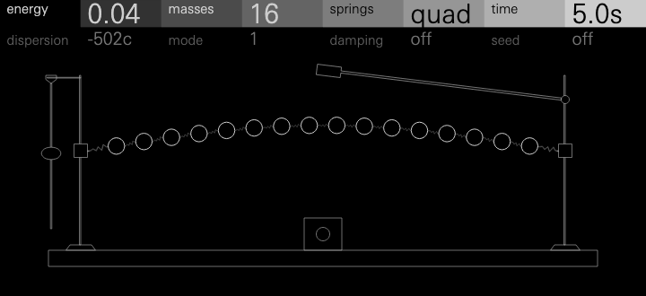
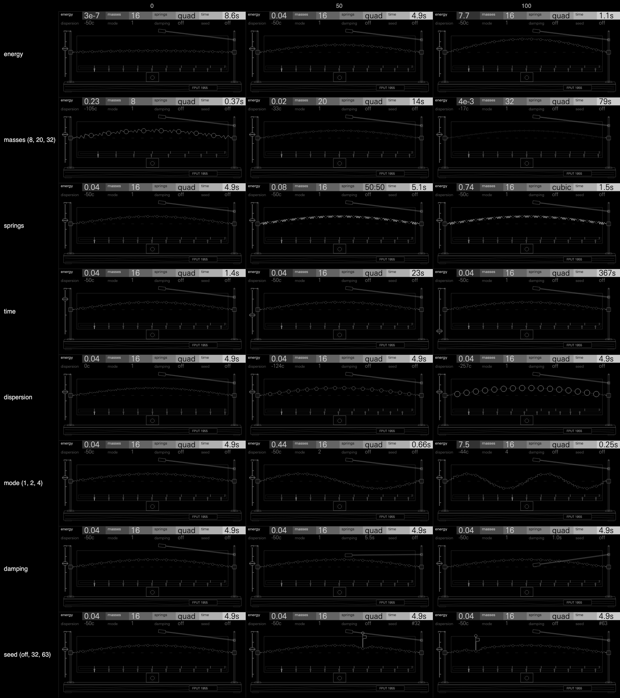

# Fermi

Each note is a Fermi–Pasta–Ulam–Tsingou chain: N masses joined by slightly
nonlinear springs. The note puts all the energy in one mode of the chain, and
the sound is the chain's modes, voiced. Mode k is a partial, and its loudness
is the share of the energy that mode holds now.

Between 1953 and 1955 Enrico Fermi, John Pasta and Stanislaw Ulam, with Mary
Tsingou programming the computer, ran such a chain on the MANIAC I at Los
Alamos. They put all its energy in the lowest mode and expected the
nonlinearity to share it out evenly among all the modes. Instead it flowed
into a few higher modes and then returned almost wholly to the first, again
and again. Their report, *Studies of Nonlinear Problems* (LA-1940), appeared
in 1955, after Fermi's death. Fermi plays that return, and the chaos past it.

It is a warm, rounded tone that will not sit still, as a real object would
not. At low energy it is still, like a flute stop. In the middle it breathes:
the note brightens as the energy flows up into modes 2 to 5, then mellows as
almost all of it comes back to the struck mode. The cycle can be counted:
about 5 s, two bars at 96 BPM, at the default. Every breath comes back a
little differently, and over many the returns drift and recover (the
super-recurrence). With more energy the breath breaks into a shimmering
spectrum that never settles: the thermalized chain, tilted so it is lush
rather than white. With damping, the high partials die first and a note
settles toward its struck mode, as a string's does.

**Status: experimental.** Fermi passes the SDK's tests and runs on an
OP-XY, where its CPU is
measured (below). Its screen follows the track's amp envelope, which needs
version 1.10 of the Open-XY SDK, on its `staging` branch.

## Controls

| Page | Encoder 1 | 2 | 3 | 4 |
| --- | --- | --- | --- | --- |
| 1 | **Energy**: the load on the springs. Still at 0, breathing from about 0.05, deeper to 0.5, chaos above about 0.85 | **Masses**: 8, 12, 16, 20, 24, 28 or 32 | **Springs**: from quadratic (the α chain) to cubic (the β chain), the even partials fading on the way | **Time**: the chain's clock, independent of pitch: a breath from 2.1 s to 32 s at 16 masses |
| 2 | **Dispersion**: partials from exact harmonics to the top one 500 cents flat, along the chain's own law | **Mode**: the mode the note strikes, 1 to 4, always tuned to the key | **Damping**: lossless, or the struck mode's T60, with the high modes faster | **Seed**: a nudge to the starting shape, from none to two thirds of the note's energy in the low modes |

Measured on a 12 s A3 note through Fermi's own `render()`
(`tools/sweep.py`), each control at 0, 25, 50, 75 and 100 with the others at
their defaults. Each cell gives the header's caption; the spectral
centroid's median and its 10th–90th percentile range (how far the timbre
moves); the breath's depth (the 10th–90th percentile range of the struck
partial's share of the energy), with its period where the control moves it;
what the control acts on where the centroid misses it (the even harmonics'
share for springs, the harmonic share and roughness for dispersion, the fall
by 2 s for damping); and Δ, how far the long-term spectrum stands from the
previous setting's, in dB.

| Control | 0 | 25 | 50 | 75 | 100 |
| --- | --- | --- | --- | --- | --- |
| Energy | `3e-7` 246 Hz (246–246), still | `1e-3` 249 Hz (236–268), breath 0.13, Δ 8.3 dB | `0.04` 326 Hz (256–414), breath 0.50, Δ 11.5 dB | `0.57` 570 Hz (265–671), breath 0.65, Δ 10.6 dB | `7.7` 706 Hz (426–881), breath 0.58, Δ 4.7 dB |
| Masses | `8` 311 Hz (252–378), breath 0.38 every 0.37s | `12` 312 Hz (257–388), breath 0.37 every 1.7s, Δ 0.2 dB | `20` 373 Hz (262–418), breath 0.49 every 14s, Δ 3.1 dB | `28` 261 Hz (242–304), breath 0.20 every 51s, Δ 6.7 dB | `32` 250 Hz (239–276), breath 0.14 every 79s, Δ 4.7 dB |
| Springs | `quad` 326 Hz (256–414), breath 0.50 every 4.8s, even 0.36 | `75:25` 300 Hz (243–369), breath 0.36 every 5.4s, even 0.28, Δ 2.3 dB | `50:50` 277 Hz (244–388), breath 0.36 every 5.1s, even 0.21, -1 dB by 2 s, Δ 1.8 dB | `25:75` 262 Hz (243–335), breath 0.19 every 7.2s, even 0.14, Δ 2.2 dB | `cubic` 311 Hz (251–500), breath 0.34 every 1.5s, even 0.12, Δ 8.0 dB |
| Time | `2.1s` 327 Hz (254–415), breath 0.49 | `3.1s` 331 Hz (258–422), breath 0.51, Δ 0.1 dB | `6.8s` 348 Hz (249–415), breath 0.50, Δ 0.3 dB | `15s` 375 Hz (259–417), breath 0.48, Δ 0.8 dB | `32s` 292 Hz (243–378), breath 0.33, Δ 2.7 dB |
| Dispersion | `0c` 378 Hz (274–451), breath 0.47, harmonic 0.79, rough 0.001 | `-118c` 316 Hz (248–409), breath 0.49, harmonic 0.76, rough 0.001, Δ 1.3 dB | `-238c` 324 Hz (250–405), breath 0.48, harmonic 0.75, rough 0.003, Δ 0.6 dB | `-367c` 326 Hz (252–409), breath 0.48, harmonic 0.72, rough 0.007, Δ 0.4 dB | `-502c` 327 Hz (251–408), breath 0.46, harmonic 0.69, rough 0.006, Δ 1.1 dB |
| Mode | `1` 326 Hz (256–414), breath 0.50 every 4.8s | `1` 326 Hz (256–414), breath 0.50 every 4.8s, Δ 0.0 dB | `2` 303 Hz (250–373), breath 0.41 every 0.66s, Δ 2.8 dB | `3` 297 Hz (273–324), breath 0.33 every 0.15s, Δ 12.5 dB | `4` 265 Hz (246–277), breath 0.50 every 0.24s, Δ 10.9 dB |
| Damping | `off` 326 Hz (256–414), breath 0.50 | `13s` 288 Hz (249–321), breath 0.28, -6 dB by 2 s, Δ 6.8 dB | `5.5s` 268 Hz (237–293), breath 0.19, -16 dB by 2 s, Δ 4.4 dB | `2.3s` 251 Hz (237–301), breath 0.07, -41 dB by 2 s, Δ 3.4 dB | `1.0s` 250 Hz (246–448), breath 0.30, -154 dB by 2 s, Δ 2.7 dB |
| Seed | `off` 326 Hz (256–414), breath 0.50 | `22%` 323 Hz (280–435), breath 0.47, Δ 3.2 dB | `41%` 427 Hz (330–519), breath 0.58, Δ 4.6 dB | `56%` 459 Hz (344–581), breath 0.53, Δ 1.6 dB | `66%` 494 Hz (464–542), breath 0.15, Δ 1.8 dB |

Time and masses act mostly on the breath's rate, which the spectrum's change
(Δ) does not see: the time caption gives it. Mode is a four-position switch.
Time's 0 column was measured before the CPU's step cap, which runs the chain
a third slower there: its caption now reads 2.1s.

The captions use real units:
- **Energy** is the chain's energy in the 1955 runs' units: a chain with
  α = 1/4, or β = 1 when mostly cubic. The report's run was 0.07. The knob
  crosses the stillest stretch, where a chain barely stirs, in its first
  twentieth.
- **Masses** and **mode** are numbers.
- **Springs** shows the quadratic and cubic shares.
- **Time** is the breathing period in seconds, from 2.1 s to 32 s at 16
  masses. Larger chains breathe more slowly: about 35 s at 32 masses at the
  fastest. The CPU's cap holds the first eighth of the knob at its fastest,
  more with stiff springs.
- **Dispersion** is how far the top voiced partial sits from harmonic, in
  cents: −500 at full for every number of masses. The partials between bend
  as the chain's own law does, growing as (k/N)², so the low ones stay close
  and beat against the body's harmonics, and the high ones fall well flat.
- **Damping** is the struck mode's T60, and the measured fades match it. A
  chaotic note fades faster than its caption, because the chain keeps feeding
  the high modes that damping drains fastest.
- **Seed** is the share of the note's energy its nudge takes from the struck
  mode, into modes 1 to 6 at random amplitudes (a different pattern at each
  step of the knob). At low energy those modes sound beside the struck one,
  like drawbars; breathing, they change the breath's course; in chaos the
  note goes somewhere else. The note stays as loud.

Energy, springs, time, dispersion and damping act live on a sounding chain.
Masses and mode restring it, as a new chain would. The seed shapes the next
note.

## Presets

| Preset | Role | Sound | Phrase peak |
| --- | --- | --- | --- |
| Breath | pad (the defaults) | 16 masses breathing every 5 s: a soft tone that brightens and returns | 0.55 (four-note chords) |
| Organ | organ | 24 masses at low energy on exact harmonics: still and round, like a flute stop, with a slow shimmer | 0.47 (four-note chords) |
| Tsingou | long pad | The 1955 chain: 32 masses, a breath of 23 s, super-recurrences under long chords | 0.52 (five-note chords) |
| Clarinet | lead | The cubic chain: odd partials only, a hollow reed tone that breathes slowly | 0.12 (single notes) |
| Bell | bell | 8 masses struck in mode 2 with the chain's full stretch: inharmonic, a sub-partial beneath, damped | 0.14 (single notes) |
| Pluck | bass | 12 masses at the fastest clock: each note flares bright as energy flows up, then damping settles it round | 0.11 (single notes) |
| Thermal | texture | 24 masses past the crossing: a slow-churning, shimmering cloud | 0.35 (a four-note cluster) |
| Flutter | keys | 8 masses at the fastest clock: the breath becomes a quick bright flutter, lightly damped | 0.37 (four-note chords) |

Presets ship with full sustain and release 20000 (`machine.json`), so a
breath plays out after key-up. Each preset plays a phrase in its role
(`tools/phrases.py`), measured (`tools/measure.py`) beside Hexagon's engines
in the same roles, on the same phrases, through each engine's own `render()`:

| Sound | Role | RMS dBFS | Peak | Crest dB | Tonal dB | Centroid Hz (10–90%) | Roughness | Pitch c (median / worst) |
| --- | --- | --- | --- | --- | --- | --- | --- | --- |
| Fermi Breath | pad | −19.1 | 0.55 | 13.9 | >60 | 409 (316–533) | 0.08 | 0.3 / 2.1 |
| Orbit Dusk Pad | pad | −18.0 | 0.54 | 12.6 | >60 | 312 (257–366) | 0.10 | 0.9 / 27.6 |
| Hollow Choir | pad | −20.5 | 0.51 | 14.7 | >60 | 773 (722–850) | 0.17 | 2.4 / 5.8 |
| Fermi Organ | organ | −18.8 | 0.47 | 12.2 | 29.6 | 327 (314–366) | 0.04 | 0.1 / 0.6 |
| Orbit Drawbars | organ | −17.6 | 0.54 | 12.2 | >60 | 638 (574–770) | 0.05 | 0.3 / 11.7 |
| Fermi Tsingou | long pad | −18.6 | 0.52 | 12.9 | 30.4 | 372 (321–463) | 0.07 | 0.1 / 1.3 |
| Fermi Clarinet | lead | −25.6 | 0.12 | 7.2 | 17.8 | 512 (390–654) | 0.00 | 0.1 / 0.1 |
| Wane Clean | lead | −25.7 | 0.17 | 10.4 | >60 | 918 (769–1128) | 0.02 | 0.1 / 17.0 |
| Fermi Bell | bell | −28.8 | 0.14 | 11.9 | 28.9 | 1448 (1201–2373) | 0.02 | 0.0 / 0.1 |
| Moth Bell | bell | −25.5 | 0.17 | 10.4 | 29.0 | 1725 (1324–2320) | 0.01 | 0.4 / 1.9 |
| Bloom Glass Bells | bell | −30.3 | 0.17 | 15.0 | 26.8 | 3374 (2265–4956) | 0.02 | 0.0 / 0.1 |
| Fermi Pluck | bass | −28.4 | 0.11 | 9.5 | 17.5 | 93 (66–134) | 0.07 | 0.4 / 1.6 |
| Bend Wah Bass | bass | −30.0 | 0.13 | 12.2 | 13.3 | 214 (189–268) | 0.16 | 3.3 / 8.3 |
| Moth Marimba | bass | −32.9 | 0.14 | 15.9 | 10.9 | 93 (73–125) | 0.01 | (its pitch is not the key's) |
| Fermi Thermal | texture | −23.5 | 0.35 | 14.3 | 23.0 | 832 (588–964) | 0.10 | 0.1 / 0.2 |
| Bloom Fog | texture | −21.3 | 0.42 | 13.7 | >60 | 569 (436–773) | 0.32 | 3.5 / 7.6 |
| Hollow Whisper | texture | −21.8 | 0.44 | 14.8 | 1.6 | 2914 (2477–3414) | 0.48 | (breath noise) |
| Fermi Flutter | keys | −23.4 | 0.37 | 14.7 | >60 | 480 (448–540) | 0.08 | 0.2 / 0.4 |

- **Level and peaks** match Hexagon's in every role. Chords peak at 0.35 to
  0.55 (Hexagon's pads 0.51 to 0.54).
- **Pitch:** every Fermi note sits within 2.1 cents of its key.
- **Roughness** is low throughout. Thermal's (0.10) is a third of Bloom
  Fog's.
- **Tonality:** the breathing's motion counts against this figure, so the
  slower-moving pads read 29–30 dB against 60+ for Hexagon's static waves.
  Short notes in its 0.37 s window read low too: Clarinet 18 dB, though a
  held note reads 60+.
- **Clicks:** none from Fermi. The one the measurement finds in Tsingou's
  five-note chords is the renderer's: it gives a new note a voice whose last
  note is still releasing and restarts that voice's envelope at zero, a cut
  the OP-XY's own voice stealing smooths.

## Screen

One object (`tools/make_panel.py`): **the chain as a laboratory apparatus**,
drawn in the stock look's grey code. Each part takes the grey of the encoder
that moves it, and the four run left to right in encoder order: the bobs
strung on their coils in one light line (encoder 1), the stands dark solids
(2), the felt mid grey (3), the pendulum and the seed's flag light (4). The
plank belongs to no encoder.

- **The apparatus:**
  - Bobs strung on coil springs between the clamps of two retort stands, on
    a plank.
  - The chain is drawn as a stroboscope would light it, once a period of the
    struck mode, at the peak of that mode's own swing. It locks to the mode
    itself, since loading the springs shifts its period. So the struck mode
    stands still and only the energy's flow moves the shape. While the chain
    breathes, the arch ripples into higher modes and comes back clean at each
    return. In chaos it shivers.
  - A **regulator pendulum** in a bracket on the right stand, and a felt
    damper on a lever from the left stand.
- **Every control moves a part of it.** `docs/controls.png` shows each
  control at 0, 50 and 100 with the others at their defaults, and
  `docs/controls-1x.png` the same at the screen's own size:
  - **Energy** draws the chain back before the note, from a 4 px arch to a
    34 px one.
  - **Masses** sets the number of bobs (8 to 32). They hang at a near-even
    spacing, so more bobs make a longer chain and the stands move apart, from
    226 px between them to 376.
  - **Springs** swaps the coils. Quadratic coils open out along their
    length (they stiffen one way). Cubic coils are straight and even (alike both
    ways).
  - **Time** slides the regulator's bob down its rod, from fast near the
    knife edge to slow at the rod's foot: the longer the pendulum, the slower
    the clock. While a note runs, the pendulum swings once a breath, out at
    each return.
  - **Dispersion** sizes the bobs. At 0 they are beads on what is nearly a
    continuous spring, and a continuous string is harmonic. At 100 they are
    lumped into heavy bobs: a lattice, which disperses.
  - **Mode** sets the arch's humps.
  - **Damping** lowers the felt pad from 34 px above the drawn-back chain to
    4 px above it.
  - **Seed** reshapes the arch itself: between notes the chain is drawn in
    the next note's starting shape, its nudge drawn three times over so it
    reads, and a flagged pin marks the bob the nudge moves most. The pin
    lifts off when a note lets the chain go.

The sheets are lettered in the device's face, and `docs/controls-1x.png` is
at 1:1, each cell 480 × 220 like the screen. The artwork is drawn for that
size: no part under about 3 px, no lines closer than 3 px, and no lettering
of its own.

It is drawn for the device's renderer too, which merges an outline's
neighbouring points within an eighth of a pixel, draws a closing edge under
a quarter of a pixel as a sliver, and streaks an outline with no area. Every
line is a closed ribbon. The chain is four reshaping outlines, a quarter of
its springs each, redrawn whole every frame: a 0.6 px ribbon out along the
string, over the top of each bob and along each coil's turns, and back under
them, so the stroke draws each bob as a hollow ring and each coil as a zigzag.
A coil meets its bob on the line between their centres, so the ribbon never
folds back onto the rim; a coil stretched steeper than 2 in 1 is drawn
straight, pulled taut; the bobs never grow so big that the string between
them is under 6.4 px. With 64 points an outline, the coils lose turns as the
masses grow: seven at 8 masses, three at 16, one at 24, and at 28 and 32 the
bobs are beads on a straight string.

The screen cannot hear the voices. It runs its own copy of the latest note's
chain with the same code (`chain.h`), a block of time at a time. With the
controls still it is the same chain, step for step, even in chaos:
`tests/screen.cpp` checks that the screen's chain and a voice's are
bit-identical after 9,600 blocks at energy 0.9.

Where the OP-XY tells the screen the track's amp envelope (SDK 1.10), the
chain runs for as long as the sound lasts, and it is drawn as it is
heard: the arch and the regulator's swing scaled by the envelope,
swelling with its attack, holding at its sustain while keys are held and
fading over its release. A short release stops the chain at once; a long
one keeps the chain swinging, ever smaller, until the sound ends. Damping
still takes the swing down sooner. Without the envelope (an older OS, the
builder's preview) the screen keeps its own timing: the chain runs while a
key is held and for 2 s after the last release. Either way the chain then
eases back to its drawn rest. Motion eases out in 0.15 s, and
reduced motion snaps. The whole chain moves every frame, in at most four
changed nodes. The idle screen is still.

**Churn** (host, `tests/envelope.cpp`, a note held 3 s and released): a mean
of 2.4 to 2.6 nodes a frame at the defaults and 5.3 at the heaviest
settings, peaking at 7.
`tests/screen.cpp` holds the GIF's 31 s scene, a change of masses included
(it moves the stands, the plank's halves, the pendulum and the damper), to a
mean of 20 and a peak of 30. Idle: 0. The artwork is 20 nodes and no static
paths.

## How it works

`chain.h` holds the physics, shared by the engine and the screen, in 32-bit
integers only.

- **The chain.**
  - N masses with fixed ends and springs f(d) = d + d²(α + βd), in
    strain-normalized units: a note loads mode m with a bond strain of
    amplitude 1. Here energy and nonlinearity are the same thing, so the
    energy knob sets the springs' coefficients.
  - Springs splits a strength g: α = (1 − s)g and β = 1.6α² + s·g. The 1.6α²
    floor keeps the quadratic chain's well bounded, and stays far from the
    integrable Toda chain.
- **The integrator** is symplectic Euler (kick, then drift), a leapfrog on a
  staggered clock.
  - dt is 1/2, or 1/4 or 1/8 when the springs stiffen.
  - In integers each half-step is a shear, so the tests run 200,000 steps
    forward and back to the starting state bit for bit.
  - Every shift rounds to nearest, written ((a >> (k − 1)) + 1) >> 1 so it
    needs no constant.
  - The force and the kick/drift are separate passes, which keeps each loop's
    constants in the Blackfin's registers.
  - A guard every fourth block restrikes a chain that ever left the force's
    range. No test reaches it.
- **The clock.** Each block runs a whole number of steps. The clock's law is
  96/N steps a block at its fastest, slowed by time by up to 2^4.5; the CPU
  runs at most two thirds of that (`step_cap`: 8 for 8 masses, 4 for 16, 2
  for 32), so the top of the knob, and stiff springs, meet the cap sooner.
- **Calibration.** `tools/calibrate.py` simulates every masses, mode and
  springs setting in double precision. For each it finds where mode m stays
  pure, where it gives up 70% and comes back, and where the spectrum
  thermalizes. The energy knob runs through those three on log scales, the
  first 0.22 of the way to the second in its first twentieth. The same runs
  measure the breathing period for the time caption and the
  pendulum's swing.
- **Voicing.**
  - A third of the modes are projected each block, in turn. Each one's energy
    is the leapfrog's own invariant, exact for the linear chain.
    A note's first block sounds the starting shape's levels, measured once
    for every note that shares the shape. A note whose shape is new (a new
    seed, masses or mode) waits one block (1.5 ms) while the shape is made,
    holding what the voice was sounding.
  - Each partial's level is the square root of its mode's share (a table
    square root), eased an eighth of the way each time.
  - The lowest min(N, 10) modes are voiced. Partial k sits at the key times
    k/m + D(ω_k/ω_m − k/m): harmonic at D = 0, the chain's own at D = 1.
    Dispersion runs D from 0 to the value that sets the top voiced partial
    500 cents flat, from 0.86 for 8 masses to 6.8 for 32.
  - Springs fades the partials at even multiples of the struck mode, which
    the cubic law never feeds, by its own amount, so the cubic chain's hollow
    tone arrives across the knob rather than at its end.
  - Increments and these fades are recomputed only when the pitch, the
    dispersion, the springs or the chain changes.
  - Above the struck mode, levels are tilted by √(m/k). A gain taken once a
    block restores the chain's own total, so the tilt changes colour, not
    loudness.
- **The seed.** Each note starts in the same shape: mode m at its widest
  plus the seed's nudge, modes 1 to 6 (but m) at random amplitudes falling
  as 1/k. The two are scaled so the nudge takes its share of the springs'
  energy and the struck mode the rest. Voices share the shape, made once for
  a seed, masses and mode.
- **Synthesis.**
  - Ten table oscillators run one at a time, two samples a pass, each read
    through an address made a sample ahead, with levels stepped every 16
    samples. A note's first block ramps every sample, so the attack never
    clicks. Silent partials only keep time, the first block's too.
  - A partial under −80 dBFS, or more than 40 dB under the note's loudest,
    fades out over a block and costs nothing until it is back within 36 dB.
  - Each oscillator reads the body wave (sine, plus 0.32 of the second
    harmonic and 0.12 of the third) while its third harmonic fits under 0.45
    of the sample rate, else a plain sine. It changes wave only once it has
    faded to silence. The body's amount is fixed. Both waves are 1,024
    points (2 KB each), read without interpolation.
- **Damping.**
  - It runs in audio time, four blocks' worth at a time (the displacements one
    block, the velocities two blocks later), so it holds at any clock.
  - Every mode loses a share, and the Laplacian of the chain takes more as ω²
    rises. The struck mode gets exactly the caption's T60, and the top voiced
    mode loses four times as fast.
  - Once a damped note has died away (every partial silent, every mode's level
    at zero, the chain within 2^−8 of rest), the voice stops: no steps, no
    projections, only its partials' phases kept, until a new note or chain.

### Springs and mode

The quadratic chain struck in mode m feeds 2m, 3m and on: all the harmonics.
The cubic chain is symmetric and feeds only the odd multiples, which gives a
hollow, clarinet-like tone. Mode m tunes the struck mode to the key. Modes
below it are sub-partials, which a recurrent chain never feeds; in chaos they
wake, and the note grows tones beneath itself.

### The release, and the OP-XY's amp envelope

A synth voice on this SDK hears its note start, but never its release or its
velocity: stock applies both after `render`.
- **Every note starts the gesture.** The chain is loaded at the note-on.
- **The amp envelope ends it**, with full sustain and release 20000 in the
  presets. Damping is the engine's own decay, for bells and plucks.
- **Velocity** reaches only stock's amp.
- **Tempo:** synth voices get no transport, so the breath cannot lock to the
  beat. Its period shows in seconds, so it can be set by ear.

## Level

- A single A3 is −25.0 dBFS RMS at energy 0 to 0.8, and −25.7 at energy 1,
  where some of the energy flows above the voiced modes. Hexagon's Wane and
  Orbit measure −24.6 and −23.7 on the same note.
- An eight-note chord peaks at 0.70.
- Output stays within half scale at all 256 control corners from A0 to C8.

## CPU

Measured on an OP-XY (OS 1.2.1) with the SDK's `profile benchmark`, at `v0.6.0`,
as one capture of its sweep: one voice playing middle C with the first four
controls at their midpoint costs **2.98%** of the 580,352-cycle audio block, so
eight voices take about 24%. The heaviest setting in the sweep costs **6.44%**,
about 52% for eight. The OP-XY's own engines measure 1.6–2.7% a voice at the
midpoint.

In a later capture of the same sound code, on a firmware holding v0.9.0, one
voice at the midpoint measured **3.27%** on average and **7.37%** in its
worst single block.

The figures below are host estimates made during development. They are
counted from the compiled Blackfin code (`sdk.py compile`), since the SDK's
host estimate varies widely from run to run (3,500 to 17,500 instructions).
At the heaviest setting (32 masses, energy 1, the fastest clock, damping on)
a voice block runs about:

- 3,000 instructions in the chain: 2 steps × (33 bonds × 28 + 32 masses ×
  18);
- 6,100 in synthesis: 10 partials × 64 samples × 9.5, plus overhead;
- 1,300 in projections: 4 modes × 16 × 13, plus overhead;
- 700 in levels and targets;
- 450 in output clamping;
- up to 480 in damping;
- and up to 1,200 of straight-line code, counted as if it all ran.

That is about 12,700, and 13,300 at most. A note's first block costs about
2,000 more for its per-sample ramps; the seed's starting shape is made once
for every note that shares it (about 1,400 instructions, when the seed,
masses or mode change). Ten voiced partials are what fit this budget.

- `sdk.py test --firmware` compiles for the Blackfin: Fermi is 89.6 KiB of
  the 2040 KiB module region.
- There is no division per sample, and none per block: the tilt's gain is a
  14-step long division, without the runtime's divide.
- **Memory:** a voice is 560 bytes, the voices' shared starting shape, its levels and the setup 328
  and the screen state 804.

## Tests

`sdk.py test` passes, with three host tests.

`tests/sound.cpp` checks:
- **Reversibility:** 200,000 steps at energy 0.9 return to the start bit for
  bit.
- **Energy:** over 2,000,000 lossless steps, the integer chain's energy stays
  within 0.34%, 1.11% and 2.92% (three settings). The same integrator in
  double precision swings 0.63%, 1.74% and 4.23%: the swings are the
  leapfrog's own, and fixed point adds none.
- **Recurrence:** at energy 0.5, mode 1 falls to 0.24 and returns to 0.988 at
  the stated period for 16 masses (4.8 s at the default time). It returns to
  0.991 for 8 masses, 0.986 for 24 and 0.982 for 32.
- **Equipartition:** at energy 1, time-averaged mode shares come within 0.77
  to 1.23 of equal.
- **Still at energy 0:** mode 2 stays 46 dB down, and the tone's harmonics
  hold within 0.07 dB.
- **Damping:** it darkens a chaotic note. The mean mode number falls from 3.0
  to 2.3, while the lossless chain rises to 6.8.
- **Seed:** the nudge takes the energy share the caption states (0.23, 0.42
  and 0.66 for seeds 16, 32 and 63), all of it in modes 2 to 6, and the
  note's energy stays within 1.3% of the plain note's.
- **Dispersion:** at 8 masses, partials sit within 0.1 cent of
  k + D(ω_k/ω_1 − k) at dispersion 1, or of k at dispersion 0.
- **Level:** as above.

`tests/screen.cpp` checks:
- every frame is valid through all masses, mode and energy settings, the
  control corners and a 2-minute note;
- every frame is drawn as the device draws it: no outline it shows, at the
  size and turn its node gives it, merges points, closes over a sliver or
  has no area. It runs over every frame of its scenes and a sweep of each
  control through a note, and the sweep again under a slow amp envelope
  swelling in and fading out (19,720 frames), from each node's outline as
  `tools/make_panel.py` writes it to `tests/outlines.h`;
- every caption fits its column in the device's face, Univers Next Pro
  Light (its advance widths in `tests/widths.h`, from `tools/make_widths.py`):
  a value at 20 px within 53 px and a title at 10 px within 56, over 1.2
  million captions from a fine sweep of the controls. The widest is −503c at
  50.6 px;
- the idle screen is still;
- churn;
- the screen's chain matches the voice's.

`tests/screen.cpp` also writes the GIF's frames, the contact sheet and the
captions.

`tests/envelope.cpp` checks the screen under the amp envelope:
- with the envelope unknown, every frame of a scene is as the screen drew it
  before it read the envelope;
- a short envelope (instant attack, a release of about 40 ms) stops the
  chain 0.05 s after the note-off, and a long one (a 1.25 s attack, a 3.4 s
  release) keeps it running 3.5 s; a quarter second in, the slow attack has
  drawn the chain out 4.7 px against the instant one's 18.7;
- churn under a held note and its release, at the defaults and the heaviest
  settings, under each: at most 5.3 nodes a frame on average, a peak of 7,
  none at rest.

## Prior art

FPUT is studied in physics, and no synthesizer or sonification found voices
its mode energies or its recurrence. The nearest work in sound is nonlinear
mass-spring strings played directly as audio: Willemsen's mass-spring strings
(DAFx 2023), Bilbao and colleagues' modular networks (DAFx 2019), and
CORDIS-ANIMA. Those play the chain's motion. Fermi runs the chain on its own
clock and voices the energy flow between its modes.

## Files

| File | |
| --- | --- |
| `chain.h` | The chain, integrator, damping, projections and the controls' mappings, shared by engine and screen |
| `core.h`, `engine.cpp` | Voice state and the render: tilt, body, partials |
| `tables.h` | Mode shapes, dispersion, calibration, tilt, roots, the body and sine waves (`tools/make_tables.py`) |
| `display.h`, `display.cpp`, `panel.svg.fragment` | The apparatus (`tools/make_panel.py`, which also writes `tests/outlines.h`) |
| `tools/make_widths.py` | `tests/widths.h`: the header face's advance widths, for the captions' check |
| `tools/calibrate.py`, `tools/calibration.json` | The energy knob's and the clock's calibration |
| `amp.h` | The amp envelope as the screen follows it, a copy of the suite's `tools/amp.h` |
| `amp_curve.h` | Stock's amp envelope times and shapes, which `amp.h` follows, a copy of the suite's `tools/amp_curve.h` |
| `tests/sound.cpp`, `tests/screen.cpp`, `tests/envelope.cpp` | Host checks |
| `tools/render.cc`, `tools/phrases.py`, `tools/sweep.py`, `tools/measure.py` | Phrase renders, Hexagon comparisons, the control sweep and the measurements |
| `tools/make_gif.py` | `docs/fermi.gif`, `docs/controls.png` and `docs/controls-1x.png`, and stills such as `docs/breathing.png`, `docs/into-chaos.png` and `docs/cubic.png` |

Each tool's usage is at the head of its file. `tools/phrases.py` and
`tools/sweep.py` take an Open-XY SDK checkout (`--sdk`) and an output folder
(`--out`); `tools/phrases.py` also takes a checkout of the Hexagon Suite
(`--pads`) for its engines. `tools/make_gif.py` needs the device's face,
UniversNextPro-Light, which is not in the repository: pass its `.ttf` with
`--font` or set `XY_FONT` to its path.
