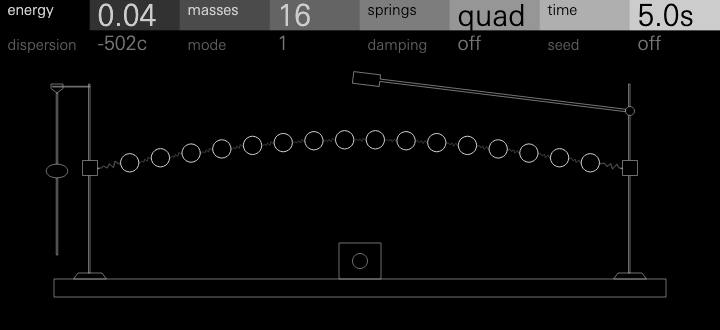
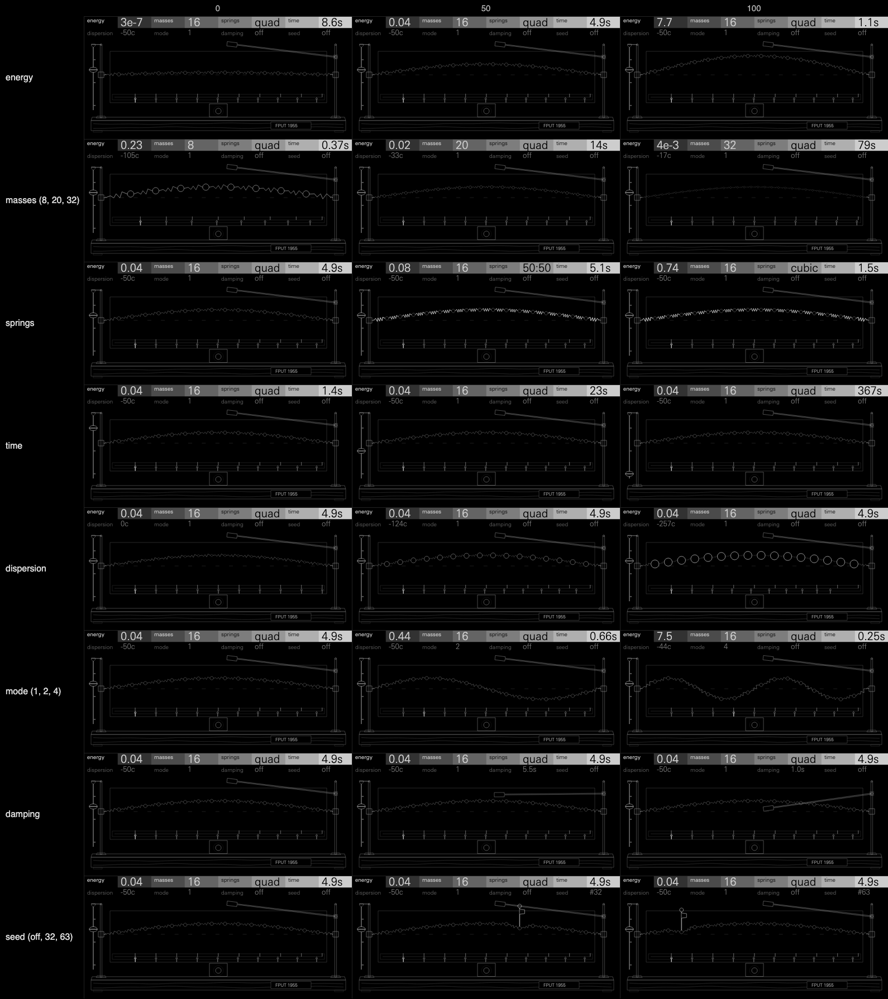

# Fermi

Each note is a Fermi–Pasta–Ulam–Tsingou chain: N masses joined by slightly
nonlinear springs. The note puts all the energy in one mode of the chain, and
the sound is the chain's modes, voiced. Mode k is a partial, and its loudness
is the share of the energy that mode holds now.

Between 1953 and 1955 Enrico Fermi, John Pasta and Stanislaw Ulam, with Mary
Tsingou programming the computer, ran such a chain on the MANIAC I at Los
Alamos. They put all its energy in the lowest mode and expected the
nonlinearity to share it out evenly among all the modes. Instead it flowed
into a few higher modes and then returned almost wholly to the first, again
and again. Their report, *Studies of Nonlinear Problems* (LA-1940), appeared
in 1955, after Fermi's death. Fermi plays that return, and the chaos past it.

It is a warm, rounded tone that will not sit still, as a real object would
not. At low energy it is still, like a flute stop. In the middle it breathes:
the note brightens as the energy flows up into modes 2 to 5, then mellows as
almost all of it comes back to the struck mode. The cycle can be counted:
about 5 s, two bars at 96 BPM, at the default. Every breath comes back a
little differently, and over many the returns drift and recover (the
super-recurrence). With more energy the breath breaks into a shimmering
spectrum that never settles: the thermalized chain, tilted so it is lush
rather than white. With damping, the high partials die first and a note
settles toward its struck mode, as a string's does.

**Status: experimental.** Fermi passes the SDK's tests but has not yet been
played on an OP-XY. Its CPU figures are estimates, not measurements on the
device.

## Controls

| Page | Encoder 1 | 2 | 3 | 4 |
| --- | --- | --- | --- | --- |
| 1 | **Energy**: the load on the springs. Still, breathing from about 0.4, chaos above about 0.85 | **Masses**: 8, 12, 16, 20, 24, 28 or 32 | **Springs**: from quadratic (the α chain) to cubic (the β chain) | **Time**: the chain's clock, independent of pitch |
| 2 | **Dispersion**: partials from exact harmonics to the chain's own ratios | **Mode**: the mode the note strikes, 1 to 4, always tuned to the key | **Damping**: lossless, or the struck mode's T60, with the high modes faster | **Seed**: a nudge of 3 parts in a million to the starting shape |

Measured on an 8 s A3 note through Fermi's own `render()`
(`tools/sweep.py`), each control at 0, 25, 50, 75 and 100 with the others at
their defaults. Each cell gives the header's caption, then the spectral
centroid's median and its 10th–90th percentile range, which is how far the
timbre moves.

| Control | 0 | 25 | 50 | 75 | 100 |
| --- | --- | --- | --- | --- | --- |
| Energy | `3e-7` 246 Hz (246–246) | `2e-4` 246 Hz (241–253) | `0.04` 335 Hz (253–416) | `0.57` 558 Hz (272–678) | `7.7` 722 Hz (411–900) |
| Masses | `8` 309 Hz (263–373) | `12` 313 Hz (250–394) | `20` 368 Hz (251–410) | `28` 248 Hz (237–283) | `32` 246 Hz (237–257) |
| Springs | `quad` 335 Hz (253–416) | `75:25` 284 Hz (254–387) | `50:50` 298 Hz (253–442) | `25:75` 282 Hz (241–409) | `cubic` 314 Hz (250–495) |
| Time | `1.4s` 319 Hz (256–416) | `5.7s` 318 Hz (251–404) | `23s` 283 Hz (242–363) | `92s` 246 Hz (238–261) | `367s` 246 Hz (244–249) |
| Dispersion | `0c` 400 Hz (270–449) | `-61c` 340 Hz (250–406) | `-124c` 344 Hz (249–409) | `-189c` 357 Hz (245–408) | `-257c` 343 Hz (249–411) |
| Mode | `1` 335 Hz (253–416) | `1` 335 Hz (253–416) | `2` 307 Hz (266–354) | `3` 303 Hz (273–316) | `4` 268 Hz (258–280) |
| Damping | `off` 335 Hz (253–416) | `13s` 279 Hz (256–325), −7 dB by 2 s | `5.5s` 249 Hz (239–273), −17 dB by 2 s | `2.3s` 250 Hz (242–253), −41 dB by 2 s | `1.0s` silent by 2 s |
| Seed | `off` | `#15` | `#31` | `#47` | `#63` (same sound: the chain at default energy recurs) |

The captions use real units:
- **Energy** is the chain's energy in the 1955 runs' units: a chain with
  α = 1/4, or β = 1 when mostly cubic. The report's run was 0.07.
- **Masses** and **mode** are numbers.
- **Springs** shows the quadratic and cubic shares.
- **Time** is the breathing period in seconds. Larger chains breathe more
  slowly: 1.4 s at 16 masses at the fastest, 23 s at 32.
- **Dispersion** is how far the top voiced partial sits from harmonic, in
  cents.
- **Damping** is the struck mode's T60, and the measured fades match it. A
  chaotic note fades faster than its caption, because the chain keeps feeding
  the high modes that damping drains fastest.
- **Seed** only matters once the chain is chaotic. At energy 1, seeds 1 and 2
  part ways (a mode's share differs by up to 0.48). At energy 0.5 they stay
  within 0.0003.

Energy, springs, time, dispersion and damping act live on a sounding chain.
Masses and mode restring it, as a new chain would. The seed applies from the
next note.

## Presets

| Preset | Role | Sound | Phrase peak |
| --- | --- | --- | --- |
| Breath | pad (the defaults) | 16 masses breathing every 5 s: a soft tone that brightens and returns | 0.50 (four-note chords) |
| Organ | organ | 24 masses at low energy on exact harmonics: still and round, like a flute stop, with a slow shimmer | 0.47 (four-note chords) |
| Tsingou | long pad | The 1955 chain: 32 masses, a breath of 23 s, super-recurrences under long chords | 0.48 (five-note chords) |
| Clarinet | lead | The cubic chain: odd partials only, a hollow reed tone that breathes slowly | 0.12 (single notes) |
| Bell | bell | 8 masses struck in mode 2 with the chain's full stretch: inharmonic, a sub-partial beneath, damped | 0.15 (single notes) |
| Pluck | bass | 12 masses at the fastest clock: each note flares bright as energy flows up, then damping settles it round | 0.12 (single notes) |
| Thermal | texture | 24 masses past the crossing: a slow-churning, shimmering cloud | 0.39 (a four-note cluster) |
| Flutter | keys | 8 masses at the fastest clock: the breath becomes a quick bright flutter, lightly damped | 0.37 (four-note chords) |

Presets ship with full sustain and release 20000 (`machine.json`), so a
breath plays out after key-up. Each preset plays a phrase in its role
(`tools/phrases.py`), measured (`tools/measure.py`) beside Hexagon's engines
in the same roles, on the same phrases, through each engine's own `render()`:

| Sound | Role | RMS dBFS | Peak | Crest dB | Tonal dB | Centroid Hz (10–90%) | Roughness | Pitch c (median / worst) |
| --- | --- | --- | --- | --- | --- | --- | --- | --- |
| Fermi Breath | pad | −19.2 | 0.50 | 13.2 | 34.3 | 432 (303–514) | 0.09 | 0.3 / 2.1 |
| Orbit Dusk Pad | pad | −18.0 | 0.54 | 12.6 | >60 | 312 (257–366) | 0.10 | 0.9 / 27.6 |
| Hollow Choir | pad | −20.5 | 0.51 | 14.7 | >60 | 773 (722–850) | 0.17 | 2.4 / 5.8 |
| Fermi Organ | organ | −18.8 | 0.47 | 12.2 | 29.6 | 327 (314–366) | 0.04 | 0.1 / 0.6 |
| Orbit Drawbars | organ | −17.6 | 0.54 | 12.2 | >60 | 638 (574–770) | 0.05 | 0.3 / 11.7 |
| Fermi Tsingou | long pad | −18.6 | 0.48 | 12.2 | 29.4 | 383 (318–480) | 0.07 | 0.1 / 1.3 |
| Fermi Clarinet | lead | −25.6 | 0.12 | 7.3 | 17.8 | 515 (384–654) | 0.00 | 0.1 / 0.1 |
| Wane Clean | lead | −25.7 | 0.17 | 10.4 | >60 | 918 (769–1128) | 0.02 | 0.1 / 17.0 |
| Fermi Bell | bell | −28.6 | 0.15 | 12.1 | 28.5 | 1492 (1219–2431) | 0.02 | 0.0 / 0.1 |
| Moth Bell | bell | −25.5 | 0.17 | 10.4 | 29.0 | 1725 (1324–2320) | 0.01 | 0.4 / 1.9 |
| Bloom Glass Bells | bell | −30.3 | 0.17 | 15.0 | 26.8 | 3374 (2265–4956) | 0.02 | 0.0 / 0.1 |
| Fermi Pluck | bass | −28.1 | 0.12 | 9.7 | 15.7 | 95 (67–141) | 0.07 | 0.4 / 1.6 |
| Bend Wah Bass | bass | −30.0 | 0.13 | 12.2 | 13.3 | 214 (189–268) | 0.16 | 3.3 / 8.3 |
| Moth Marimba | bass | −32.9 | 0.14 | 15.9 | 10.9 | 93 (73–125) | 0.01 | (its pitch is not the key's) |
| Fermi Thermal | texture | −21.9 | 0.39 | 13.7 | 24.5 | 909 (644–1089) | 0.11 | 0.1 / 0.2 |
| Bloom Fog | texture | −21.3 | 0.42 | 13.7 | >60 | 569 (436–773) | 0.32 | 3.5 / 7.6 |
| Hollow Whisper | texture | −21.8 | 0.44 | 14.8 | 1.6 | 2914 (2477–3414) | 0.48 | (breath noise) |
| Fermi Flutter | keys | −23.4 | 0.37 | 14.7 | >60 | 476 (447–541) | 0.08 | 0.2 / 0.4 |

- **Level and peaks** match Hexagon's in every role. Chords peak at 0.39 to
  0.50.
- **Pitch:** every Fermi note sits within 2.1 cents of its key.
- **Roughness** is low throughout. Thermal's (0.11) is a third of Bloom
  Fog's.
- **Tonality:** the breathing's slow motion counts against this figure, so
  pads read 29–34 dB against 60+ for Hexagon's static waves. Short notes in
  its 0.37 s window read low too: Clarinet 18 dB, though a held note reads
  60+.
- **Clicks:** none in any Fermi render.

## Screen

One object, engraved in greys and fine line (`tools/make_panel.py`): **the
chain as a laboratory apparatus.**

- **The apparatus:**
  - Brass bobs strung on coil springs between the hooks of two retort
    stands, on a wooden plank.
  - A **stroboscope** on the base, clocked by a **regulator pendulum** hung
    from the left stand, lights the bobs once a period of the struck
    mode, at the peak of that mode's own swing. It locks to the mode itself,
    since loading the springs shifts its period. So the struck mode stands
    still and only the energy's flow moves the shape. While the chain
    breathes, the arch ripples into higher modes and comes back clean at each
    return. In chaos it shivers.
  - A faint ghost around the chain holds the swing's recent extremes, like a
    long exposure.
  - An **index board** behind the chain carries a harmonic index: a
    graduation at each harmonic, and a needle per partial that brightens while
    its mode holds energy.
  - A brass plate on the plank, solid so the grain stops at its edge, reads
    *FPUT 1955*.
- **Every control moves a part of it.** `docs/controls.png` shows each
  control at 0, 50 and 100 with the others at their defaults:
  - **Energy** draws the chain back before the note, from a 4 px arch to a
    34 px one.
  - **Masses** sets the number of bobs (8 to 32), which shrink as they crowd.
  - **Springs** swaps the coils. Quadratic coils are open, conical and
    dim (they stiffen one way). Cubic coils are straight, tall and white
    (alike both ways).
  - **Time** slides the regulator's bob down its rod, from fast near the
    knife edge to slow at the rod's foot: the longer the pendulum, the slower
    the clock. While a note runs, the pendulum swings once a breath, out at
    each flash of the lamp.
  - **Dispersion** sizes the bobs. At 0 they are beads on what is nearly a
    continuous spring, and a continuous string is harmonic. At 100 they are
    lumped into heavy bobs: a lattice, which disperses. The needles on the
    index fall short of their graduations as well.
  - **Mode** sets the arch's humps.
  - **Damping** lowers a long felt-tipped lever from the right stand down
    onto the chain.
  - **Seed** presses a flagged pin down on the bob it nudges hardest, denting
    the arch by 6 px. The pin lifts off when a note lets the chain go. With
    the seed off, there is no pin.

The sheet is at 1:1, each cell 480 x 220 like the screen, lettered in the
device's face. The artwork is drawn for that size: no part under about 3 px,
no lines closer than 3 px, no lettering under 8 px.

The screen cannot hear the voices. It runs its own copy of the latest note's
chain with the same code (`chain.h`), a block of time at a time. With the
controls still it is the same chain, step for step, even in chaos:
`tests/screen.cpp` checks that the screen's chain and a voice's are
bit-identical after 9,600 blocks at energy 0.9.

The strobe runs while a key is held and for 2 s after the last release. Then
the chain eases back to its drawn rest. Motion eases out in 0.15 s, and
reduced motion snaps. A bob moves with both its coils, three nodes at a time,
so the chain never tears, however the budget falls. The idle screen is still.

**Churn** (host, the GIF's 31 s scene): a mean of 8.3 nodes a frame at
60 fps and 10.2 at 30 fps, peaking at 21 at a note-on or a change of masses.
The swinging pendulum is 2 of those a frame. Idle: 0. The artwork has 42
static paths and 147 nodes, and is 49 KB (the preview's limit is 64 KiB).

## How it works

`chain.h` holds the physics, shared by the engine and the screen, in 32-bit
integers only.

- **The chain.**
  - N masses with fixed ends and springs f(d) = d + d²(α + βd), in
    strain-normalized units: a note loads mode m with a bond strain of
    amplitude 1. Here energy and nonlinearity are the same thing, so the
    energy knob sets the springs' coefficients.
  - Springs splits a strength g: α = (1 − s)g and β = 1.6α² + s·g. The 1.6α²
    floor keeps the quadratic chain's well bounded, and stays far from the
    integrable Toda chain.
- **The integrator** is symplectic Euler (kick, then drift), a leapfrog on a
  staggered clock.
  - dt is 1/2, or 1/4 or 1/8 when the springs stiffen.
  - In integers each half-step is a shear, so the tests run 200,000 steps
    forward and back to the starting state bit for bit.
  - Every shift rounds to nearest, written ((a >> (k − 1)) + 1) >> 1 so it
    needs no constant.
  - The force and the kick/drift are separate passes, which keeps each loop's
    constants in the Blackfin's registers.
  - A guard every fourth block restrikes a chain that ever left the force's
    range. No test reaches it.
- **The clock.** Each block runs a whole number of steps, at most 96/N: 12
  for 8 masses, 3 for 32. Time slows it by up to 2^8.
- **Calibration.** `tools/calibrate.py` simulates every masses, mode and
  springs setting in double precision. For each it finds where mode m stays
  pure, where it gives up 70% and comes back, and where the spectrum
  thermalizes. The energy knob runs through those three on log scales. The
  same runs measure the breathing period for the time caption and the
  strobe's flashes.
- **Voicing.**
  - A third of the modes are projected each block, in turn. Each one's energy
    is the leapfrog's own invariant, exact for the linear chain.
  - Each partial's level is the square root of its mode's share (a table
    square root), eased an eighth of the way each time.
  - The lowest min(N, 10) modes are voiced. Partial k sits at the key times
    ω_k/ω_m, blended toward k/m by dispersion. Increments are recomputed only
    when the pitch, the dispersion or the chain changes.
  - Above the struck mode, levels are tilted by √(m/k). A gain taken once a
    block restores the chain's own total, so the tilt changes colour, not
    loudness.
- **Synthesis.**
  - Ten table oscillators run two to a pass, with levels stepped every 16
    samples. A note's first block ramps every sample, so the attack never
    clicks.
  - Each oscillator reads the body wave (sine, plus 0.32 of the second
    harmonic and 0.12 of the third) while its third harmonic fits under 0.45
    of the sample rate, else a plain sine. It changes wave only once it has
    faded to silence. The body's amount is fixed.
- **Damping.**
  - It runs in audio time, four blocks' worth at a time (the displacements one
    block, the velocities two blocks later), so it holds at any clock.
  - Every mode loses a share, and the Laplacian of the chain takes more as ω²
    rises. The struck mode gets exactly the caption's T60, and the top voiced
    mode loses four times as fast.

### Springs and mode

The quadratic chain struck in mode m feeds 2m, 3m and on: all the harmonics.
The cubic chain is symmetric and feeds only the odd multiples, which gives a
hollow, clarinet-like tone. Mode m tunes the struck mode to the key. Modes
below it are sub-partials, which a recurrent chain never feeds; in chaos they
wake, and the note grows tones beneath itself.

### The release, and the OP-XY's amp envelope

A synth voice on this SDK hears its note start, but never its release or its
velocity: stock applies both after `render`.
- **Every note starts the gesture.** The chain is loaded at the note-on.
- **The amp envelope ends it**, with full sustain and release 20000 in the
  presets. Damping is the engine's own decay, for bells and plucks.
- **Velocity** reaches only stock's amp.
- **Tempo:** synth voices get no transport, so the breath cannot lock to the
  beat. Its period shows in seconds, so it can be set by ear.

## Level

- A single A3 is −25.0 dBFS RMS at energy 0 to 0.8, and −25.7 at energy 1,
  where some of the energy flows above the voiced modes. Hexagon's Wane and
  Orbit measure −24.6 and −23.7 on the same note.
- An eight-note chord peaks at 0.70.
- Output stays within half scale at all 256 control corners from A0 to C8.

## CPU

These are estimates: Fermi has not been measured on an OP-XY. They are
counted from the compiled Blackfin code (`sdk.py compile`), since the SDK's
host estimate varies widely from run to run (3,500 to 17,500 instructions).
At the heaviest setting (32 masses, energy 1, the fastest clock, damping on)
a voice block runs about:

- 4,600 instructions in the chain: 3 steps × (33 bonds × 28 + 32 masses ×
  18);
- 5,900 in synthesis: 5 pairs × 64 samples × 16, plus overhead;
- 1,300 in projections: 4 modes × 16 × 13, plus overhead;
- 700 in levels and targets;
- 450 in output clamping;
- up to 480 in damping;
- and up to 1,200 of straight-line code, counted as if it all ran.

That is about 14,300, and 14,900 at most. A note's first block costs about
2,000 more for its per-sample ramps. Ten voiced partials are what fit this
budget.

- `sdk.py test --firmware` compiles for the Blackfin: Fermi is 91.3 KiB of
  the 2040 KiB module region.
- There is no division per sample, and one per block (the tilt's gain).
- **Memory:** a voice is 552 bytes and the screen state 1,044.

## Tests

`sdk.py test` passes, with two host tests.

`tests/sound.cpp` checks:
- **Reversibility:** 200,000 steps at energy 0.9 return to the start bit for
  bit.
- **Energy:** over 2,000,000 lossless steps, the integer chain's energy stays
  within 0.34%, 1.11% and 2.92% (three settings). The same integrator in
  double precision swings 0.63%, 1.74% and 4.23%: the swings are the
  leapfrog's own, and fixed point adds none.
- **Recurrence:** at energy 0.5, mode 1 falls to 0.24 and returns to 0.988 at
  the stated period for 16 masses (4.9 s at the default time). It returns to
  0.991 for 8 masses, 0.986 for 24 and 0.982 for 32.
- **Equipartition:** at energy 1, time-averaged mode shares come within 0.85
  to 1.36 of equal.
- **Still at energy 0:** mode 2 stays 46 dB down, and the tone's harmonics
  hold within 0.09 dB.
- **Damping:** it darkens a chaotic note. The mean mode number falls from 3.7
  to 2.6, while the lossless chain rises to 5.3.
- **Seed:** it changes chaotic runs and not recurrent ones (figures above).
- **Dispersion:** partials sit within 0.1 cent of ω_k/ω_1, or of k at
  dispersion 0.
- **Level:** as above.

`tests/screen.cpp` checks:
- every frame is valid through all masses, mode and energy settings, the
  control corners and a 2-minute note;
- the idle screen is still;
- churn;
- the screen's chain matches the voice's.

`tests/screen.cpp` also writes the GIF's frames, the contact sheet and the
captions.

## Prior art

FPUT is studied in physics, and no synthesizer or sonification found voices
its mode energies or its recurrence. The nearest work in sound is nonlinear
mass-spring strings played directly as audio: Willemsen's mass-spring strings
(DAFx 2023), Bilbao and colleagues' modular networks (DAFx 2019), and
CORDIS-ANIMA. Those play the chain's motion. Fermi runs the chain on its own
clock and voices the energy flow between its modes.

## Files

| File | |
| --- | --- |
| `chain.h` | The chain, integrator, damping, projections and the controls' mappings, shared by engine and screen |
| `core.h`, `engine.cpp` | Voice state and the render: tilt, body, partials |
| `tables.h` | Mode shapes, dispersion, calibration, tilt, roots, the body and sine waves (`tools/make_tables.py`) |
| `display.h`, `display.cpp`, `panel.svg.fragment` | The apparatus (`tools/make_panel.py`) |
| `tools/calibrate.py`, `tools/calibration.json` | The energy knob's and the clock's calibration |
| `tests/sound.cpp`, `tests/screen.cpp` | Host checks |
| `tools/render.cc`, `tools/phrases.py`, `tools/sweep.py`, `tools/measure.py` | Phrase renders, Hexagon comparisons, the control sweep and the measurements |
| `tools/make_gif.py` | `docs/fermi.gif`, `docs/controls.png`, and stills such as `docs/breathing.png`, `docs/into-chaos.png` and `docs/cubic.png` |

Each tool's usage is at the head of its file. `tools/phrases.py` and
`tools/sweep.py` take an Open-XY SDK checkout (`--sdk`) and an output folder
(`--out`); `tools/phrases.py` also takes a checkout of the Hexagon Suite
(`--pads`) for its engines. `tools/make_gif.py` needs the device's face,
UniversNextPro-Light, which is not in the repository: pass its `.ttf` with
`--font` or set `XY_FONT` to its path.
