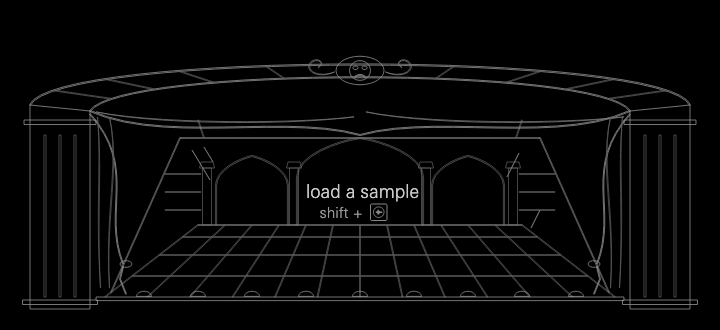
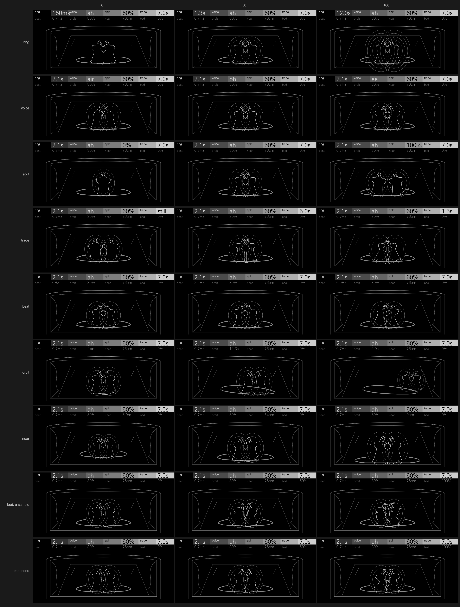

# Ghost

An apparition between the ears. Each note is sung by a pair of tuned
resonators, one for each ear. The note's harmonics are divided between the
ears, it beats slowly against itself across them, and it stands, circles and
whispers somewhere round your head.

Either ear alone hears a thin, strange tone. Together they hear the whole
note: a haunted pad, a choir from nowhere, a drone that breathes, a melody
whose fundamental is only in your head. Breath, a hummed vowel or your own
recording sets it ringing. On speakers and in mono it folds down to a plain,
full note: nothing cancels and nothing turns into a notch. Headphones show it
best.

Ghost starts from two phantoms. One is the binaural pitch that no single ear
hears: in the Huggins pitch (Cramer and Huggins, 1958) both ears get the same
noise except for a narrow band whose phase is shifted in one, and a faint
tone is heard at that band, though neither ear alone carries it. Ghost
divides a note between the ears in the same spirit, so the whole note exists
only where the ears fuse it, and its beat is a binaural beat. The other is
the stage's Pepper's ghost, devised by Henry Dircks and staged by John Henry
Pepper in London in 1862: a pane of glass leaning over the stage reflects an
actor hidden from the audience, so a transparent figure seems to stand among
the cast. Ghost's screen is that stage.

Ghost is an OP-XY sample engine with stereo output, id `ghost`. It needs the
SDK's sample-overview change, which gives sample engines their own screen and
is still in review as
[etcetc000/open-xy pull request 182](https://github.com/etcetc000/open-xy/pull/182).
It plays without a sample, on breath and hum alone; a loaded sample feeds its
bed, and without one the bed is a whisper of Ghost's own.

**Status: experimental.** Ghost passes the SDK's tests but has not yet been
played on an OP-XY, and its CPU figures (below) are estimates, not
measurements on the device.

## Controls

Press any encoder to switch pages. Shift + turn makes fine steps.

| Encoder | Page 1 | Page 2 |
| --- | --- | --- |
| 1 | ring | beat |
| 2 | voice | orbit |
| 3 | split | near |
| 4 | trade | bed |

| Control | Range | Default | Caption | What it does |
| --- | --- | --- | --- | --- |
| ring | 0.15 s to 12 s, exponential | 2.1 s | ring time, `150ms` to `12.0s` | How long the resonance rings: from a breathy whisper to glass. Long rings also swell in. |
| voice | breath, oo, oh, ah, eh, ee | ah | the vowel, `air` (breath) to `ee` | What excites the resonators: breath alone at 0, then a hummed voice through two formants for each vowel, the loop brightening toward ee. |
| split | 0 to 100% | 60% | `60%` | How far the harmonics divide between the ears, even to one and odd to the other. Past 75% the fundamental goes too, so the pitch is only in your head. |
| trade | still, then a swap and back from every 24 s down to every 1.5 s (12 s at 25, 5 s at 50) | 7 s | `still`, `7.0s`, `1.5s` | How fast the halves swap ears, so the note drifts inside the skull, from a slow tide to a flicker. |
| beat | 0 to 6 Hz, curved (0.9 Hz at 25, 2.2 Hz at 50) | 0.7 Hz | `0.7Hz` | The right ear sharp by this much: a binaural beat on the fundamental, and on each harmonic its multiple. |
| orbit | front; spread to 100%; then a circle from every minute down to every 2 s (14 s at 50) | 80% spread | `front`, `80%`, `2.0s` | Its first quarter spreads the notes from the front round your head. The rest circles them, close by the right ear and far on the left. |
| near | 3 m to 10 cm, exponential | 76 cm | `3.0m`, `76cm`, `9cm` | Distance: far is quieter and much darker (4 octaves darker at 3 m); near is brighter, louder, and much louder in the facing ear, as a whisper at the ear is. |
| bed | 0 to 100%, equal power | 0% | `40%` | The loaded sample against breath and hum. It is mostly whitened, so it keeps its grain and envelope but rings the note, not its own pitch. With no sample, Ghost's own whisper: white breath in gusts, a syllable every 60 to 250 ms, and the note comes and goes with them. |

Each control measured on a held A3, the others at the defaults (Seance)
(`tools/controls.cpp`):

| Control | 0 | 25 | 50 | 75 | 100 |
| --- | --- | --- | --- | --- | --- |
| ring: harmonic to noise | 12 dB | 15 dB | 19 dB | 20 dB | 22 dB |
| ring: rise to within 3 dB of its level | 0 s | 0 s | 0.10 s | 0.40 s | 0.75 s |
| voice: spectral centroid | 1128 Hz | 405 Hz | 595 Hz | 626 Hz | 396 Hz |
| voice: harmonic to noise | 14 dB | 21 dB | 20 dB | 21 dB | 24 dB |
| split: each of the first 8 harmonics louder in its own ear, at least (trade still) | −2.8 dB | +2.8 dB | +7.9 dB | +15.4 dB | +28.5 dB |
| split: the fundamental against the third harmonic, in the odd ear | −11 dB | −9 dB | −7 dB | −6 dB | −20 dB |
| trade: a full swap and back (beat still) | still | 12.2 s | 5.1 s | 2.5 s | 1.5 s (set) |
| beat: the right ear above the left | 0 Hz | 0.94 Hz | 2.26 Hz | 3.94 Hz | 5.99 Hz |
| orbit: where a note begun 67° right starts, as the left ear's delay | 0 (front) | +14 samples | +14 | (circling) | (circling) |
| orbit: a circle (set) | none | none | 14 s | 4.3 s | 2.0 s |
| orbit: how far the left ear's delay travels over 4 s | 0 | 1 sample | 25 samples | 30 | 30 |
| near: level (a note at the right; split and trade still) | −31.3 dBFS | −26.5 | −24.7 | −24.1 | −22.9 |
| near: right over left | +9.4 dB | +7.4 | +6.0 | +8.7 | +13.7 |
| near: spectral centroid | 596 Hz | 695 Hz | 715 Hz | 720 Hz | 736 Hz |
| bed, no sample: harmonic to noise | 21 dB | 14 dB | 12 dB | 12 dB | 12 dB |
| bed, no sample: how far the level swells and sinks (25 ms, 10th to 90th percentile) | 4.2 dB | 4.6 dB | 5.7 dB | 7.8 dB | 8.7 dB |
| bed, no sample: spectral centroid | 716 Hz | 858 Hz | 898 Hz | 965 Hz | 933 Hz |
| bed, a recorded voice loaded: harmonic to noise | 21 dB | 17 dB | 14 dB | 10 dB | 11 dB |
| bed, a recorded voice loaded: spectral centroid | 726 Hz | 738 Hz | 849 Hz | 909 Hz | 919 Hz |

`tools/controls.cpp --fifths` measures each at 21 points and finds its
flattest fifth of travel. Each control moves through at least one of its
measures over every fifth of its range, except where a measure saturates
by design: orbit's travel is a full swing once it circles faster than every
4 s, and its rate is the change there.

The OP-XY's envelopes, LFOs, filter and effects still apply. The factory
envelope (`machine.json`) has a gentle attack and a long release, for pads.

## Presets

"Chord" is the peak of an eight-note chord (C3 E3 G3 B3 D4 F#4 A4 C5) struck
together, where 1.0 is full scale.

| Preset | Role | Sound | Chord |
| --- | --- | --- | --- |
| Seance | The init sound: a haunted pad | A sung "ah", 2 s ring, harmonics split 60% and trading every 7 s, a 0.7 Hz beat, the notes spread round you | 0.75 |
| Whisper | Whispers at your ears | Breath alone, a short ring (a pitched whisper), each note in its own place, 12 cm away | 0.86 |
| Choir | A choir from nowhere | A sung "oh", long ring, split 80%, the voices circling slowly, at a distance | 0.56 |
| Revenant | A drone | "oo", 10 s ring, a 2.2 Hz beat breathing between the ears, held in front | 0.60 |
| Wraith | A presence that circles | Breath turning to "oo", circling every 3.1 s and passing close | 0.83 |
| Skull | The note that isn't there | "eh", the fundamental gone, the halves trading every 8.4 s: a melody heard only between the ears | 0.69 |
| Glass | Ringing, bell-like | "ee", 8 s ring, a slight beat: a glass harmonica | 0.61 |
| Haunting | A recording, as an apparition | The bed at full, rung at the note, split 70%, spread and drifting; with no sample, a whispering ghost | 0.61 |

Every preset, measured on a held A3 (`tools/measure.cpp`):

| Preset | Level (dBFS RMS) | Crest | Harmonic to noise | Centroid | Mono fold-down | Its worst third-octave | Coherence between the ears, now |
| --- | --- | --- | --- | --- | --- | --- | --- |
| Seance | −26.7 | 14.0 dB | 21 dB | 688 Hz | −3.2 dB | −3.5 dB | 0.07 |
| Whisper | −25.4 | 15.4 dB | 8 dB | 1680 Hz | −3.0 dB | −5.0 dB | 0.66 |
| Choir | −25.8 | 10.7 dB | 23 dB | 469 Hz | −2.9 dB | −4.2 dB | 0.40 |
| Revenant | −24.3 | 7.2 dB | 26 dB | 258 Hz | −3.0 dB | −3.0 dB | 0.10 |
| Wraith | −25.8 | 14.2 dB | 13 dB | 842 Hz | −2.4 dB | −3.9 dB | 0.29 |
| Skull | −24.7 | 8.9 dB | 21 dB | 589 Hz | −2.0 dB | −3.0 dB | 0.22 |
| Glass | −25.4 | 9.3 dB | 29 dB | 284 Hz | −2.8 dB | −3.6 dB | 0.74 |
| Haunting | −27.0 | 13.3 dB | 11 dB | 689 Hz | −2.0 dB | −4.4 dB | 0.40 |

- **The mono fold-down** loses about 3 dB, which is what two decorrelated ears
  lose when summed, not a cancellation. Its worst third of an octave is at
  most 7 dB down.
- **"Now"** is coherence between the ears over 0.37 s windows at 220–880 Hz.
  It is low because each harmonic sits in one ear, or turns between them:
  that is the effect.

`tools/render.cpp` plays a short phrase on each preset and writes it as a
stereo WAV.

## How it works

Each note borrows a pair of resonators from a pool of 16 that every Ghost
voice on every track shares. Sample engines get no call when a voice ends,
so slots are freed by census: a slot not rendered for two cycles is free.
A resonator is a delay line one period long, fed back through a gentle
low-pass: a string that rings for ring's time.

**What excites it.** Breath, a sawtooth hum through two formant filters,
and the bed run at half rate, since they lie well under 11 kHz; the
resonators interpolate them up. Each ear has its own hum, because a
resonator driven by a periodic pulse rings at the pulse's pitch, and the
right ear's has to beat. The bed has its sign flipped at random for 70% of
its samples, which whitens it while keeping its envelope, so a recording
rings the note instead of replaying its own partials. With no sample, the
bed is white breath in gusts, each gust a random strength (a quarter of them
silent) eased in over about 12 ms, and up to 70% of the note's level rides
the same gusts.

**split.** Each ear's output is its resonator plus or minus itself half a
period back, which keeps the even harmonics or the odd. Mono is always the
whole note, so nothing cancels. Past 75%, the odd ear's excitation is
notched at the note (the even ear's half-period tap leaves no fundamental).
The notch is wide, so the resonator's peak, a few cents off, still falls in
it.

**trade, beat and orbit.**
- trade swings the split through zero to its opposite.
- beat sharpens the right resonator and its hum.
- orbit's head model gives the far ear up to 0.27 ms of delay and a head
  shadow (14 kHz down by 2.5 to 4 octaves). Level differs between the ears
  by up to 12 dB, with their power kept constant. Behind is 1.6 octaves
  darker. Distance darkens both ears by up to 4 octaves at 3 m (as the cube
  of how far, so little nearer than a metre) and lowers the level by 4 dB.

**DC.** A loop resonates at DC as well as at the note, so each loop takes
its own 0.2 Hz average off its feedback, too slow to touch the note.

All of this is fixed point, with no division in the sample loop. Each note
caches its period and loop response.

## Level

A follower holds every setting, pitch and bed near Hexagon's level, about
−24 dBFS RMS a voice. It falls fast, rises slowly and moves at most 18 dB.
The excitation is scaled by the loop's true gain at the note, so the lines
never clip. Every preset's held A3 is within 3 dB of Hexagon's level (the
table above); trade moves it a little, since each ear's head shadow takes
more from the half with the higher harmonics. Breath sits 2.6 dB lower than song because it peaks higher and
sounds louder at the same power. An eight-note chord peaks at 0.56 to 0.86
of full scale.

## Screen

Pepper's ghost: a theatre stage in front elevation, drawn in as few lines
as it takes. A proscenium arch, outlined twice; a curtain tied back each
side; the apron's edge; and the great pane of glass leaning over the stage,
with two glints on it. The apparition leads: it is drawn brightest and
boldest, the frame and apron a step down, the curtains and glass a step
below that, and the halos and chalk path in between. Three greys and three
weights, nothing finer than about 4 px apart, and no text but the header's.
The contact sheets are at 1:1 (`docs/controls-1x.png`) and twice that
(`docs/controls.png`).

The note's apparition stands in the glass where the sound is in your head:
across the stage for left and right, upstage and dimmer behind you,
downstage and larger when near. It is faint at rest, as a preview of where
the next note will sound. It brightens on a note in 0.15 s and fades on
release over ring's time (at most 2.5 s).

Every control acts on the apparition or the stage:

| Control | On the screen |
| --- | --- |
| ring | Halos round the apparition, and round its twin: none at 0, four at 100. While notes are held they breathe at the beat's rate. |
| voice | Its pose, from a bowed, hooded figure (breath) to one singing with arms raised (ee), and its mouth, shaped to the vowel. |
| split | The glass's two faces give two apparitions, each with its own mouth and halos: one at 0, overlapping at 50, standing apart at 100 (72 px between them at full size). |
| trade | The twins lean toward each other, up to 20°. While held they swing through each other at trade's pace. |
| beat | The apparition's outline trembles, up to 6 px, the tremble running at the beat's rate while held. |
| orbit | The chalk path on the floor where it can walk: a mark at the front at 0, an arc as the notes spread, the whole circle once they circle. The apparition walks it while held. |
| near | Its size and depth, from small at the back to large at the apron's edge. The chalk path follows it. |
| bed | Its robe frays, up to 8 px: into the sample's own waveform (the 64 peaks of its overview), or with no sample into the whisper's ragged gusts. The fray scrolls while held. |

A second and third held note bring two more apparitions, each where its
own note began.

Ghost has no empty state: it plays without a sample, and bed then whispers,
so the stage is always the same and every control acts on it.

The display cannot read the audio, so it draws everything from the
controls, note activity and time, through the same `place()` (`ghost.h`) the
engine uses. Each apparition's place is seeded from the note's serial, so it
matches the sound in kind, not note for note.

The screen uses 4 reshaping outlines of 64 points (the apparition, its twin,
its mouth and the chalk path), 23 nodes (8 of them the header bar), all 16
text slots, 8 static outlines and 84 bytes of state. Churn over a scripted
run (`tools/frames.cpp`: every control, a page switch, three notes circling,
the bed, reduced motion) is below. The idle screen is still: nothing changes
a second after the last fade. Reduced motion snaps the apparition and stills
its tremble, hem and circling.

| | Mean nodes changed a frame | While notes are held | Peak |
| --- | --- | --- | --- |
| 60 fps | 3.9 | 7.5 | 16 (a page switch) |
| 30 fps | 4.2 | 7.5 | 16 |

Sample engines have no browser preview, so the screen's frames, churn, GIF
and contact sheets come from `tools/frames.cpp` on the host.

## CPU

These are estimates: Ghost has not been measured on an OP-XY.

Counted from the inner loops of `sdk.py compile`'s Blackfin disassembly,
per sample:

| Stage | Instructions a sample |
| --- | --- |
| Breath (half rate) | 11.5 |
| Each ear's exciter | 20.5 |
| Each resonator | 41.5 |
| The near ear's head stage | 15 |
| The far ear's head stage | 35 |
| Level follower | 3 |
| Stereo bed (when bed is on, with a sample) | 10.5 |
| The notch (past 75% split) | 16.5 |

With about 1.1k a block of per-block work, a voice comes to:
- **about 13k instructions a block at the default (Seance);**
- **about 14.9k at the heaviest setting** (a stereo bed, split past 75%,
  beat, trade and orbit all moving).

Without a sample, bed's whisper replaces the sample read with one
multiply a half-rate sample, so it is lighter than a loaded bed.

The host estimate (`tools/bench.cpp`, timed against the SDK's reference loop
as the SDK estimates synths) reads 20k and 21.6k, because the portable
`q31::multiply` is one instruction on the Blackfin but a slow path on the
host. With a plain multiply in its place it reads 8.7k and 9.7k.

Memory is 226 KiB, mostly the pool's lines (16 notes × 8 KiB). A note's
first block clears its lines, a one-off of about 4k stores.

## On the OP-XY

Not yet checked on the device:

- **Anything that narrows the stereo image weakens the effect,** though it
  never breaks the sound, since mono is a full note: a track filter or
  envelope that does not act alike on both channels, pan, the mixer, the
  master compressor, a wet send reverb (it fills in between the ears), or a
  headphone output that is not truly stereo.
- **The pool's census** assumes the OP-XY stops rendering a voice once its
  envelope ends. If it renders silent voices, lines stay held.
- **The LFOs** can target every control. Fast modulation of split or orbit
  is untested.

## Files

- `sample.cpp`, `core.h`: the voice.
- `ghost.h`: the controls' laws and the apparition's place, shared by the
  engine and the screen.
- `tables.h`: the sine, exp2, head-shadow and formant tables, written by
  `tools/gen_tables.py`.
- `display.cpp`, `display.h`, `captions.h`, `figure.h`: the screen.
- `panel.svg.fragment`: the screen's artwork, written with `figure.h` (the
  apparition's two poses) by `tools/make_panel.py`. Run the script after
  changing a shape, and commit all three.
- `tests/sound.cpp`, with `tests/analysis.h`: the sound checks, run by
  `sdk.py test`.
- `docs/`: the screen's GIF and contact sheets.

`tests/sound.cpp` checks:

- **Every preset:** a held A3 within −29 to −21 dBFS, never over half scale,
  and an eight-note chord under 0.95.
- **The mono fold-down:** no third of an octave more than 10 dB down, and at
  most 6 dB lost in all.
- **Tuning:** within 3 cents at 110, 220, 440 and 880 Hz.
- **split:** each harmonic at least 10 dB louder in its own ear at 0.74, the
  fold-down keeping every harmonic, and the fundamental at least 15 dB down
  at full.
- **trade:** at full it swaps the halves and back every 1.5 s.
- **beat:** 0.7 detunes the right ear by 3.57 Hz.
- **The head:** a near source on the right is louder there and later on the
  left, the far ear's highs are shadowed, and behind is darker.
- **orbit:** it closes a circle in 2 s.
- **bed, the pool and mono:** the bed plays, and breath plays without one;
  without a sample, bed at full is at least 5 dB noisier and swells and
  sinks at least 3 dB more; a seventeenth note waits for a line; mono
  output works.

The tools are not part of the machine. The compile command for each is at
the top of its file.

- `tools/controls.cpp` and `tools/measure.cpp` print the tables above.
- `tools/render.cpp` writes each preset's phrase as a WAV into a folder you
  give it.
- `tools/bench.cpp` gives the host CPU estimate.
- `tools/frames.cpp` checks the screen frame by frame, counts its churn and
  writes frames as JSON. `tools/frame2svg.py` draws a frame as SVG; it needs
  `XY_FONT` set to the path of the OP-XY's face, UniversNextPro-Light.ttf,
  which is not in this repository. `tools/make_gif.py` makes `docs/ghost.gif`
  and `tools/make_sheet.py` makes `docs/controls.png` and `docs/controls-1x.png`
  from those frames.
