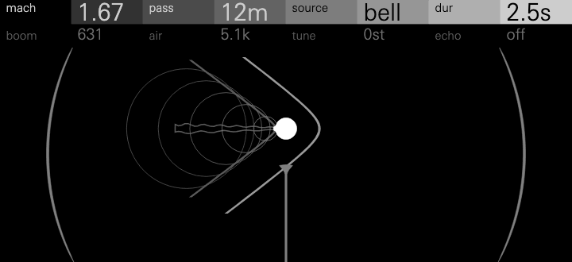
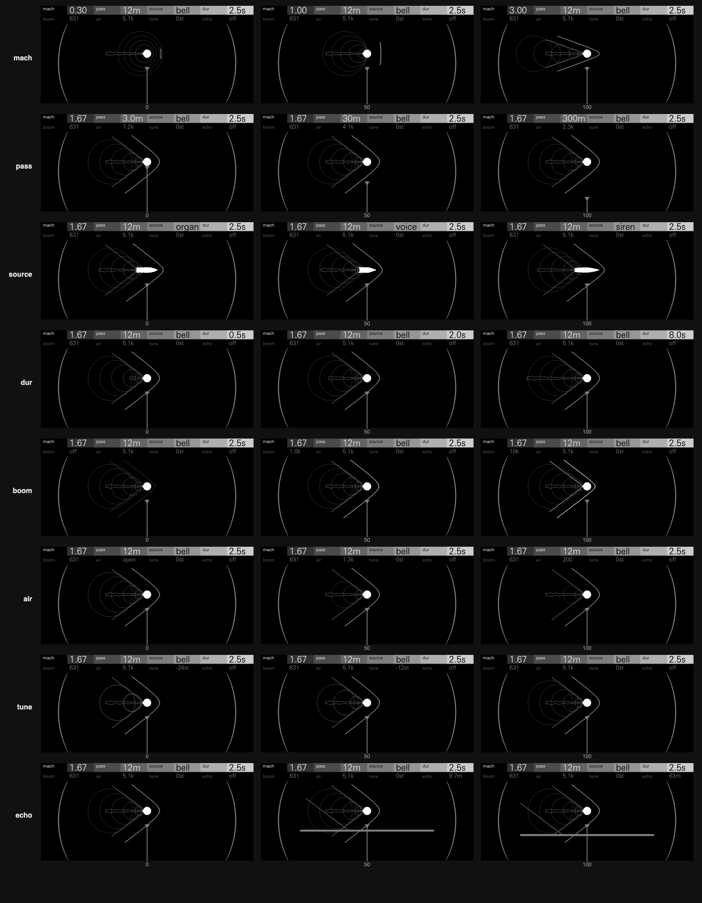

# Mach

A flyby. Every note is an object flying past you in a straight line at a
Mach number you choose, sounding a source pitched by the key. You hear the
source at every retarded time τ that solves t = τ + |r(τ)| / c: as loud as it
was near, as dark as the air it crossed. Below Mach 1 that is a Doppler glide.
Near Mach 1 the approach piles up into a zip. Above it you hear nothing until
the Mach cone reaches you, then a boom, and then the source **forwards and
backwards at once**, the two images parting from the moment the cone left.

A source moving toward a listener is heard higher, and moving away lower: the
Doppler effect, which Christian Doppler described in 1842. A source faster
than sound outruns its own waves, which pile up into a cone trailing behind
it, the Mach cone, its half-angle asin(1/M) at Mach number M. Where the cone
sweeps over a listener it is heard as a sonic boom. In 1887 Ernst Mach and
Peter Salcher photographed the shock waves round a bullet flying faster than
sound. Mach plays the whole flyby: the glide, the cone, the boom and what is
heard inside the cone.

Tune pitches the source. At one end the flight's start sounds the key
exactly, at the other its end, and between them the source moves evenly in
pitch. So a supersonic bell can land its backward ring on the key, a swell
into the note, or settle its departing ring there.

The engine never sees a note-off. Holding a note keeps the OP-XY's amp
envelope open on the whole pass, including what arrives after the object has
gone. Releasing fades it, as sound already in the air cannot be called back.

**Status: experimental.** Mach passes the SDK's tests and runs on an
OP-XY, where its CPU is
measured (below).

## Controls

Press any encoder to switch pages. Page 1 is the flight, page 2 what the air
and the ground do to it.

| Encoder | Page 1 | Page 2 |
| --- | --- | --- |
| 1 | mach | boom |
| 2 | pass | air |
| 3 | source | tune |
| 4 | dur | echo |

| Control | Range | Default | Caption | What it does |
| --- | --- | --- | --- | --- |
| mach | 0.3 to 3, Mach 1 at the middle | 1.67 | `1.67` | The object's speed. Below 1 a glide down through the key, steeper near 1, and (with boom on) the bow wave's pulse as it passes, stronger toward 1. Above 1 the cone: a boom, then two images, the backward one higher. At 5/3 they land two octaves apart, at 2 a twelfth, at 3 an octave. |
| pass | 3 to 300 m, exponentially | 12 m | `12m` | The closest distance. Near, the glide swoops past in a quarter of a second; far, it takes a second and more. Near is up to 6 dB louder at the pass itself, but brief, and brighter: the air's corner falls as the distance's fourth root. |
| source | organ, pad, voice, bell, siren | bell | the name | What flies. **Organ:** drawbars 8′ to 1′. **Pad:** a bowed spectrum on two oscillators 0.3% apart. **Voice:** three formants whose vowel opens from "oo" to "ah" and closes to "oh" over the flight, so the backward image sings it in reverse. **Bell:** a minor-third bell (hum, prime, tierce, nominal), struck as the flight begins and again as it passes. **Siren:** winds up into its note, a semitone below over the first 30% of every 0.9 s. |
| dur | 0.5 to 8 s, exponentially | 2.5 s | `2.5s` | The flight's own time: the window it sounds in, and so how long a note sounds (about twice dur; 11.6 s at 8 s). |
| boom | off, 0 to 100 | 40 | `off`, or the shock's rise: `631` | The N-wave as the cone passes. Low, a soft thump: a 100 Hz rise, three times the shock's length, its level made up. High, the full crack: a 10 kHz rise (100 Hz × 100^boom). Below Mach 1 there is no shock: the boom is the bow wave's pressure pulse as the object passes, heard with the pass, at 0.4 + 0.6 M² of a shock's level. A chord's booms share out, so eight at once sum to 2.7, not 8. |
| air | 0 to 100 | 15 | `open`, or the low-pass's corner at the pass: `5.1k` | Thick air darkens and quietens what is far. Each image has a one-pole low-pass, its corner 200 Hz × 2^(5.5 (1 − air)) at a 12 m pass, falling as the fourth root of the pass's distance and through the flight as 1 / √r, as air's absorption does; and the level falls with distance as (d / r)^(½ + ½ air), from 3 dB a doubling to 6. Live. |
| tune | start to end | end | where the flight's end settles against the key: `-24st` to `0st` | The source's pitch. At the start it is pitched so the flight's start sounds the key exactly (above Mach 1, where the backward image ends); at the end so its end does (within half a cent), each landing at most half a second or four closest distances' flight from the pass. Between them the source moves evenly in pitch, so the key sounds where the glide passes through it. Tune also places the window: at the end a short approach and a long departure settling onto the key; at the start a long approach, so above Mach 1 the backward image's swell lands on it. |
| echo | off, then 1.5 to 63 m | off | `off`, or the ground's depth under you: `9.7m` | A reflecting ground under the listener. Its image of the flight passes at d + 2h with its own roots and its own boom, a flanged, delayed copy (the ground takes the highs: the bell's low ring, one darker table, the voice's first formant). Full strength from a third up. |

Page 1, tune and echo are fixed at note-on, as a flight is. Boom's level and
air act live.

Measured on one held C4, each control at 0, 25, 50, 75 and 100 with the
others at Init's (`tools/control_table.py`, from the audio and the voice's own
roots):

| | 0 | 25 | 50 | 75 | 100 | measured |
| --- | --- | --- | --- | --- | --- | --- |
| **mach** | `0.30` +10 to 0 st; boom −19 dBFS | `0.65` +25 to 0 st; boom −16 dBFS | `1.00` +7 to 0 st; boom −12 dBFS | `2.00` +2 to 0 st; back +19 to +29; boom −12 dBFS | `3.00` +1 to 0 st; back +12 to +21; boom −13 dBFS | the forward image's glide against the key (and the backward one's), 1st to 99th percentile, and the boom's peak |
| **pass** | `3.0m` 0.27 s, −31 LUFS | `9.5m` 0.31 s, −28 LUFS | `30m` 0.39 s, −26 LUFS | `95m` 0.66 s, −26 LUFS | `300m` 1.32 s, −26 LUFS | how long the glide takes, and the loudest 400 ms |
| **source** | organ 385 Hz | pad 345 Hz | voice 355 Hz | bell 258 Hz | siren 271 Hz | spectral centroid |
| **dur** | `0.5s` 1.1 s | `1.0s` 2.1 s | `2.0s` 4.2 s | `4.0s` 7.5 s | `8.0s` 11.6 s | how long it sounds (within 40 dB of its loudest) |
| **boom** | `off` none | `316` −12 dBFS, 75 Hz | `1.0k` −12 dBFS, 114 Hz | `3.2k` −14 dBFS, 169 Hz | `10k` −15 dBFS, 255 Hz | the boom alone: its peak and centroid |
| **air** | `open` 5.5 s, −8 dB | `3.5k` 4.7 s, −8 dB | `1.3k` 3.0 s, −9 dB | `518` 1.7 s, −12 dB | `200` 0.9 s, −17 dB | how long it sounds, and its share above 400 Hz |
| **tune** | `-24st` fwd −24, back 0 st | `-18st` fwd −18, back +6 st | `-12st` fwd −12, back +12 st | `-6st` fwd −6, back +18 st | `0st` fwd 0, back +24 st | the pitch each image ends on, against the key |
| **echo** | `off` none | `3.8m` +17 ms | `9.7m` +45 ms | `25m` +116 ms | `63m` +296 ms | the ground's sound, after the direct sound's |

At Init (Mach 1.67) the forward image glides down onto the key and the
backward one settles two octaves up; turning tune down moves both evenly,
six semitones a quarter of its travel, until the backward one settles on the
key and the forward one two octaves down.

## Presets

| Preset | Role | Sound | 8 notes, peak |
| --- | --- | --- | --- |
| Init | Supersonic bell melody | Mach 1.67 at 12 m: a soft thump, the bell struck as it passes settling onto the key, its backward ring two octaves up | 0.80 |
| Flyby Pad | Pad | Mach 0.45, 40 m, 4 s: each chord note swoops in sharp and settles onto its pitch, with a little ground echo | 0.67 |
| Reverse Swell | A swell into a note | Mach 3, tune at the start: the bell's ring heard backwards swells onto the key while the forward strike rings an octave down | 0.66 |
| Boom Drum | Boom percussion | Mach 2.5 at 6 m, half a second: a full crack and a short organ tail settling on the key | 0.56 |
| Siren Lead | Lead | Mach 0.35 at 6 m: a siren winding up into each note as it passes close | 0.74 |
| Drone Pass | Drone | Mach 0.3 at 150 m, 8 s: a distant organ crossing slowly, darkened by the air, flanged by the ground | 0.55 |
| Choir Jet | Pad, chords | Mach 1.4 at 60 m with echo: a choir's vowel forwards and backwards at once, booming twice | 0.71 |
| Doppler Bass | Bass | Mach 0.8 at 3 m: a zip down into each note, in tune within 6 cents by the note's end | 0.61 |

The peaks are the raw sum of an eight-note C major chord across three
octaves, full scale 1; Hexagon's chords peak at 0.59 to 0.77. Init's and
Choir Jet's are their booms, eight of them on one sample, shared out.

Each preset also plays a phrase (`tools/render_phrases.py`: a melody, a chord
progression or a bass line), measured (`tools/measure.py`, `tools/pitch.py`)
beside Hexagon's Moth Bell, Hollow Choir, Wane Clean and Orbit Drawbars
through the same harness:

| | Mach | Hexagon |
| --- | --- | --- |
| Loudest 400 ms of a phrase | −18.5 LUFS (Flyby Pad) to −28.4 (Doppler Bass), Boom Drum −32.1; Init −27.5 | −22.6 to −24.9 |
| Pitch at a note's end | Init: long notes within 2 cents, 0.5 s notes +13; Siren within 11; Bass within 6 | within 2 cents |
| Spectral centroid of a phrase | 124 Hz (Boom Drum) to 560 Hz (Siren) | 445 to 810 Hz |
| Crest factor | 10 dB (Siren) to 26 dB (Reverse Swell) | 11 to 14 dB |
| DC | at most 5×10⁻⁵ | at most 3×10⁻⁴ |

Mach is more dynamic than Hexagon by design: a flyby swells, passes and
fades, and a supersonic one starts with a boom, so its crest factor is higher
and Init sits about 3 dB under Hexagon's melodies at its loudest.

## Screen

The whole screen is one object: a photograph after Ernst Mach and Peter
Salcher's 1887 schlieren images of a bullet in flight. Its round field, a
200 px circle, shows as two tapering arcs framing the left and right, while
its middle fills the screen.

Every control acts on something in the photograph, and
each change reads at a glance on the screen itself
([`docs/controls-1x.png`](docs/controls-1x.png): each control at 0, 50 and
100, at 1:1; [`docs/controls.png`](docs/controls.png) the same at 2x).

It is drawn for 480 x 222 pixels seen at 1:1, in three greys and few
weights: the projectile (solid) and a crack's shocks brightest; the field's
edge, the listener, the plate and a thump's shocks a step down; the wake and
the sound waves dimmer. No lines closer than about 3 px, nothing finer than
a pixel, no text under 8 px, and nothing fainter than grey 5 of 15. The
shocks and the wake are the device's reshaping outlines, which it draws
unfilled, so a shock is a ribbon thin enough to read as one line. Each sound
wave is a circle authored near the size it is drawn at (the k-th newest at
10 (k + 1) px), so every ring keeps its line weight.

| Control | In the photograph |
| --- | --- |
| mach | The cone: the bow and tail shocks at asin(1/M). Below Mach 1 there is none: the sound waves nest ahead of the projectile, and with boom on a bow wave stands off its nose, wider toward Mach 1 |
| pass | The listener, an ear trumpet on a post hung up into the field: its mouth 10 px under the line of flight at 3 m, 80 px at 300 m, on a scale of the distance's logarithm |
| source | The projectile, solid, one a 19th-century range might fire: a rifle bullet (organ), a round-nose bullet (pad), a Minié ball (voice), a musket ball (bell), a spitzer (siren). The blunter its nose, the further its bow shock stands off |
| dur | The turbulent wake: from a 30 px wisp to a 126 px trail, 2 to 7 px wide, its two edges billowing |
| boom | The shocks: a dim hairline when off; as a thump dim, with a broad, rounded front standing up to 16 px off; as the crack bright, sharp and crisp |
| air | The sound waves: the thicker the air, the dimmer they fade and the nearer they stop (it absorbs the outer waves, from 58 px out to 21) |
| tune | The sound waves' spacing, the source's pitch: 20 px apart at tune's start, 10 at its end |
| echo | A polished plate under the listener, and the shock it reflects |

**Idle,** the photograph is still: the projectile at its closest pass, with
the waves it sent out behind it. A control change eases in over about 0.15 s.

**A note** launches the flight, fixed at its note-on as the engine fixes it,
on a scale where the whole flight spans the field and sound crosses it on the
same scale. Waves spread from where the projectile was and its wake churns.
A thin ring flashes at the listener's ear as each boom (or, below Mach 1,
the pass's pulse) is heard. Two marks
on the line of flight show where the sound you hear now left the projectile;
after the cone they part, one forwards and one backwards. Releasing every
note eases the photograph back. Reduced motion shows the end state at once.

The screen cannot hear the engine: it derives the flight from the controls
and time through `flight.h`, which the engine shares.

**Redrawing little.** Nodes changed a frame (`tests/screen.cpp`, at 60 and
30 fps):

| Scenario | average | while a flight shows | peak |
| --- | --- | --- | --- |
| One supersonic flight | 2.1 | 4.2 | 11 |
| A session of turns and notes | 3.6 | 5.0 | 11 |
| Echo | 2.4 | 3.5 | 12 |
| Subsonic | 1.8 | 4.6 | 9 |
| The GIF's tour | 4.2 | 6.7 | 12 |

The peaks fall at a note-on. The screen uses 34 nodes, eight of them the
header, and four reshaping outlines of 64 points (the bow and tail shocks,
the reflected shock and the wake), re-keyed only when they change. Fills are
kept to the small solid parts (the projectile, the listener, the plate) and
the field's static edge.

## How it works

- **Roots.** Each image of the flight has up to two retarded times. The voice
  solves h(σ) = (s − σ)² − (Mσ)² − d² = 0 for each every 64 samples, by
  Newton steps in 64-bit integers made of 32-bit words (`wide.h`), predicted
  from the last two sub-steps, so one step usually settles it to within
  1 µs. The pitch moves across each sub-step to the rate at its end.
- **The fold.** Above Mach 1, both roots are born at the cone, σ* =
  −d / (M √(M² − 1)), from the fold's own law, (σ − σ*)² = fold (s − s*),
  and tracked from there. The images come in over fold / 30 (at least 40 ms
  after the boom). Every partial fades out before 0.45 of the sample rate, by
  the higher of its pitches across a sub-step, so the fold cannot click.
- **Distance, compression and air.** In open air distance falls as
  √(d / r), so far images stay heard; thick air takes it toward d / r. A
  root heard faster than its source runs is louder by 1.25ρ / (0.25 + ρ), up
  to a quarter again. Air is a one-pole low-pass on each root, its corner
  falling as 1 / √r through the flight.
- **Tune.** The heard pitch at the flight's start and at its end (each
  within half a second or four closest distances of the pass) set the
  source's two extremes, each landing that moment on the key; tune moves the
  source evenly in pitch between them, and places the window so the landing
  is the note's bulk.
- **Boom.** Above Mach 1 an N-wave as the cone arrives; below it, or when
  the cone leaves outside the flight, the bow wave's pressure pulse as the
  pass's sound arrives, an N-wave a Mach 1.4 shock's length. Both rise
  through a one-pole at 100 Hz × 100^boom and then the air.
- **Echo.** The ground's image passes at d + 2h, at 0.8 of the level from a
  third up, with its own roots and its own boom.
- **Chords.** A chord's notes fly one path and are born at one instant, so
  each starts at a phase hashed from its key, the bell's strikes do the same,
  and the k-th boom at once plays at 1/k (`Shared`).
- **Output.** A soft knee above 0.7 of half scale, then a DC blocker at 6 Hz.

## Level

A voice peaks within half of full scale (`outputPeakQ31`), which the knee
holds; Init's phrase peaks at 0.32. The CPU's sample loops (below) hold
steps and amplitudes over a sub-step; while a partial sweeps through the top
of the band or a pitch changes fast (at the fold) they ramp sample by sample,
so nothing steps audibly.

## CPU

Measured on an OP-XY (OS 1.2.1) with the SDK's `profile benchmark`, at `v0.4.0`,
as one capture of its sweep: one voice playing middle C with the first four
controls at their midpoint costs **3.80%** of the 580,352-cycle audio block, so
eight voices take about 30%. The heaviest setting in the sweep, Echo at 87.5%,
costs **5.91%**, so eight voices there take about 47%. The OP-XY's own engines
measure 1.6–2.7% a voice at the midpoint.

The figures below are host estimates made during development.

- **`sdk.py test`** estimates about 8,200 to 8,800 Blackfin instructions a
  voice block at the heaviest setting of its sweep (it varies from run to
  run, and with the machine's load).
- **Counted from the compiled code** (the pinned `bfin-elf-g++ -O2`), every
  sample loop is a zero-overhead hardware loop without stack traffic, a
  function of its own: the bell 52 instructions a sample, its reflection 26;
  a wavetable 50; the pad, or a reflection, 46; the voice 61 and its
  reflection 37 (each counting a branch taken once a period). One Newton step
  is about 190, and a root's sub-step about 600 with it. The bell's echo
  corner (every source with echo at Mach 1.67 or Mach 3 and four roots
  sounding) therefore comes to about (52 + 52 + 26 + 26) × 64 = 10,000 for
  the loops, 2,400 for the four roots' solves and 1,000 for the output,
  about 13,400.
- **No float or 64-bit helper** runs in the audio path: the firmware links
  none (`sdk.py test --firmware` compiles it), so products, quotients and
  roots are made of 32-bit words. Division by reciprocal is per sub-step or
  per block; the compiler's divide runs only once a note, as its flight is
  set up and as each boom starts.

## Tests

`sdk.py test` passes, with 44 sound checks and 9 screen checks
(`tests/sound.cpp`, `tests/screen.cpp`).

- **Subsonic:** one root, within 50 ns of the exact retarded time; its heard
  pitch follows f / (1 − M cos θ) within 0.2% (within 0.04 Hz).
- **Tune** lands within half a cent at either end at Mach 0.5 to 3, and
  half way in pitch between them at its middle.
- **Boom below Mach 1:** a pulse as the pass is heard. **A cone leaving at
  the flight's very start:** the flight sounds and settles on the key.
- **Supersonic:** silence, then the boom ahead of the tone, then two roots,
  one running backwards, both within 200 ns of the exact retarded times, at
  Mach 1.2, 2, 2.5 and 3. With the bell, the backward image's ring swells
  and the forward image's dies away.
- **The fold** does not click at Mach 1.1 to 3, or with echo: above 21 kHz it
  carries no more energy than steady playing, where a 10% step would show.
- **Every source** sounds, stays within its declared peak and ends.
- **Screen:** every frame is valid and churn stays within budget, over four
  sessions and a flight at every control's setting (each in twentieths, also
  below Mach 1 and at Mach 3); and every outline it reshapes draws cleanly on
  the OP-XY: none without area or turning straight back, no neighbouring
  points within an eighth of a pixel, no closing edge under a quarter.
  Every header caption, each control swept in 400ths and all of them at
  their ends and middles together, fits its column in the OP-XY's font
  (a value at most 53 px at 20 px, a title 56 at 10).

## Files

| File | |
| --- | --- |
| `engine.cpp`, `core.h` | the voice: roots, sources, tuning, booms, its sample loops |
| `wide.h` | 64-bit products, quotients and roots from 32-bit words |
| `flight.h` | the controls' laws and the flight's timeline, shared with the screen |
| `display.cpp`, `display.h`, `plate.h` | the photograph |
| `tables.h` ← `tools/make_tables.py` | wavetables, sine, the bell's rings, the voice's pulse, small curves |
| `panel.svg.fragment`, `plate.h` ← `tools/make_panel.py` | the artwork |
| `tests/sound.cpp`, `tests/screen.cpp` | host checks; `screen` also prints frames (`tour` for the GIF, `still:` for the contact sheet) |
| `tools/render.cc`, `render_phrases.py`, `measure.py`, `pitch.py`, `control_table.py` | renders, their measurements and the control table |
| `tools/frame2svg.py`, `make_gif.py`, `make_contact.py` | frames to SVG, `docs/mach.gif`, and the contact sheets `docs/controls-1x.png` (1:1) and `docs/controls.png` (2x) |

Each tool's usage is at the head of its file. The renders and measurements
take a host build of `tools/render.cc`, and the GIF and contact sheets one of
`tests/screen.cpp`; both lines are in those files. The images also need
Google Chrome, ffmpeg and `XY_FONT` set to the path of the OP-XY's face,
UniversNextPro-Light.ttf, from an OP-XY checkout.
