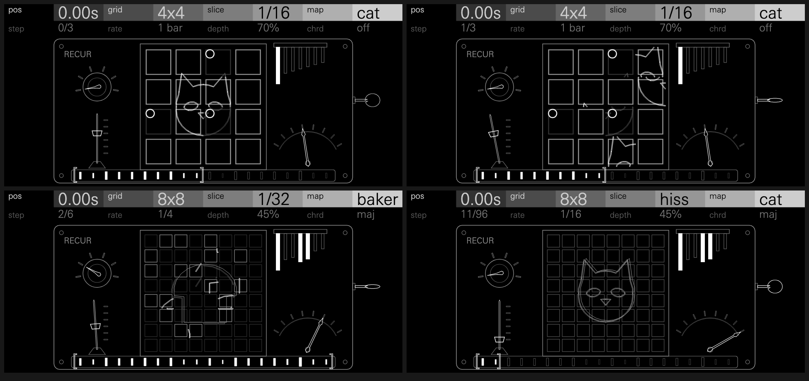
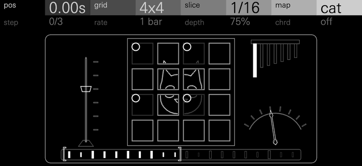
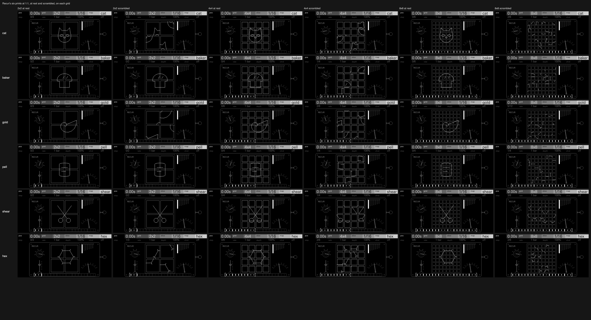

# Recur

A sample engine that cuts a loop into slices and deals them out again by
Arnold's cat map, a step each bar, until the loop comes back exactly.

A window of the loaded sample is cut into a square of slices on the
project's tempo: 4 x 4 sixteenths by default, a bar. Each iteration an
area-preserving map of the torus moves every slice to a new place in the
square. What you hear between is the recording re-sequenced: swapped beats,
stutters, phrases in a new order, every one of them the map's. After the
map's period (three bars for the cat on 4 x 4) the recording is back, bit
for bit. At the hiss end of slice the cells are single samples, and the loop
shreds into noise and back instead.

With depth at zero, or rate off at step zero, Recur plays the sample as a
tempo-locked loop. The key plays it pitched: every slice starts on the
tempo's grid and plays its part of the recording at the note's pitch, so
higher notes, chords and melodies keep the loop in time. The OP-XY's own
envelopes, filter, LFOs and effects follow.

Recur starts from Arnold's cat map. In the 1960s V. I. Arnold illustrated
the map with a picture of a cat on a torus: each step stretches the picture
and folds it back onto the square, until the cat dissolves into streaks. On
a picture made of pixels the map only reshuffles them, so after a fixed
number of steps the cat comes back exactly. Behind it is Poincaré
recurrence: in 1890 Henri Poincaré showed that a system which keeps its
volume as it moves, within a bounded space, returns arbitrarily close to
where it started. Recur's square of slices is such a picture.

Recur is an OP-XY sample engine, id `recur`. It needs the SDK's
sample-overview change, which gives sample engines their own screen and the
sample's overview, and is still in review as
[etcetc000/open-xy pull request 182](https://github.com/etcetc000/open-xy/pull/182).
With no sample loaded, its screen shows a cover reading "load a sample ·
shift +" and the Sample key's icon.

**Status: experimental.** Recur passes the SDK's tests but has not yet been
played on an OP-XY, and its CPU figure (below) is a host estimate, not a
measurement on the device.

## Controls

Press any encoder to switch pages.

| Encoder | Page 1 | Page 2 |
| --- | --- | --- |
| 1 | pos | step |
| 2 | grid | rate |
| 3 | slice | depth |
| 4 | map | chrd |

The values below are each control at 0, 25, 50, 75 and 100.

| Control | 0 / 25 / 50 / 75 / 100 | Default | Caption | What it does |
| --- | --- | --- | --- | --- |
| pos | the window starts 0 / 25 / 50 / 75 / 100% into the sample | 0 | seconds | Where the window sits. A window longer than the sample wraps round it. |
| grid | 2x2, 2x2, 4x4, 8x8, 8x8 | 4x4 | `2x2` to `8x8` | Slices a side: 4, 16 or 64 slices to deal. The maps' periods grow with it (the cat: 3, 3, 6). |
| slice | hiss, 1/64, 1/32, 1/8, 1/4 | 1/16 | `hiss`, `1/64` to `1/4` | Each slice, a 64th to a quarter note at the project's tempo; the window is grid² of them (4 x 4 sixteenths is a bar). hiss makes the cells single samples, on a square 16 times the grid's side (32, 64 or 128). |
| map | cat, baker, gold, shear, hex (pell between gold and shear) | cat | the map's name | The map that deals the slices. Each has its own pattern and period (below). |
| step | iteration 0, 0, 1, 2, 2 of 3 (at the defaults) | 0 | `1/3`: the iteration of the period | The iteration a note starts at. With rate off it is the arrangement you hear, held. |
| rate | off, 4 bar, 1 bar, 1/4, 1/16 | 1 bar | `off`, `4 bar` to `1/16` | How often the iteration moves on, always on a slice boundary. At the default each pass of the window is the next iteration. |
| depth | 0 to 100% | 70% | % | How many slices move. The map's orbits (the cells it carries round together) are held still whole, so every state is a reshuffle and still comes back at the period. At 0 nothing moves. In hiss, depth lays the plain window under the noise. |
| chrd | off, dtun, 5th, min, harm (oct and maj between) | off | the chord's name | Up to three readers of the window at once, each a pitch apart; every reader plays the same slice at the same time. In hiss a chord stacks two readers at most. |

Each control measured on the drum loop (`tools/make_sources.py`), over the
Recur preset with only that control moved. *Distance* is from the recording
at that window, after the first bar: 0 is the recording, about 1.4 an
unrelated sound of the same level (for step, the first bar, where a note
starts). *Grid* is the share of onsets within 15 ms of the 1/16 grid (the
source: 0.90).

| Control | 0 | 25 | 50 | 75 | 100 |
| --- | --- | --- | --- | --- | --- |
| pos | 0.67, grid 0.91 | 0.86, 0.98 | 0.97, 1.00 | 0.95, 0.91 | 0.86, 0.91 |
| grid | 2x2: 0.44, 1.00 | 2x2: 0.44, 1.00 | 4x4: 0.67, 0.91 | 8x8: 1.01, 0.95 | 8x8: 1.01, 0.95 |
| slice | hiss: 1.04, 0.23 | 1/64: 0.71, 0.72 | 1/32: 0.71, 0.67 | 1/8: 0.77, 0.95 | 1/4: 0.71, 0.97 |
| map | cat: 0.67, 0.91 | baker: 1.15, 0.91 | gold: 0.95, 0.91 | shear: 0.90, 0.89 | hex: 0.66, 0.95 |
| step | 0/3: 0.05 | 0/3: 0.05 | 1/3: 0.96 | 2/3: 0.95 | 2/3: 0.95 |
| rate | off: 0.06 | 4 bar: 0.06 | 1 bar: 0.67 | 1/4: 0.77 | 1/16: 0.76 |
| depth | 0%: 0.06 | 25%: 0.39 | 50%: 0.67 | 75%: 0.67 | 100%: 0.79 |
| chrd | off: 0.67, 0.91 | dtun: 0.73, 0.84 | 5th: 1.01, 0.60 | min: 1.15, 0.46 | harm: 1.08, 0.63 |

The scrambles stay on the beat (0.89 to 1.00 of onsets on the grid) except
at hiss, where they are noise, and with chords, whose readers blur the
onsets. Peaks run −6.0 to −9.3 dBFS for one note at any setting but chrd,
which sits 2 to 4 dB lower.

### The maps

Each map's period, in iterations:

| map | matrix | 2x2 | 4x4 | 8x8 | hiss (32, 64, 128 a side) |
| --- | --- | --- | --- | --- | --- |
| cat (Arnold's) | 1 1 / 1 2 | 3 | 3 | 6 | 24, 48, 96 |
| baker | the discrete baker's map | 2 | 4 | 6 | 10, 12, 14 |
| gold (Fibonacci's, the cat's square root) | 0 1 / 1 1 | 3 | 6 | 12 | 48, 96, 192 |
| pell (2 + √3) | 2 3 / 1 2 | 2 | 4 | 4 | 16, 32, 64 |
| shear | 1 1 / 0 1 | 2 | 4 | 8 | 32, 64, 128 |
| hex (a sixth of a turn) | 1 1 / −1 0 | 3 | 6 | 6 | 6, 6, 6 |

## Presets

| Preset | Plays | Settings | Measured (distance per iteration) |
| --- | --- | --- | --- |
| **Recur** | A beat re-sequenced each bar, home every third | cat, 4x4 of 1/16, a bar an iteration, depth 70 | 0.05, 0.96, 0.96, home 0.11 |
| **Stutter** | Rolls and repeats: rows of 1/32s slide past each other | shear, 8x8 of 1/32, an iteration a 1/4, depth 50 | rows alternate 0.0 to 0.2 and 1.2 to 1.4 |
| **Phrase** | A melody's notes re-ordered into new phrases, home after six bars | gold, 4x4 of 1/8, a bar an iteration | 0.02, 1.18 to 1.40, home 0.07 at bar 7 |
| **Riffle** | The baker's shuffle: the bar's halves interleaved like cards, home every fourth | baker, 4x4 of 1/16, a bar an iteration | 0.05, 1.11 to 1.26, home 0.06 |
| **Glitch** | Dense 1/64 glitching, a new deal every 1/8 | pell, 8x8 of 1/64, an iteration a 1/8 | 0.12, then 1.27 to 1.44, home every half bar |
| **Chorale** | Four beats swapped round under a minor chord of readers | hex, 2x2 of 1/4, a bar an iteration, chrd min | home every third bar |
| **Frozen** | No motion: one fixed re-sequencing, a new beat to play from | cat, 8x8 of 1/32, rate off, step at the half period | 1.29, every pass the same |
| **Shred** | The window shredded into hiss and back in six seconds | hiss on 64 x 64, cat, an iteration a 1/16 | flatness 0.26 to 0.38 against the source's 0.000 |

Every preset clicks no more than its source (2.9 to 3.2 click-like events a
second on the drums, against the source's own 3.2). A slice seam scores at
most 6.1 to 8.5 on the same scale, where the drums' own onsets reach 117.

## How it works

- **Slices.** Slot s of the window plays slice F⁻ᵏ(s) of the recording,
  where F is the map on the square of slots and k the iteration, worked out
  as a matrix power once per iteration. Each slot starts with an
  equal-power crossfade from where the reader was, along a smoothstep so no
  seam has a kink: 5.8 ms at most, a quarter of the slice at least. A slot
  that follows on in the recording does not crossfade, so an unscrambled
  window is the recording bit for bit. Slices are timed in Q8 (a 1/16 at
  120 BPM is 5512.5 samples), so a held note never drifts off the grid.
- **Pitch.** The note sets how fast each slice is read, not when it starts:
  every slice still starts on the tempo's grid, so a higher note keeps the
  loop in time and pitches each slice.
- **depth** holds whole orbits of the map, chosen by a hash of each orbit's
  first cell, so every state is a permutation.
- **hiss** gathers single samples through the map's power with no copy,
  crossfading a quarter of each iteration into the next; depth blends the
  plain window under it at equal power. A chord in hiss stacks two readers
  at most.
- Fixed point throughout. Divisions happen once a block, or when the pitch,
  chord or slice changes.

## Level

One note of a full-scale sample peaks at half scale, as the stock sampler
does; the sample's own volume applies. A chord of readers within a note
sits at 0.6 or 0.45 a reader, so it peaks near one reader alone. A triad
played as three notes of a sample normalised to 0.85 peaks at 0.94 of full
scale, as the stock sampler's would.

## Screen

A clockwork tin picture puzzle. Each map has its own print, a bold picture
named for it, and the grid's square tiles carry it in pieces. The tiles are
the slices: they slide to where the map deals them as the sound plays, and
come home together at the period.

- **map** turns the knob on the left and changes the print:
  - cat: the cat from Arnold and Avez's *Ergodic Problems of Classical
    Mechanics* (1968);
  - baker: a tin loaf;
  - gold: a nautilus, its shell a golden spiral;
  - pell: a scroll (a pell is a roll of parchment);
  - shear: a pair of scissors;
  - hex: a honeycomb cell.

  At rest the tiles sit square in their slots and the picture is whole; a
  note scrambles it.
- **grid** cuts the tray into 4, 16 or 64 tiles.
- **depth** sets how many tiles move. The tiles it holds still go dark, with
  a large pin at the corner on the 2 and 4 grids; the moving tiles stay
  bright.
- **step** is the arrangement at rest.
- **slice** slides the weight up the pendulum (hiss at the bottom, 1/4 at
  the top). While a note plays, the pendulum ticks a side every slice.
- **rate** sets the governor lever, off to 1/16; the key on the right
  clicks round once per iteration.
- **chrd** plucks the music-box comb: its readers' teeth stand longer and
  lit solid. With a second reader, the print's outline shows again under
  the tiles, shifted up and right by that reader's interval.
- **pos** moves the lit stretch along the tape at the tin's foot: the whole
  sample as a strip of its peaks, with the window's bars lit solid between
  the caliper's jaws. grid and slice set how much of the tape it covers; in
  slices the window wraps round the sample's end, so near 100 it comes back
  to the start.
- In **hiss** the tiles stay home and dim by how much of each is out of
  place, so the print fades away and comes back.
- With **no sample**, a cover over everything but the header reads
  "load a sample · shift +" beside the Sample key's icon.

It is drawn for the screen at 1:1: no text under 8 px, no lines closer than
3 px, strokes a good pixel wide, and the tile squares a shade under the
picture so it reads over the grid.
[docs/controls-1x.png](docs/controls-1x.png) shows each control at 0, 50 and
100 (map at each of its six) and the empty screen, at 1:1;
[docs/controls.png](docs/controls.png) is the same at 2x.

The screen is still at rest. Tiles slide in 0.16 s, easing out. A frame
spends at most 20 changes on tiles and the pieces they carry, so a big
reshuffle ripples across the tray. The display cannot read the tempo, so it
times slices at 120 BPM. Reduced motion and reset snap. Churn over a
scripted run averages 6.4 nodes a frame (7.6 while notes play) and peaks
at 26. The screen uses all 256 nodes the SDK allows, no reshaping outlines,
and 45.6 KB of artwork.

The tiles are 68 plain squares shared by every print (the 8 grid's 64, the
first 16 of them doubled in size for the 4 grid, and 4 large ones). Each
print is cut on the 8 grid's cells, a node for each piece of a stroke in a
cell, and a piece rides on whichever tile holds its cell, so the prints are
kept simple: 16 to 26 pieces each.

Sample engines have no browser preview, so the screen's frames, churn and
contact sheets come from `tools/screen.cpp` on the host.

## CPU

This is an estimate: Recur has not been measured on an OP-XY.

The host estimate (`tools/cpu.cpp`: the SDK's reference loop timed in turn
with the voice, best of nine) is about 1,700 Blackfin instructions a voice
block at the defaults, and 5,000 to 5,600 for the heaviest slices (8x8 of
1/64, maj, a stereo sample). The heaviest hiss (baker on 128 x 128, two
readers, a stereo sample, depth 50) reads about 9,500 to 13,800. The
estimate varies from run to run.

## Tests

`tests/sound.cpp`, run by `sdk.py test`, checks:
- the maps' periods, powers and permutations, and that depth keeps every
  state a permutation;
- that unscrambled slices play the recording bit for bit, and scrambled slots
  play the slices the map put there, exactly;
- that the default comes back bit for bit on its fourth bar;
- that rate off holds, and slices follow the tempo and don't drift;
- that every change ramps (1.3% largest step on a constant), and slice seams
  on a sine stay within 1.47 of its own slope;
- and for hiss: exactness, the return at the period, flatness mid-period, and
  depth 0 playing the window plain.

## Files

- `sample.cpp`, `core.h`: the voice.
- `recur.h`: the maps, their periods and permutations, and how the controls
  set the iteration, shared by the engine and the screen.
- `tables.h`: the crossfade, semitone and bit-reversal tables, written by
  `tools/make_tables.py`.
- `display.cpp`, `display.h`, `layout.h`: the screen.
- `panel.svg.fragment`: the screen's artwork, written with `layout.h` by
  `tools/make_panel.py`. Run the script after changing a shape, and commit
  all three.
- `definition.json`: the controls and presets. `tools/presets.py` writes its
  presets and `tools/presets.h`; run it after changing a preset.
- `tests/sound.cpp`: the sound checks, run by `sdk.py test`.
- `docs/`: the screen's picture, GIF and contact sheets.

The tools are not part of the machine. The C++ ones build against the SDK's
headers; the compile command for each is at the top of its file.

- `tools/make_sources.py <folder>` synthesises the test material, a drum
  loop and a melodic phrase over a bass line, two bars each at 120 BPM.
- `tools/render.cpp` plays each preset on its source and writes WAVs into a
  folder you name; with `sweep` it writes the controls sweep.
  `tools/sweep.py` prints the controls table from that sweep,
  `tools/analyse.py` measures one render against its source, and
  `tools/measure.py` measures level, DC and clicks.
- `tools/cpu.cpp` gives the host CPU estimate.
- `tools/screen.cpp` plays the screen through a script of controls and
  notes, counts its churn and writes frames as JSON into a folder you
  name (`sheet` and `prints` write the contact sheets' frames).
  `tools/sheet.py` lays those out as `docs/controls-1x.png`, `docs/controls.png` and `docs/prints.png`
  with headless Chrome, and `tools/frame2svg.py` draws one frame as SVG.
  Both take the OP-XY's face, UniversNextPro-Light.ttf, from `XY_FONT`; it
  is not in this repository. `sheet.py` needs it; `frame2svg.py` uses it if
  set.
