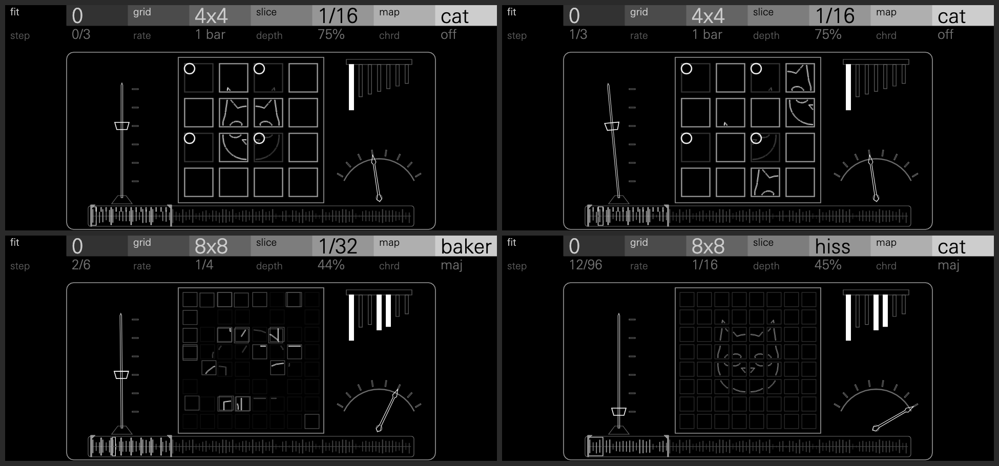
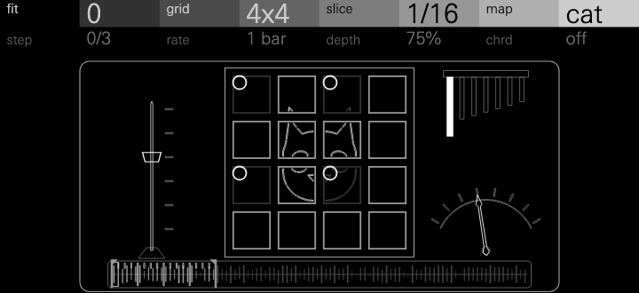
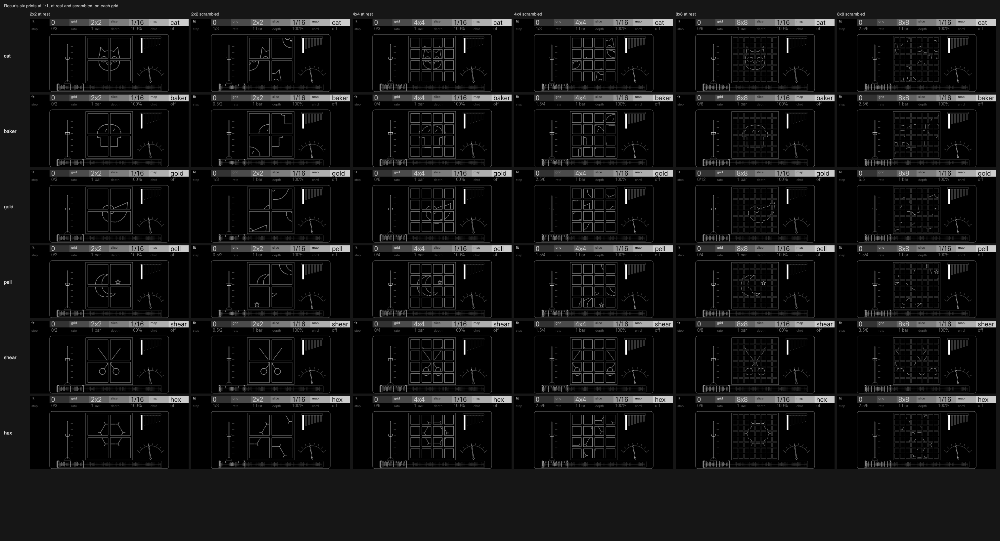

# Recur

A sample engine that cuts a loop into slices and deals them out again by
Arnold's cat map, a step each bar, until the loop comes back exactly.

The trim of the loaded sample, the stretch between the sampler's start and
end markers, is the loop. It is cut into a square of equal slices, 4 x 4 by
default, and each slice plays in a slot on the project's tempo: a sixteenth
by default, so a one-bar trim plays as a bar. Each iteration an
area-preserving map of the torus moves every slice to a new place in the
square. What you hear between is the recording re-sequenced: swapped beats,
stutters, phrases in a new order, every one of them the map's. After the
map's period (three bars for the cat on 4 x 4) the recording is back, bit
for bit. At the hiss end of slice the cells are single samples, and the loop
shreds into noise and back instead.

With depth at zero, or rate off at step zero, Recur plays the trim as a
tempo-locked loop. The cut points come from the sample, so a trimmed bar's
slices land on its own hits whatever tempo it was played at. The key plays
it pitched: every slice starts on the tempo's grid and plays from its cut at
the note's pitch, so higher notes, chords and melodies keep the loop in
time. fit decides what a slice does when it is longer or shorter than its
slot: at 0 it plays at the note's pitch and is cut off when the slot ends,
like a beat slicer; at 100 it is read faster or slower to fill its slot
exactly, so the whole trim fits the loop and its pitch follows the tempo.
The OP-XY's own envelopes, filter, LFOs and effects follow.

Recur starts from Arnold's cat map. In the 1960s V. I. Arnold illustrated
the map with a picture of a cat on a torus: each step stretches the picture
and folds it back onto the square, until the cat dissolves into streaks. On
a picture made of pixels the map only reshuffles them, so after a fixed
number of steps the cat comes back exactly. Behind it is Poincaré
recurrence: in 1890 Henri Poincaré showed that a system which keeps its
volume as it moves, within a bounded space, returns arbitrarily close to
where it started. Recur's square of slices is such a picture.

Recur is an OP-XY sample engine, id `recur`. It targets Open-XY
SDK 1.10, which gives a sample engine its own screen, the sample's overview
and samples of its own, and hands Shift and all four encoders back to the
stock sampler's start and end markers and gain (`stockShift`). Showing the
gain needs the sample overview's `gain`
([etcetc000/open-xy#400](https://github.com/etcetc000/open-xy/pull/400)) as
well as `stockShift`. A new Recur track opens with
**break** loaded, a four-bar drum break made for it, so it plays straight
away; load your own over it with Shift + the Sample key. With no sample
loaded, its screen shows a cover reading "load a sample · shift +" and the
Sample key's icon.

**Status: experimental.** Recur passes the SDK's tests and runs on an
OP-XY, and its CPU is measured there
(below).

## The break

`samples/break.wav` is a funk break in the pattern of the most sampled one
of all, the four bars of the Winstons' "Amen, Brother" groove: a dry ride on
the eighths, the kick's pairs, ghost notes round the backbeat, the backbeat
pushed late in bars 3 and 4, and the crash on the and of three in bar 4, with
soft closed-hat pickups, a foot chick on two and four and one open hat
closing into bar 3. It is played on
[MD KIT](https://github.com/mmockett/OP-XY-MNMD), not sampled from any
record: MD KIT's engine renders every hit on the host. The kick is a short,
damped P-I BD over a short TRX-BD; the snare a P-I SD tuned low with its
shell ringing, over a TRX-SD's crack; the ghosts the same snare struck
softly; the ride a P-I RC tuned up and cut short to a bright ping; the hats
TRX-CH and TRX-OH; the crash a P-I CC with a TRX-CY. The hits sit a little
behind the grid as a drummer plays (1.2 ms on the off-sixteenths, the
backbeat 3 ms late, a millisecond of spread), through a small dark room, a
firm compressor and some crunch.

It is four bars at 120 BPM, the tempo Recur falls back on and its screen
times slices at: exactly 8 seconds, 352,800 frames, 16-bit mono at 44.1 kHz
(689 KiB), peaking at −4 dBFS so the seams' crossfades stay under Recur's
output ceiling. At 120 BPM every slice Recur cuts lands on the break's own
grid: the default 4 x 4 of 1/16 is one bar of it, Shift's window steps the
trim through bars 1 to 4, and 8 x 8 of 1/16 trimmed to the whole break is
the whole break. Its tail wraps round, so the loop has no seam. At another
tempo the slices are still cut on the break's own hits: fit at 0 plays them
at their pitch in the project's slots, fit at 100 stretches the bar to fit.

The build installs it once as `/content/samples/recur/break.wav`, in the
OP-XY's own storage rather than the module memory; the OP-XY loads it into
its sample memory when a preset naming it is loaded, as it loads any sample.
The init preset (`presets/default.json`) and every preset below name it, each
keeping its own controls, trimmed to bar 1 (2 s, frames 0 to 88,200), or to
the two bars its grid and slice fill (Stutter, Phrase, Frozen), or for
Shred to a bar from 0.79 s, where its hiss square sat before. `tools/make_regions.py` writes those regions and the
init preset; `tools/break/make_break.py` renders the break from an MD KIT
checkout.

## Controls

Press any encoder to switch pages.

| Encoder | Page 1 | Page 2 |
| --- | --- | --- |
| 1 | fit | step |
| 2 | grid | rate |
| 3 | slice | depth |
| 4 | map | chrd |

Holding Shift, the encoders edit the stock sampler's markers and gain
instead, on either page. The markers trim the loop: the whole sample when it
is newly loaded.

| Shift + | Edits | On the screen |
| --- | --- | --- |
| encoder 1 | **start**: where the trim begins | the trim's start marker on the tape; its time in the sample |
| encoder 2 | **window**: start and end together, keeping the trim's length | the trim slides along the tape; its length |
| encoder 3 | **gain**: the sample's gain, in stock's steps from -30 to +20 | the tape's waveform grows and shrinks; `+0`, `-12`, `+20` |
| encoder 4 | **end**: where the trim ends | the end marker; its time in the sample |

Trim to the bar or phrase that matters: a downbeat set on the start marker
starts every pass, and window steps a bar-long trim
through the sample a bar at a time. The track saves the markers and gain,
as the sampler does, and a sample trimmed on the stock sampler plays the
same stretch here; tuning set there still applies. With no gain known (no
sample), its cell is blank.

### Saved sounds

Recur's first control was pos, which placed a window inside the trim; it is
now fit. Projects and sounds saved with pos play the whole trim from its
start, and pos's old value now sets fit. To restore one: turn fit to 0, then
hold Shift and move the start marker to where the window began and the end
marker to its length (a bar of 1/16s on 4 x 4).

The values below are each control at 0, 25, 50, 75 and 100.

| Control | 0 / 25 / 50 / 75 / 100 | Default | Caption | What it does |
| --- | --- | --- | --- | --- |
| fit | the note's pitch, cut off at the slot's end; a quarter, half and three quarters of the way; each slice read to fill its slot | 0 | `0` to `100` | How a slice fills its slot. At 0 it plays at the note's pitch from its cut until the slot ends: a short slice runs on into the audio after it, a long one is cut off. At 100 its read rate is scaled so it fills the slot exactly (slice frames over slot frames, times the note's ratio), so the whole trim fits the loop and its pitch follows the tempo. Between, the rate moves evenly in pitch. Where the slices already fill their slots (a bar of 1/16s on 4 x 4 at the tempo it was played at) it changes nothing. In hiss it does nothing. |
| grid | 2x2, 2x2, 4x4, 8x8, 8x8 | 4x4 | `2x2` to `8x8` | Slices a side: the trim cut into 4, 16 or 64 equal slices to deal. The maps' periods grow with it (the cat: 3, 3, 6). |
| slice | hiss, 1/64, 1/32, 1/8, 1/4 | 1/16 | `hiss`, `1/64` to `1/4` | Each slot, a 64th to a quarter note at the project's tempo; a pass is grid² of them (4 x 4 sixteenths is a bar). Every slot starts on the tempo's grid. hiss makes the cells single samples, on a square 16 times the grid's side (32, 64 or 128), taken from the trim's start. |
| map | cat, baker, gold, shear, hex (pell between gold and shear) | cat | the map's name | The map that deals the slices. Each has its own pattern and period (below). |
| step | iteration 0, 0.5, 1, 1.5, 2 of 3 (at the defaults) | 0 | `1.5/3`: the iteration, and a part of the next | The iteration a note starts at, from the first to the last. Between two, a share of the moving orbits starts an iteration ahead, so step turns smoothly through the period. With rate off it is the arrangement you hear, held. |
| rate | off, 4 bar, 1 bar, 1/4, 1/16 | 1 bar | `off`, `4 bar` to `1/16` | How often the iteration moves on, always on a slice boundary. At the default each pass of the trim is the next iteration. |
| depth | 0 to 100% | 70% | % of the slices that move | How many slices move. The map's orbits (the cells it carries round together) move or stay whole, in a fixed order, until they cover depth's share of the slices, so every state is a reshuffle and still comes back at the period. At 0 nothing moves. In hiss, depth lays the plain square under the noise. |
| chrd | off, dtun, 5th, min, harm (oct and maj between) | off | the chord's name | Up to three readers of the trim at once, each a pitch apart; every reader plays the same slice at the same time. In hiss a chord stacks two readers at most. |

Each control measured on the drum loop (`tools/make_sources.py`) trimmed to
its first bar, over the Recur preset with only that control moved.
*Distance* is from the trim played unscrambled, after the first bar: 0 is
the recording, about 1.4 an unrelated sound of the same level (for step, the
first bar, where a note starts). *Grid* is the share of onsets within 15 ms
of the 1/16 grid (the source: 0.90). fit is measured at 90 BPM, where the
bar's sixteenths are shorter than the project's, against its own render at
0 (at 120 BPM they fill their slots already and fit changes nothing).

| Control | 0 | 25 | 50 | 75 | 100 |
| --- | --- | --- | --- | --- | --- |
| fit (90 BPM) | 0 | 1.18 | 1.44 | 1.47 | 1.51 |
| grid | 2x2: 0.85, 1.00 | 2x2: 0.85, 1.00 | 4x4: 0.67, 0.91 | 8x8: 1.04, 0.36 | 8x8: 1.04, 0.36 |
| slice | hiss: 1.04, 0.23 | 1/64: 0.81, 0.57 | 1/32: 0.74, 0.74 | 1/8: 0.88, 0.89 | 1/4: 0.73, 0.90 |
| map | cat: 0.67, 0.91 | baker: 1.15, 0.91 | gold: 0.95, 0.91 | shear: 0.90, 0.89 | hex: 0.94, 1.00 |
| step | 0/3: 0.05 | 0.5/3: 0.55 | 1/3: 0.96 | 1.5/3: 0.96 | 2/3: 0.95 |
| rate | off: 0.00 | 4 bar: 0.00 | 1 bar: 0.67 | 1/4: 0.77 | 1/16: 0.76 |
| depth | 0%: 0.00 | 25%: 0.32 | 50%: 0.49 | 75%: 0.67 | 100%: 0.79 |
| chrd | off: 0.67, 0.91 | dtun: 0.73, 0.84 | 5th: 1.01, 0.60 | min: 1.15, 0.46 | harm: 1.08, 0.63 |

Moved from 0 to 50 and to 100, each control changes the render by 0.5 to
1.4 on the same scale (`tools/travel.py`, in steps of 5%; fit by 1.40 and
1.41, at 90 BPM, with no flat stretch). The only stretches where a control
does nothing are within a choice of an enum, grid's longest: it has three,
2x2, 4x4 and 8x8. rate's 4 bar moves on after 8 seconds.

The scrambles stay on the beat (0.89 to 1.00 of onsets on the grid) except
at hiss, where they are noise; with chords, whose readers blur the onsets;
and on 8 x 8, where a bar's 64 slices are 1/64s each playing a 1/16 slot,
so they overlap into stutters. Peaks run −6.0 to −9.3 dBFS for one note at any setting but chrd,
which sits 2 to 4 dB lower.

### The maps

Each map's period, in iterations:

| map | matrix | 2x2 | 4x4 | 8x8 | hiss (32, 64, 128 a side) |
| --- | --- | --- | --- | --- | --- |
| cat (Arnold's) | 1 1 / 1 2 | 3 | 3 | 6 | 24, 48, 96 |
| baker | the discrete baker's map | 2 | 4 | 6 | 10, 12, 14 |
| gold (Fibonacci's, the cat's square root) | 0 1 / 1 1 | 3 | 6 | 12 | 48, 96, 192 |
| pell (2 + √3) | 2 3 / 1 2 | 2 | 4 | 4 | 16, 32, 64 |
| shear | 1 1 / 0 1 | 2 | 4 | 8 | 32, 64, 128 |
| hex (a sixth of a turn) | 1 1 / −1 0 | 3 | 6 | 6 | 6, 6, 6 |

## Presets

| Preset | Plays | Settings | Measured (distance per iteration) |
| --- | --- | --- | --- |
| **Recur** | A beat re-sequenced each bar, home every third | cat, 4x4 of 1/16, a bar an iteration, depth 70 | 0.05, 0.96, 0.96, home 0.11 |
| **Stutter** | Rolls and repeats: rows of 1/32s slide past each other | shear, 8x8 of 1/32, an iteration a 1/4, depth 50 | rows alternate 0.0 to 0.3 and 1.2 to 1.3 |
| **Phrase** | A melody's notes re-ordered into new phrases, home after six bars | gold, 4x4 of 1/8, a bar an iteration | 0.02, 1.18 to 1.40, home 0.07 at bar 7 |
| **Riffle** | The baker's shuffle: the bar's halves interleaved like cards, home every fourth | baker, 4x4 of 1/16, a bar an iteration | 0.05, 1.11 to 1.26, home 0.06 |
| **Glitch** | Dense 1/64 glitching, a new deal every 1/8 | pell, 8x8 of 1/64, an iteration a 1/8 | 0.12, then 1.27 to 1.44, home every half bar |
| **Chorale** | Four beats swapped round under a minor chord of readers | hex, 2x2 of 1/4, a bar an iteration, chrd min | home every third bar |
| **Frozen** | No motion: one fixed re-sequencing, a new beat to play from | cat, 8x8 of 1/32, rate off, step at the half period | 1.29, every pass the same |
| **Shred** | The trim shredded into hiss and back in six seconds | hiss on 64 x 64, cat, an iteration a 1/16 | flatness 0.26 to 0.38 against the source's 0.000 |

Every preset opens on the break. They were measured on the test sources
(`tools/make_sources.py`); Phrase and Chorale were made on a melody and play
the break as beats instead. On the break the presets peak 1.2 to 2.2 dB
under the output ceiling (Shred 7.6 dB), never clamped.

Every preset clicks no more than its source (2.9 to 3.2 click-like events a
second on the drums, against the source's own 3.2). A slice seam scores at
most 6.1 to 8.5 on the same scale, where the drums' own onsets reach 117.

## How it works

- **The trim is the loop.** It is cut into grid² equal slices, slice c
  starting c/grid² of the way through it, to the frame; a pass of grid²
  slots plays them, so Shift's start and end set exactly what is sliced.
- **Slices.** Slot s plays slice F⁻ᵏ(s) of the trim,
  where F is the map on the square of slots and k the iteration, worked out
  as a matrix power once per iteration. Each slot starts with an
  equal-power crossfade from where the reader was, along a smoothstep so no
  seam has a kink: 5.8 ms at most, a quarter of the slice at least. A slot
  that follows on in the recording does not crossfade, so an unscrambled
  trim whose slices fill their slots is the recording bit for bit. Slices are timed in Q8 (a 1/16 at
  120 BPM is 5512.5 samples), so a held note never drifts off the grid.
- **Pitch.** The note sets how fast each slice is read, not when it starts:
  every slice still starts on the tempo's grid, so a higher note keeps the
  loop in time and pitches each slice.
- **fit** scales each reader's rate by (slice frames / slot frames at the
  sample's own rate) to the power of fit, worked out once a block: in
  cents, so the pitch moves evenly along its travel, and exactly at 100. A
  slice at fit 0 that ends before its slot reads on into the next audio of
  the trim, wrapping at its end; the slot's end cuts it off.
- **depth and step** act on whole orbits of the map, ranked by a hash of
  each orbit's first cell: depth moves the first of them, up to its share
  of the slices, and step's fraction puts the first of those an iteration
  ahead. Each orbit moves by one power of the map, so every state is a
  permutation.
- **hiss** gathers single samples through the map's power with no copy,
  crossfading a quarter of each iteration into the next; depth blends the
  plain square under it at equal power. Its square starts at the trim's start. A chord in hiss stacks two readers
  at most.
- Fixed point throughout. Divisions happen once a block, or when the pitch,
  chord or slice changes.

## Level

One note of a full-scale sample peaks at half scale, as the stock sampler
does; the sample's own volume applies. A chord of readers within a note
sits at 0.6 or 0.45 a reader, so it peaks near one reader alone. A triad
played as three notes of a sample normalised to 0.85 peaks at 0.94 of full
scale, as the stock sampler's would.

## Screen

A clockwork tin picture puzzle. Each map has its own print, a bold picture
named for it, printed on the grid's square tiles as on a real sliding
puzzle. The tiles are the slices: they slide to where the map deals them as
the sound plays, and come home together at the period. The puzzle fills the
middle of the tin; beside it are only the instruments that carry a control.

- **map** changes the print:
  - cat: the cat from Arnold and Avez's *Ergodic Problems of Classical
    Mechanics* (1968);
  - baker: a tin loaf;
  - gold: a nautilus, its shell a golden spiral;
  - pell: a crescent moon and a star;
  - shear: a pair of scissors;
  - hex: a honeycomb cell.

  At rest the tiles sit square in their slots and the picture reads whole,
  broken only by the gutters; a note scrambles it.
- **grid** cuts the tray into 4, 16 or 64 tiles.
- **depth** sets how many tiles move. The tiles it holds still go dark, with
  a large pin at the corner on the 2 and 4 grids; the moving tiles stay
  bright.
- **step** is the arrangement at rest.
- **slice** slides the weight up the pendulum on the left (hiss at the
  bottom, 1/4 at the top). While a note plays, the pendulum ticks a side
  every slice.
- **rate** sets the governor lever on the right, off to 1/16.
- **chrd** plucks the music-box comb above it: its readers' teeth stand
  longer and lit solid, one for each note the chord plays.
- **The tape** at the tin's foot is the whole sample: its waveform, the
  trim's start and end markers as flags, and the grid's cuts over the trim,
  a long tick where each row of the square begins and a short one at each
  other slice (only the rows when the slices are closer than 3 px, as on a
  bar of a long sample at 8 x 8). A bright frame round part of it is the
  stretch the slot playing reads: from its slice's cut, as long as the slot
  reads at the note's pitch. At rest it is the first slot's; while a note
  plays it jumps to each slot's slice in turn.
- **fit** stretches that frame: at 0 it spans what the slot reads at the
  note's pitch (two slices, when 1/8 slots play a bar's sixteenths; half
  one, when 1/32s do), at 100 exactly its slice, between the next cuts.
  The display has no tempo, so it reckons at 120 BPM.
- **Shift** lights the trim's markers and the waveform, and the header's
  bright row reads start, window, gain and end, with the times the markers
  mark and the gain in stock's steps. **gain** scales the waveform's height,
  twice as tall each 10 steps up, within the slot.
- In **hiss** the tiles stay home and dim by how much of each is out of
  place, so the print fades away and comes back.
- With **no sample**, a cover over everything but the header reads
  "load a sample · shift +" beside the Sample key's icon.

Every line of a print lies inside the square of the tile carrying it, at
rest and all through a slide, so nothing is drawn in the gutters. It is
drawn for the screen at 1:1, in two inks: the tin, the tray and the tiles
brightest, the instruments' fixed parts a step down. No text under 8 px, no
lines closer than 3 px, and the tile squares under the picture (well under
on the 8 grid) so it reads over the grid.
[docs/controls-1x.png](docs/controls-1x.png) shows each control at 0, 50 and
100 (map at each of its six) and the empty screen, at 1:1;
[docs/controls.png](docs/controls.png) is the same at 2x.

The screen is still at rest. Tiles slide in 0.16 s, easing out. A frame
spends at most 20 changes on tiles and the pieces they carry, so a big
reshuffle ripples across the tray, and what that leaves (at least 4) on the
tape's cuts, which move only when the trim, the grid or the sample does; the
waveform is redrawn only for a new sample or gain. The display cannot read
the tempo, so it times slices at 120 BPM. Reduced motion and reset snap.
Churn over a scripted run (`tools/screen.cpp`: notes on several settings,
hiss, then Shift held with the trim stepped through the break's bars)
averages 5.7 nodes a frame (7.9 while notes play) and peaks at 31, on the
frame Shift is pressed after a change of grid. The screen uses 299 nodes
(SDK 1.8 and later allow 512), four of them reshaping outlines (the
waveform's three thirds and the frame round the stretch read, 64 points
each), and 50.4 KB of artwork.

The tiles are 68 plain squares shared by every print (the 8 grid's 64, the
first 16 of them doubled in size for the 4 grid, and 4 large ones). Each
print is cut on the 8 grid's cells, a node for each piece of a stroke in a
cell, and a piece rides on whichever tile holds its cell, so the prints are
kept simple: 16 to 26 pieces each. A stroke stops half its width short of
its cell's edge, and each tile's pieces are drawn shrunk about the tile's
centre (by 0.88 on the 2 grid, 0.75 on the 4 and 0.72 on the 8), which fits
them inside its square with its gutter clear, while pieces within one tile
still meet.

Sample engines have no browser preview, so the screen's frames, churn and
contact sheets come from `tools/screen.cpp` on the host.

## CPU

Measured on an OP-XY (OS 1.2.1) with the SDK's `profile benchmark`, as one capture, at
`v0.7.0`: Recur's sample callback at its default settings, playing the SDK's
generated two-second test sample, costs **1.16%** of the 580,352-cycle audio
block. This test plays one setting; heavier settings cost more.

The figures below are host estimates made during development.

The host estimate (`tools/cpu.cpp`: the SDK's reference loop timed in turn
with the voice, best of nine) is about 1,700 Blackfin instructions a voice
block at the defaults on a quiet machine. Measured with the computer busy
(load average 23, which inflates these figures by about half): 2,550 at the
defaults, 8,500 for the heaviest slices (8x8 of 1/64, maj, a stereo
sample), 11,200 with step and depth turning every block, and 12,900 to
14,700 for the heaviest hiss (baker on 128 x 128, two readers, a stereo
sample, depth 50). The estimate varies from run to run.

## Tests

`tests/sound.cpp`, run by `sdk.py test`, checks:
- the maps' periods, powers and permutations; that depth moves none at 0,
  all at 100 and about half at 50; and that depth and step's fraction keep
  every state a permutation;
- that unscrambled slices play the recording bit for bit, and scrambled slots
  play the slices the map put there, exactly;
- that a bar trimmed anywhere, at 100 BPM, puts each slot's slice on its
  cut point and plays it at the note's pitch (fit 0), on every map; that fit
  100 reads each slice through in its slot (to within 4 frames, the ramp
  source's resolution), fit 50 at the geometric middle; and that at a
  matching tempo fit changes nothing;
- that the default comes back bit for bit on its fourth bar;
- that rate off holds, and slices follow the tempo and don't drift;
- that every change ramps (1.6% largest step on a constant), and slice seams
  on a sine stay within 1.47 of its own slope;
- for hiss: exactness, the return at the period, flatness mid-period, and
  depth 0 playing the square plain;
- and on the shipped break: that it is 16-bit mono at 44.1 kHz and four bars
  at 120 BPM to the sample, that 8 x 8 of 1/16 plays it whole and loops bit
  for bit, that a trim to each of its bars plays that bar, and that every
  preset plays it, trimmed as it ships, under the ceiling, never clamped.

`tests/screen.cpp`, also run by `sdk.py test`, checks that every point of
every print piece lies inside the square of the tile carrying it, at rest
and at every frame of a scramble, for each map on each grid, and that every
frame is valid. It also checks every outline against what the OP-XY can
draw, as authored and as drawn at its scale, over a sweep of every control
on each map, the scrambles and the cover with no sample: no neighbouring
points within an eighth of a pixel (the device merges them), no closing
edge under a quarter of a pixel, and no outline without area or turning
straight back at a point (the device draws those as streaks). And it sweeps
every control in hundredths on each map, grid and slice, with samples from a
tenth of a second to twenty minutes long, and Shift's row for those samples
trimmed anywhere, and measures every caption the header shows in the OP-XY's
face: a value must fit 53 px at 20 px, a title 56 px at 10 px. The tape's
reshaped outlines are held to the same rules as drawn. With Shift held it
checks the row's titles, times and gain on both pages, every gain from -30
to +20, a blank cell with no gain known, and that the markers stand on the
trim and light up. It checks that the waveform grows with the gain within
the slot and ignores an unknown one; that the cuts stand on the slices the
engine cuts (rows only when slices crowd); that the screen doesn't change at
rest; and that fit stretches the frame round the stretch read from two
slices to one for 1/8 slots on a bar of sixteenths.

## Files

- `sample.cpp`, `core.h`: the voice.
- `recur.h`: the maps, their periods and permutations, and how the controls
  set the iteration, shared by the engine and the screen.
- `tables.h`: the crossfade, semitone and bit-reversal tables, written by
  `tools/make_tables.py`.
- `display.cpp`, `display.h`, `layout.h`: the screen.
- `panel.svg.fragment`: the screen's artwork, written with `layout.h` by
  `tools/make_panel.py`. Run the script after changing a shape, and commit
  all three.
- `definition.json`: the controls and presets. `tools/presets.py` writes its
  presets and `tools/presets.h`; run it after changing a preset.
- `samples/break.wav`: the break every preset opens on.
- `presets/`: the presets as the OP-XY saves them, each naming the break;
  `tools/make_regions.py` writes their regions and `default.json`.
- `tests/sound.cpp`, `tests/screen.cpp`: the sound and screen checks, run by
  `sdk.py test`.
- `docs/`: the screen's picture, GIF and contact sheets.

The tools are not part of the machine. The C++ ones build against the SDK's
headers; the compile command for each is at the top of its file.

- `tools/break/make_break.py --mnmd <OP-XY-MNMD> --sdk <open-xy>` renders
  `samples/break.wav` on MD KIT's engine, through `tools/break/hits.cpp`;
  `--grid <file>` writes the pattern out as a grid.
- `tools/make_sources.py <folder>` synthesises the test material, a drum
  loop and a melodic phrase over a bass line, two bars each at 120 BPM.
- `tools/render.cpp` plays each preset on its source and writes WAVs into a
  folder you name; with `sweep` it writes the controls sweep, in steps of
  5%. `tools/sweep.py` prints the controls table from that sweep,
  `tools/travel.py` how much each control changes the sound across its
  travel,
  `tools/analyse.py` measures one render against its source, and
  `tools/measure.py` measures level, DC and clicks.
- `tools/cpu.cpp` gives the host CPU estimate.
- `tools/screen.cpp` plays the screen through a script of controls and
  notes, counts its churn and writes frames as JSON into a folder you
  name (`sheet` and `prints` write the contact sheets' frames).
  `tools/sheet.py` lays those out as `docs/controls-1x.png`, `docs/controls.png` and `docs/prints.png`
  with headless Chrome, and `tools/frame2svg.py` draws one frame as SVG.
  Both take the OP-XY's face, UniversNextPro-Light.ttf, from `XY_FONT`; it
  is not in this repository. `sheet.py` needs it; `frame2svg.py` uses it if
  set.
