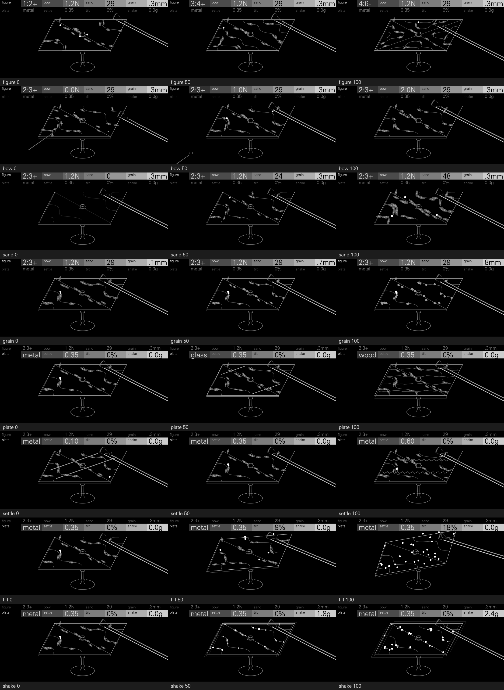

# Sand

A metal plate covered in sand, bowed or struck. Each note sets the plate
ringing in one of its Chladni figures. At first the sand lies all over the
plate, on ground that moves, so it is thrown up and lands with a crackling
patter on top of the tone. Within a second or two the grains drift to the
figure's nodal lines, where the plate is still, and stop there: the patter
dies away and a glassy, gently beating tone is left. A new figure finds the
sand on moving ground again, so it crackles and then settles into the new
figure; a steep plate keeps it running downhill.

The sand also weighs on the plate where it lies. Heavy sand on the moving
ground flattens and damps the plate a little, so the tone clears as the sand
leaves it. The rattle is made by the sand itself: it is every grain's
landings, each a click and a knock on the plate's own modes, so it is only as
dense as the sand still on moving ground.

Sand starts from Ernst Chladni's sound figures. In *Entdeckungen über die
Theorie des Klanges* (1787) he showed that a plate clamped at its centre,
strewn with sand and bowed at its edge, throws the sand off the parts that
move and gathers it on the still nodal lines, a different figure for each
note it rings. Robert Hooke had seen flour do the same on a bowed glass plate
in 1680; Chladni made the figures a method and published them.

**Status: experimental.** Sand passes the SDK's tests and runs on an
OP-XY, where its CPU is
measured (below).

## Controls

Press any encoder to switch pages. Page 1 holds what is played most; page 2
sits under it, one alternate per encoder.

| Encoder | Page 1 | Page 2 |
| --- | --- | --- |
| 1 | figure | plate |
| 2 | bow | settle |
| 3 | sand | tilt |
| 4 | grain | shake |

| Control | Default | Caption | What it does |
| --- | --- | --- | --- |
| figure | 2:3+ | the mode pair, e.g. `2:3+` | The Chladni figure the plate rings in, one of twelve from a single diagonal (1:2+) to a flower (4:6−). The note sounds at its pitch, and six of the plate's higher modes ring above it, each at least 10% above the last: low figures sound like a bell, high ones like a dense gong. |
| bow | 1.2N | the bow's force, e.g. `1.2N` | From a strike to a full bow. At 0 a felt mallet strikes the plate on each note and it rings like a bell, decaying at its material's pace. As bow rises the bow takes over: it sustains the tone, damps the strike and throws the sand harder, into thinner lines, and pressing harder brightens it, the note's 2nd to 4th harmonics rising as bow squared, from −28 dB at 25 to −3, −7 and −12 dB at 100. |
| sand | 29 | grains, e.g. `29` | How much sand is poured, 0 to 48 grains. A bare plate rings with all its upper modes. More sand rattles longer at each note, and once it settles on the figure's lines it lies on the upper modes' moving ground and damps them, so the tone grows purer and darker. |
| grain | .3mm | the grains' size, e.g. `.3mm` | From fine dust (0.06 mm) to stones (7.7 mm): the sound of a landing, from a soft tick of dust to the ringing knock of a stone. Heavier grains knock the plate harder and weigh more on it, so they darken the tone further. |
| plate | metal | `metal`, `glass`, `wood` | What the plate is made of: how long it rings, how its upper modes fade, how fast it beats and how many harmonics the bow draws from it. |
| settle | 0.35 | friction, e.g. `0.35` | How sticky the sand is. Slippery sand lands hard, bounces with a second click and wanders before it finds the narrow quiet lines; sticky sand needs more to lift it, lands dead and settles fast. |
| tilt | 0% | the plate's slope as a grade, e.g. `9%` | Tips the plate on its column, its far edge down, up to 10 degrees (an 18% grade). While the plate sounds, its resting sand creeps downhill, more readily the steeper it is, and hops slide that way; sand that runs off the low edge comes back at the high edge by the bow, as an hourglass is turned, so the plate trickles as steadily as it is tipped. |
| shake | 0.0g | the largest jolt, e.g. `1.8g` | Random jolts to every grain while the plate sounds, from 1.2 g, just enough to lift the lightest grain off a still line, to 2.4 g, more often as well as harder, and noise into every mode. The figure blurs and the sand never settles. |

Measured on a held A3, each control at 0, 25, 50, 75 and 100 with the others
at their defaults (the median of five seeds). Level is the tone's RMS from
2.5 to 4.5 s; the partials are the figure's six upper modes, their mean level
against the note's; the rattle is the output above 2.5 kHz, at its peak in
the first half second ("onset") and from 3 to 4.5 s ("later"); "settles" is
when the rattle stays 20 dB below its start.

| Control | 0 | 25 | 50 | 75 | 100 |
| --- | --- | --- | --- | --- | --- |
| figure | 1:2+: partials −26 dB, settles 2.5 s | 1:4+: −36 dB, 1.0 s | 2:5+: −36 dB, 0.8 s | 1:6−: −33 dB, 1.1 s | 4:6−: −44 dB, 0.9 s |
| bow | struck: −56 dB by 2.5 s (it rings down) | 2nd harmonic −28 dB, level −31 dB | −15 dB, −27 dB | −8 dB, −25 dB | −3 dB, −22 dB |
| sand | 0 grains: no rattle, partials −21 dB | 12: onset −43 dB, partials −28 dB | 24: −41 dB, −32 dB | 36: −39 dB, −34 dB | 48: −38 dB, −36 dB |
| grain | 0.06 mm: clicks at 5.5 kHz, partials −28 dB | 0.2 mm: 3.3 kHz, −32 dB | 0.7 mm: 2.0 kHz, −34 dB | 2.3 mm: 1.2 kHz, −35 dB | 7.7 mm: 0.7 kHz, ringing, −36 dB |
| plate | metal: rings 6 s | metal | glass: 3 s, purest | wood: 0.6 s, roughest | wood |
| settle | μ 0.10: onset −37 dB, settles 2.7 s | 0.23: −38 dB, 1.6 s | 0.35: −40 dB, 1.7 s | 0.48: −42 dB, 1.0 s | 0.60: −45 dB, 0.6 s |
| tilt | 0%: later −78 dB | 4%: −64 dB | 9%: −45 dB | 13%: −39 dB, partials −23 dB | 18%: −37 dB, −21 dB |
| shake | 0.0 g: later −78 dB, partials −32 dB | 1.5 g: −51 dB, −25 dB | 1.8 g: −41 dB, −18 dB | 2.1 g: −37 dB, −14 dB | 2.4 g: −37 dB, −11 dB, +4 dB level |

Tilt and shake colour the sound, so they default to off. Past about 75 on
either, all the sand is already moving, so the rattle grows little more;
tilt runs the sand off faster (from 10 grains a second at 75 to 23 at 100)
and shake stirs the modes harder. Every grain is a little different (each
needs 0.7 to 1.3 times the plate's lift to leave it, as in real sand), so the
grains settle one by one and the rattle fades rather than stopping.

**Playing it.** Sand's notes share one plate's sand, across tracks too. A
note started while another is still sounding takes over its sand, so a bowed
legato line or a chord added to a held note keeps its settled figure and
stays clean; a note with nothing sounding pours fresh sand. A strike throws
even settled sand, so struck notes (bow near 0) crackle every time. The plate
is mono, as every Open-XY synth voice is; for width, send it to the OP-XY's
chorus or reverb.

## Presets

| Preset | Role | Sound |
| --- | --- | --- |
| Chladni | the defaults | A bowed metal plate in 2:3+: a crackle on each new phrase that settles over a second and a half into a clear, beating tone. |
| Glass Pad | pad | A glass plate in 1:3+ with a little dust: chords bloom with a soft patter and settle almost at once into pure glass. |
| Bowed Metal | lead, bass | A hard-bowed metal plate in 3:4+: a bright, harmonic tone with a grainy onset; it holds a bass line as well as a melody. |
| Bell Keys | keys | Struck metal in 1:2+, ringing like a bell, with a sprinkle of dust thrown by each strike. |
| Sand Shaker | percussion | A struck wooden box of grit: each note is a knock and a burst of rattle that settles quickly, like a shaker. |
| Drone | drone | A heavily bowed metal plate in 4:6−, lightly shaken, so a little dust keeps hissing over a dense, slowly beating chord. |
| Hourglass | texture | Fine sand on a tilted plate in 3:5+: it runs downhill off the low edge and back in at the high one, a steady trickle over the tone. |
| Gravel | characterful | Stones on metal in 1:4+: a long, knocking rattle, and the note clears as the stones find the lines. |

## How it works

**The plate.** The plate is a square with free edges, modelled as Chladni's
figures usually are: mode (m, n, ±) has the shape
cos(mπx) cos(nπy) ± cos(nπx) cos(mπy) and a frequency proportional to
m² + n², the + and − pair split a little. Its modes are damped resonators in
phasor form, as in Hexagon's Hollow. Once a block, each mode's complex
amplitude decays by the plate's ring time, moves toward the bow's level (as
fast as it is bowed), and is pushed by a strike, shake, the bow's rosin and
any grain that lands. A sine table then sounds it, its amplitude ramped
across the block in eight steps of eight samples. The bow reaches the upper
modes faintly, enough that a bare plate shimmers with them. The bowed mode has a near-degenerate twin a
fraction of a hertz above it (0.4 to 1.1 Hz on metal, by figure), as a real
plate's paired modes split, so the tone beats gently. Over a block the twin
barely turns against it, so it is sounded as part of the bowed mode, a slowly
turning phasor added to its amplitude; being the weaker, it leaves the pair's
frequency at the note. The bow's stick and slip add the note's 2nd to 4th
harmonics, one waveform read at the bowed mode's phase.

**The sand.** Twelve grains are looked at each block, so each of the 48 is
looked at every 5.8 ms. A grain on the plate feels the plate's acceleration
where it sits: each mode's amplitude times its frequency times its shape
there, plus a steep plate's pull downhill and any of Shake's jolts (which
come at a look with a chance of Shake squared). Where that beats the grain's
weight by more than static friction allows, it is thrown: higher, longer and
further the more the plate beats it. It lands at a random spot nearby, but a
spot where the figure's mode shakes harder is often refused (more often with
more settle), so the sand drifts to the nodal lines and stays; a hop onto the
clamp lands against its washer. On a tilted plate a resting grain slips a
step downhill at a look with a chance from 1 in 4096 at the gentlest tilt to
1 in 2 at the steepest, so it creeps off the line and is thrown; a grain that
runs off the low edge comes back at the high edge, by the bow, and lands with
a click. Each grain keeps the plate's mode shapes where it lies, so a grain
lying still costs no table reads. The plate's upper modes and the bow's
harmonics throw sand at a quarter of their strength: in a real bowed plate
they are much quieter than the bowed mode, and at full strength they would
keep the sand from ever forming a figure.

**The rattle.** Each landing is an impulse at a random point in the block,
as loud as the grain fell and as hard as its friction lets it (slippery sand
half again as hard, sticky sand half as hard), through one two-pole band-pass
set by grain. Slippery sand bounces: a second, softer impulse 0.7 ms later. A
landing also knocks every mode of the plate by its shape where it lands, so
the rattle rings the plate's own partials. Once the rattle has rung out, the
output skips it.

**The weight.** Every round of looks, the sand on the plate (not in the air)
is weighed against each mode's shape. That flattens the mode (by up to 2%),
adds to its loss and, for the bowed mode, quietens it. Settled on the
figure's lines, the sand lies where the upper modes move, so it damps them
most: from a bare plate to a full one the upper partials fall by about 15 dB.

**The shared sand.** `Shared` holds one copy of the plate's sand and the
note it belongs to, refreshed every fourth round of looks. A note that starts
while that note still renders copies its sand; `destroy` lets it go.

## Level

Sand's levels match the Hexagon Suite's synths. A held middle C at the
defaults sits within 2 dB of Hollow's Choir (−26.5 dBFS RMS), and an
eight-note chord peaks between 0.5 and 0.8 of full scale on every preset.
Each voice's rattle is held within a tenth of full scale, so stones landing
together on many notes keep that headroom. Pitch is within 2 cents of the
note from C2 to C6 on every preset but Sand Shaker (struck, heavily loaded
wood, up to 5 cents flat at C2).

## Screen

The apparatus, as an engraving of Chladni's *Entdeckungen* would draw it,
seen from the front and a little to the left: the most recent note's plate.
It is drawn in three weights: the plate's top edge brightest and boldest, the
rest of the apparatus a step down, and the marks on the plate a step below
that.

- **The plate** is held at its centre by the stand's clamp nut, as Chladni
  held his, so every figure, and every mode that rings with it, is still at
  the centre, and no sand lies on the clamp. Its top carries the figure's
  nodal lines.
- **The stand** is a turned column on a round base. **Tilt** tips the whole
  plate on the column, up to 10 degrees, and while it sounds the sand runs
  downhill across it, off the low edge and back in at the top.
- **The sand** is up to 48 grains, as many as the sound throws, by the
  same physics. Grains in the air are white, larger and drawn above the
  plate; moving grains are bright; settled grains dim and stop. A grain
  settled on the figure's line lies on a drift of sand along it. **Sand**
  sets how much: none leaves the plate bare with the lines only scribed, a
  little lies in short drifts, and plenty draws the figure in long, heaped
  ones. **Grain** sets how big, from dust in long fine drifts to stones
  lying as themselves.
- **The bow** lies across the plate's right edge where the figure is bowed.
  More **bow** engages more of it, lying further over the plate; while notes
  are held it brightens and draws slowly across. Below 15 it lifts clear of
  the edge, and below 50 a felt mallet comes in, striking the plate on each
  note and rising to hover.
- **Plate** changes the plate itself: plain metal, thin glass with a bright
  edge and two glints, or a thick wooden board showing its grain. **Settle**
  changes its finish: polished below 35, with a sheen across it; matte above
  65, with a rosined tooth. **Shake** draws the whole plate twice more, aside
  by 3 to 11 pixels, as an engraver draws a thing that trembles; while it
  sounds, the jolts throw its sand into the air and break up the drifts.

*Shown: Chladni, a note gathering its sand into drifts; a second note as
Sand rises to full, heaping the figure; a note with Shake turned up; then a
note on a tipped plate.*

The same sheet at the screen's own size, 480 by 222, is
[docs/controls-1x.png](docs/controls-1x.png). The drawing is made for that
size: no line is finer than about a pixel, no grain is smaller than 2.6
pixels across, nothing doubled sits closer than the plate's own thickness,
and a sticky plate's tooth is a zigzag a few pixels tall rather than a fine
hatch.

The screen cannot read the sound, so it runs its own 48 grains through the
same functions (`sand.h`), with the bowed mode swelling at the bow's pace
while notes are held and a strike ringing down. Its grains are not the
sound's grains, but they move as they do.

A settled plate redraws nothing. Only part of the sand is redrawn each
frame, moving grains every third frame and settled ones every sixth, so
the sand follows a tipping plate within a fifth of a second and never
redraws all at once. Of the screen's 133 nodes, about 4 change a frame on
average while a note is bowed at the defaults (at 60 frames a second), and
about 11 at full Shake or with Tilt turned up, when the sand keeps running;
at most 29 at the heaviest settings measured, and 23 as a turning tilt moves
the plate.

## Files

- `engine.cpp`, `core.h`: the voice: the plate's modes, the bow, the strike,
  the sand's looks, the rattle and the shared sand.
- `sand.h`: the physics the sound and the screen share: the mode shapes,
  the materials, and how a grain is thrown, flies and lands.
- `plate.h`, `sine.h`: the figures, mode shapes, nodal outlines, click
  filters and the bow's harmonic waveform; the sine table.
- `display.cpp`, `display.h`, `view.h`: the screen, and the view it is
  drawn in with its node numbers.
- `panel.svg.fragment`: the screen's artwork.
- `tools/make_plate.py`: writes `plate.h`, `view.h`, `panel.svg.fragment`
  and the Figure labels and node count in `definition.json`. Run it after
  changing a figure or a shape, and commit all four;
  `python tools/make_plate.py --sheet <file>.svg` also draws every figure's
  outlines for checking by eye. Pure Python, no packages.
- `tools/make_gif.py`: makes `docs/sand.gif` and, with `--sheet`,
  `docs/controls.png` and `docs/controls-1x.png`, from the frames
  `tools/frames.cpp` writes, in UniversNextPro-Light (`XY_FONT`).
- `tests/sound.cpp`: the sound checks, run by `sdk.py test`: that the rattle
  dies as the sand settles and returns with a new figure or a fresh note,
  that a legato note keeps the settled sand and a struck one throws it, that
  settle, shake and sand do what they say, the pitch, level and headroom
  above, and that every corner of the controls stays bounded.
- `tests/screen.cpp`: the screen checks, also run by `sdk.py test`: the
  screen over every figure, each control at five settings and a note's
  animation, failing on any shown outline the OP-XY would draw as a streak
  or a sliver: one with no area or traced back over itself, one that turns
  straight back at a point, neighbouring points within an eighth of a pixel,
  or a closing edge under a quarter of a pixel. `make_plate.py` writes the
  nodal outlines to pass it: each runs round the border one way only, keeps
  its points apart, and starts at its longest edge.

## CPU

Measured on an OP-XY (OS 1.2.1) with the SDK's `profile benchmark`, three runs, at
`v0.1.0`: one voice playing middle C with the first four controls at their
midpoint costs **5.42%** of the 580,352-cycle audio block, so eight voices
take about 43%. The OP-XY's own engines measure 1.6–2.7% a voice in the same
test. It plays one setting; heavier settings cost more.

Counted from the compiled code, a block at the
heaviest setting, a full plate of resting sand with the rattle ringing, comes
to about 13,000 Blackfin instructions per voice: the six upper modes about
900 each (12 instructions a sample, one at a time), the bowed mode with its
twin and harmonics about 1,250, the rattle's output about 2,000 (about 450
once it has rung out), the twelve looks at the sand about 2,500 (a grain lying
still about 200, a throw and its landing about 420 more) and the modes' block
maths about 1,300. A settled note at the defaults comes to about 10,500. In
heavy rattle most looks find a grain in the air, which costs little, so a
shaken plate comes to about 11,000. The SDK's host estimate (`sdk.py test`)
is lower, about 6,600 to 6,900. Compiled for the device, Sand takes 81.2 KiB
of the shared module memory.
